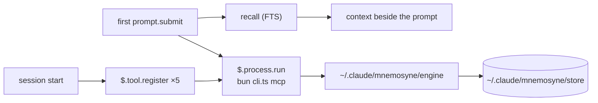

# Design

Everything below was probed on 2026-10-16 against a real install, not read off a
page. Commands that produced each finding are noted where they can be
reproduced. `v0.1.0` implements it; §5 records the decisions taken.

---

## 1. What the Mnemosyne Memory engine is, and what it costs to depend on

[`@oh-my-pi/pi-mnemopi`](https://www.npmjs.com/package/@oh-my-pi/pi-mnemopi) —
MIT, ~153K weekly downloads, source at
[`can1357/oh-my-pi` → `packages/mnemopi`](https://github.com/can1357/oh-my-pi/tree/main/packages/mnemopi).
It is a package inside the oh-my-pi monorepo, published independently, so it can
be consumed on its own.

Do not confuse it with
[`mnemosyne-oss/pi-mnemosyne`](https://github.com/mnemosyne-oss/pi-mnemosyne) —
that is a different thing: a Pi extension that shells out to the Python CLI.
The lineage is:

```
mnemosyne (Python, upstream engine)
   ├── pi-mnemopi    (Bun/TS port, inside the oh-my-pi monorepo)  ← this plugin's backend
   └── pi-mnemosyne  (Pi extension, spawns the Python CLI)
```

## 2. Constraints, with evidence

### 2.1 Bun is mandatory

The package's `exports` map points `import` at `./src/index.ts`; `dist/` ships
`.d.ts` files only. There is no compiled JavaScript.

```
$ node …/@oh-my-pi/pi-mnemopi/src/cli.ts mcp
Error [ERR_UNSUPPORTED_NODE_MODULES_TYPE_STRIPPING]: Stripping types is
currently unsupported for files under node_modules
```

Under `bun` the same command answers:
`{"serverInfo":{"name":"mnemopi","version":"3.1.2"}}`.

This is the single hardest prerequisite. A consumer without `bun` cannot use
this plugin at all, so the implementing version must detect it and say so
rather than failing obscurely.

### 2.2 One request per process works

`mnemopi mcp` speaks MCP over stdio. A bare `tools/call` — **no `initialize`
handshake** — is answered, and a single call costs **0.57 s** measured
end-to-end:

```
$ printf '%s\n' '{"jsonrpc":"2.0","id":1,"method":"tools/call",
  "params":{"name":"mnemopi_recall","arguments":{"query":"ponytail","limit":3}}}' \
  | MNEMOPI_NO_EMBEDDINGS=1 bun …/cli.ts mcp
```

The mods API's `$.process.run` accepts `stdin`, so a hook can run one process
per call. **No long-lived server, no port, no MCP approval prompt.** 0.57 s is
affordable once per conversation and not per turn.

### 2.3 The data dir must be set explicitly

The engine's built-in default is `~/.hermes/mnemopi/data`
(`packages/mnemopi/src/config.ts`). The plugin always sets `MNEMOPI_DATA_DIR`
to its own store, `~/.claude/mnemosyne/store` by default.

Verified with a throwaway `HOME`: a remember wrote only to `MNEMOPI_DATA_DIR`
(plus bun's own cache under `~/Library/Caches/bun`). Nothing under `~/.omp` or
`~/.hermes`. An end-to-end run left the other installation's `mnemopi.db*` mtimes and sizes
unchanged.

### 2.4 Scoping silently returns zero hits — the trap

This is the one that cost the most time and would have shipped as a bug.

`recall` narrows rows by
`(session_id = ? OR scope = 'global' OR channel_id = ?)`
(`core/beam/recall.ts`). Other writers set `session_id = channel_id = <bank>`.
The MCP server defaults its session id to `mcp_<bank>`, which matches neither —
so a naive recall against a populated bank returns **`count: 0`**, with no
error.

Passing the bank on **both** `MNEMOPI_SESSION_ID` and `MNEMOPI_CHANNEL_ID`
returns real hits. Verified against the live `matrixkoder-mk-5` bank:
2 hits for `"mk-builder connect"` with the channel set, **0 without**.

Every call this plugin makes therefore carries both variables. This is not a
tuning detail; it is the difference between working and silently empty.

### 2.5 Embeddings must be off in a spawned process

With fastembed enabled, both the CLI and the MCP server died repeatedly with a
Bun C++ panic when spawned as a standalone process. With
`MNEMOPI_NO_EMBEDDINGS=1` everything is stable.

Sessions of other hosts are unaffected: they attach to a detached embedding server at
`~/.omp/run/mnemopi/`. A spawned CLI does
not, and loads fastembed in-process.

**Consequence: recall from this plugin is FTS-only.** Vector recall stays with
the other hosts. If that is unacceptable, the fix is to talk to their embed server, which is
a larger piece of work and not in scope.

### 2.6 One engine only — keep the TypeScript one

The Python engine (`pip install mnemosyne-memory`) **can read** the
TS-written store: opening the live `matrixkoder-mk-5` bank with
`BeamMemory(session_id=<bank>, channel_id=<bank>)` returned 3/3/1 hits for three
queries. An earlier reading of "incompatible" was wrong — it was the same
scoping trap as §2.4.

But **writes diverge**: the TS engine writes 768-dim vectors, Python defaults to
384, and a Python backfill failed with
`Dimension mismatch … Expected 384 dimensions but received 768`.

So: **one writer, the TypeScript engine.** A second writer on the same file
would corrupt the vector index.

## 3. Where memory lives

The plugin keeps its own engine and store, separate from any other installation, so the two never
share a writer (§2.6) and an upgrade elsewhere cannot change the engine under it.
`/mnemosyne-setup` installs the plugin's own engine copy (§3.1) into
`~/.claude/mnemosyne/engine/`. Each call is one `bun <cli> mcp` process:



### 3.1 The engine lives in the repo: engine/ and UPSTREAM.md (v0.5.0)

Upstream's `mnemopi_update` changes only content and importance, and its recall
always bumps `recall_count`. Tagging an existing memory needs a metadata update,
and a dashboard search must not change counts, so the engine source is now part
of the plugin:

- `engine/` is the npm tarball of `@oh-my-pi/pi-mnemopi` 18.12.3, copied in
  whole (`src/`, `dist/types/`, `package.json`, `LICENSE`, `README.md`,
  `CHANGELOG.md`, `THIRD-PARTY-NOTICES.txt`). Its four `@oh-my-pi`
  dependencies stay npm downloads pinned at exactly 18.12.3.
- `engine/UPSTREAM.md` is the registry: upstream repo and path
  (`can1357/oh-my-pi`, `packages/mnemopi`), tag `v18.12.3` and its commit, the
  tarball URL and sha512 integrity, a numbered list of our changes (what, why,
  files, upstream issue, status), the `engine/src` sha256 of each build, and
  the rebase steps. Today: change 1, `mnemopi_update` shallow-merges a
  `metadata` object in one `BEGIN IMMEDIATE` transaction (a key set to `null`
  is removed; a row whose `metadata_json` is not an object is refused and left
  unchanged); change 2, `mnemopi_recall` takes `update_recall_counts`
  (default true); change 3, the build number (`18.12.3-mnemosyne.2`) in
  `engine/package.json`.
- `bun scripts/engine-diff.ts` downloads the tarball, checks its integrity, and
  fails unless every file that differs from `engine/` is listed in a change and
  the recorded `engine/src` hash for the current build is the real one. So an
  unlisted edit, or an edit without a build bump, fails the gate.
- Our engine tests are `engine/test/*.spec.ts` (real temporary stores, real
  engine processes, including two processes merging metadata into one row at
  once). `engine/` is not type-checked by us: upstream checks it with its
  monorepo setup, which the tarball lacks.
- `/mnemosyne-setup` runs `bin/install-engine.ts <plugin root> <engine dir>
  <store>`. It builds `<engine dir>.next` (the copy as `pi-mnemopi/`, a
  `package.json` with `file:./pi-mnemopi`, `bun install --production
  --omit=peer`, since Bun would otherwise install the folder's dev and optional
  peer dependencies, onnxruntime included), checks that the new cli answers
  `tools/list` with the metadata-capable `mnemopi_update`, and only then
  renames the old engine to `.old`, the new one into place, and deletes
  `.old`. Any failure deletes `.next` and leaves the installed engine as it
  was; a test proves it with an unreachable registry. It writes nothing outside
  those three folders and refuses a store inside them, comparing real paths
  (the nearest existing parent through `realpathSync.native`, symlinks
  followed, case-folded on macOS and Windows); `paths()` also refuses a
  `memoryDir` inside `<root>/engine`, `.next` or `.old`, ignoring case. The
  staged install has no lockfile (Bun saves none under `--production`): the
  four `@oh-my-pi` packages are pinned at 18.12.3, their own dependencies
  resolve fresh at each setup, through Bun's global cache or the registry.
  The installer's own limits (240 s install, 30 s check) stay below the
  host's 300 s limit on setup (`hooks/engine-build.ts`). The cli path is
  unchanged: `<engine dir>/node_modules/@oh-my-pi/pi-mnemopi/src/cli.ts`.
- `ENGINE_BUILD` (`hooks/engine-build.ts`, no imports) equals
  `engine/package.json`'s version; a Bun spec fails when they differ.
  `isCurrent` in `register.ts` reads the installed engine's `package.json` with
  `$.fs.read` and compares. Session start with a stale engine shows a toast
  asking for `/mnemosyne-setup`; it does not reinstall on its own (an install
  can take minutes and needs the network). The four older tools keep working
  on a stale engine; `memory_update` refuses, and so does the proxy (§5.8).

### 3.2 The activity log: activity.jsonl (v0.5.0)

Every memory call the plugin makes, and every call through the external MCP
proxy, adds one JSON line to `~/.claude/mnemosyne/activity.jsonl` (`paths()`
gives it as `activity`, `<root>/activity.jsonl`). The dashboard reads it.

- A line: `t` (ISO time), `action` (recall, remember, update, forget, stats,
  rearm), `origin` (hook = first-prompt recall or compaction, trigger = a
  recall or remember term, tool = Claude's tool call, external = the proxy;
  ui and backfill come later), `owner`, `text`, `ids`, `count`, `ok`, and
  `error` only when not ok. `ids` holds at most 50; `count` is the full
  number. `hooks/activity-log.ts` builds it and imports nothing, so the hooks,
  the proxy and the server build the same line.
- `text` is the query (as the engine gets it, 300 characters at most), the
  fact, or what an update sets (`tags: a, b`, cleaned as the engine gets
  them). It is cut to 2000 code points (dropping the cut word, so no half
  secret is left), then secret shapes are replaced by `[redacted]`, then it is
  cut to 200 code points. Redaction is pattern-based, so a secret of an
  unknown shape, or a short unnamed one, can get through. It covers API keys
  and tokens by prefix, JWTs, private key blocks, Slack and Discord webhook
  URLs, `scheme://user:password@` (spaces in the password too), `password=`,
  `token:` or `"api_key": "…"` values (quoted values up to the closing
  quote), `password is …` phrases, Bearer values, hex runs of 32+, and
  letter-and-digit runs of 32+ that are not paths (a run with `+` or a
  trailing `=` counts as base64 whatever its slashes). Every pattern that can
  backtrack is bounded: 100 KB and 200 KB inputs redact in a few ms (kit
  test, under 200 ms). A forget logs only the id, in `ids`. A remember term
  logs a `remember`/`trigger` line, and Claude's save that follows logs its
  own `remember`/`tool` line. A `memory_*` tool outside the five is not
  logged.
- The writer is `bin/activity.ts`: `appendActivity(path, lines)` for Bun code,
  or `bun bin/activity.ts <path>` with the lines on stdin. It writes only a
  file whose name ends in `.jsonl`. It creates the folder 0700 and sets the
  file to 0600 at every open, and the backup too (no chmod on Windows), writes
  the batch in one `O_APPEND` write, and drops anything that is not one JSON
  object. Past 1 MB it renames the file to `activity.jsonl.1` (one backup);
  only a writer that creates `activity.jsonl.lock` with `O_EXCL` rotates, and
  it checks the size again under the lock, so two writers rotate once. A lock
  older than 10 s is taken over: the taker first renames it to a name of its
  own, so of two takers only one rename succeeds; if what it renamed turns out
  fresh (another writer had just taken the lock), it links it back and does
  not rotate. A third writer arriving inside that microsecond gap could still
  hold a lock beside another; the size check under the lock keeps even that
  to one rotation unless both check before either renames. That race is not
  tested (it cannot be forced from one process). A line that races a rotation
  lands in `.1`. It never throws, and the script always exits 0 and stops
  itself after 5 s.
- A hook cannot append to a file (`$.fs` has no append, mode or rename), so
  each memory event starts one short Bun process for its lines. The hook waits
  for the paths only (host calls), never for the write; an append that hangs or
  fails leaves the hook's result unchanged (kit tests for both). Measured on an
  Apple M4 with Bun 1.4.3 (40 runs after 3 warm-ups, one line on stdin): one
  append process takes 11 ms wall time at the median (8 ms min, 12–21 ms p90).
  It runs beside the hook, so a prompt or tool call does not wait for it.
- How the hook hands the lines over is `APPEND_MODES` in `hooks/register.ts`:
  - `spawn` (default): a `$.process.spawn` loop drained in a detached task;
    the script's own 5 s cap bounds it.
  - `run`: `$.process.run` with a 5 s timeout, not awaited.
  - `await`: `$.process.run` awaited, capped at 1 s (the hook waits ~11 ms).
  `spawn` is the default (orchestrator decision, 2026-10-23, review r1 MED 2)
  because the plugin API's types document that a spawned child's loop runs on
  after the hook returns ("nothing else does, a hook's return included"),
  while they say nothing either way about an un-awaited `run`. The live check
  (plan LOG.5) has not run yet; it confirms the choice. Caveat: `session.end`
  has a 1.5 s bound and aborts any `$` call still in flight, and leaving the
  loop or the module unloading kills a spawned child, so an append started in
  the last moments of a session can be lost. The hooks that log (prompt, tool
  call, compaction) do not run at session end, so this is a narrow window. To
  switch, start Claude Code with `MNEMOSYNE_ACTIVITY_APPEND=run` (or `await`)
  in its environment; to change the default, edit `DEFAULT_APPEND` in
  `hooks/register.ts` and record the result here.
- The proxy imports `appendActivity` and writes synchronously, so every line is
  on disk before it exits. It keeps the calls it sent by JSON-RPC id and writes
  the line when the reply comes back (ok, ids and count read from it); a call
  it refuses (stale engine, bad tags) is logged at once with `ok: false`; a
  tool outside the five is not a memory call and is not logged; a call the
  engine never answered is logged as failed at exit. The wrapper passes the
  path as `MNEMOSYNE_ACTIVITY_LOG`, empty when the log is off; a log failure
  never changes what the client receives (Bun test).
- The `activityLog` setting (`on` by default, or `off`) turns it all off: the
  hooks read it on each call, and the wrapper is rewritten at session start,
  so the proxy follows from the next session.

## 4. Why a plugin, and why mod tools rather than an MCP server

A skill cannot do this. A skill loads when invoked or when the model decides it
is relevant; it cannot inject context at session start and cannot capture turns.

| Mechanism | Inject at session start | Capture turns | Bundle tools |
|---|---|---|---|
| Skill | ✗ | ✗ | ✗ |
| Settings-file hooks | ✓ | ✓ | needs separate `claude mcp add` |
| **Plugin** | ✓ | ✓ | ✓ |

**Mod-registered tools, not a bundled MCP server.** A server declared in
`mcpServers` or `.mcp.json` loads **whenever the plugin is enabled**. There is no
conditional inclusion, and `${user_config.*}` substitutes into `env`/`args`
only. So a bundled server **cannot be gated on a user's choice** — which
defeats the entire point of an opt-in memory.

`$.tool.register` is code, so the plugin's own enable switch gates everything;
no separate `memory` key is needed.

### 4.1 Two registration rules the engine enforces

Learned by hitting both errors:

- The engine **rejects a second bare `on('session.start')`** in a second module:
  *"on("session.start") is registered twice without a matcher"*. Existing hook
  modules already work around this — `tools.ts` and `wake.ts` register with
  `{ cwd: /.*/ }`.
- Same for `tool.call`. A new module needs a matcher on both:
  `{ cwd: /.*/ }` and `{ tool: /^mcp__mnemosyne__memory_/ }`.

## 5. Decisions (2026-10-16)

Terms: the engine's *bank* is always `default` (`<store>/mnemopi.db`). What
this plugin varies is the row's *owner*, its `session_id`, set from
`MNEMOPI_SESSION_ID` (`MNEMOPI_CHANNEL_ID` carries the same value; for this
plugin's own rows the session id alone suffices, the channel matters only for
rows written elsewhere, §2.4).

1. **Scope: the user picks at install.** `userConfig.scope` is `global` (owner
   `global`, every row `scope: 'global'`) or `per-project` (owner
   `project-<repo name>-<hash of git root>`, rows `scope: 'channel'`;
   `memory_remember` with `global: true` writes `scope: 'global'`, which every
   owner recalls). Forget deletes `WHERE id = ? AND session_id = ?`, so recall
   reports each row's owner and `memory_forget` takes it.
2. **Retain only explicit `memory_remember` calls**, written with
   `source: 'imported'`. Any other source lands as trust tier STATED, and every
   remember runs `trimWorkingMemory` (`core/beam/store.ts`), which deletes
   unconsolidated STATED rows older than 24 hours (hard-coded
   `workingMemoryTtlHours`) or past 1000 per owner. IMPORTED rows are never
   trimmed. Verified: a row backdated weeks survived 5 more remembers in 3 of 3
   scratch runs as IMPORTED; as STATED it was gone after one. Recall weight is
   keyed on `veracity`, not trust tier, so it is unchanged.
3. **Recall once per session**, on the first non-command prompt, as
   `prompt.submit` context: that message never changes, so the prompt cache
   holds. `prompt.context` was not used: it fires before any prompt text
   exists to query with. The once-only mark lives in `$.state`. The engine
   drops a row matching under ~22% of the query's words (`minimumRelevance`,
   `core/beam/recall.ts`), so a whole long prompt recalls nothing; the plugin
   sends one recall per sentence (up to 4) to a single engine process and
   merges by id.
   After a main-conversation compaction (not skipped, not a subagent's) the
   once-only mark is cleared, so the next prompt recalls again (a `precompute`
   is left alone: it installs nothing until a real compaction); `/clear` needs
   nothing, since it starts a new session id.
4. **`memoryDir` stays configurable**, defaulting to the plugin's own store. It
   must be absolute or `~/…`, and is refused inside `~/.omp`.

5. **Steering without a skill (2026-10-16, v0.2.0).** A skill loads only when
   the model picks it, which is the judgement being backed up, so instead:
   - `prompt.compose` appends one fixed section, `mnemosyne:rules`, last on the
     `session` side (fixed text: the prompt cache holds). Skipped under the
     `bare` trait and when the request does not offer the memory tools.
   - `prompt.submit` matches configurable `rememberTerms` / `recallTerms`
     (`userConfig` `string` + `multiple`) at the start of prompts a person typed
     (origin `composer`, `bridge`, `sdk`, `slack-ping`), as whole words. A
     remember term attaches a directive and the model calls `memory_remember`
     once: the hook never writes raw text, so wording and the never-secrets
     rule apply. A recall term recalls the first sentence after it, on that
     prompt only.
   Reviewed by a Fable consult; a manual `/mnemosyne` skill is deferred until
   there is a store worth curating.

6. **External clients get four tools only (v0.4.0).** `externalMcp`'s wrapper
   runs `bin/mcp-proxy.ts`, which lists and serves only
   `memory_remember/recall/forget/stats` (mapped to the engine's
   `mnemopi_*`) and pins remember to
   `source: 'imported'`. The engine's other tools were verified harmful for
   this store: `mnemopi_sleep` widens a project's `channel` facts to `global`
   when a chunk holds one global row, and leaves episodes that `forget` cannot
   remove; `mnemopi_get` reads any owner's row; `mnemopi_export` writes every
   owner to any path; `mnemopi_shared_*` writes STATED rows the 24h trim
   deletes. Every engine run also blanks `MNEMOPI_LLM_BASE_URL` and
   `MNEMOPI_HOST_LLM_ENABLED`: the env is layered over the host's, and either
   would let fact extraction call out.

7. **Visible activity (v0.4.7).** Hooks run silently, so the person never saw
   them fire. `activity()` calls `$.ui.log` (a dim transcript line) and
   `$.ui.status` (one line under the prompt); both are UI only and never reach
   the model. It fires on: engine ready at `session.start`, a first-prompt or
   recall-term recall (with the count), a remember term matched, a compaction
   that re-arms recall, and a failed recall. `recall failed` is the engine call
   failing or every query erroring; `found nothing` is the engine answering
   with no match. The status line shows the last recall's result only, not a
   running total (a total would span `/clear` and sessions). Not on
   `prompt.compose` (runs on every request) or `tool.call` (already shown as a
   tool call). `session.start`
   adds no engine call for a memory count: the first one is awaited, and an
   engine run costs about 0.57 s. `userConfig.showActivity`: `on` (default,
   line and status), `status` (status only), `off`; unknown means `on`.

8. **memory_update, and five external tools (v0.5.0).** A fifth tool,
   `memory_update`, changes a memory in place: `content`, `importance` (clamped
   to 0..1) or `tags`, by `memory_id` and `owner` (it runs as the row's owner,
   like forget). Tags are cleaned by `hooks/tags.ts` (no imports: trimmed,
   lowercased, unique, at most 5 of at most 24 characters) and sent as
   `metadata.tags`; `[]` sends `tags: null`, which removes the key. With none of
   content, importance and tags, or tags that are not an array, it is denied
   before any engine run; on a stale engine it is denied with a message to run
   `/mnemosyne-setup`. The rules text now says to update a fact by id and
   owner, to forget only to delete, and never to save a duplicate. The proxy
   (§5.6) serves `memory_update` too, so `tools/list` holds five tools; it
   drops `bank` and `metadata` from every client call (a client `bank` would
   move writes to `<store>/banks/<x>`), maps a cleaned `tags` array to
   `metadata.tags` for remember and update, shows `tags` (never `metadata` or
   `bank`) in the schemas, and refuses `memory_update` when the installed
   engine's version is not `ENGINE_BUILD`. See engine/UPSTREAM.md for the
   engine side.

## 6. What the matrixkoder side needs (findings only)

Recorded because MatrixKoder is a listed consumer, not a dependency. Nothing here
is implemented in that repo.

- `userConfig` in `plugin.json` is handed to `register(on, options)` and persists
  under `pluginConfigs.<plugin>`. That is the right home for the switch.
- The `/mk setup` wizard is `WIZARD_STEPS` + a `Body()` switch + `Nav()`; its
  confirm step loops `$.config.set({ key, value })`.
- `hooks/settings-io.ts` resolves config keys **by suffix**, so new keys need no
  code change there.
- If the setting must reach MatrixKoder's Python CLIs, it needs a slot in
  `buildYaml()` (`hooks/wizard-core.ts`).
- Adding a wizard step invalidates three tests that pin the step count and the
  input-step range. That is expected maintenance, not a regression.

## 7. Provenance

Probes run against a real machine on 2026-10-16: `bun` 1.x, Node 24.13.0,
`pi-mnemopi` 18.11.0, a second installation using the same engine, and a live store of 8
banks. Claims marked *verified* were observed directly; the rest are marked as
inference where they appear. Re-probed on 2026-10-20 with `pi-mnemopi` 18.12.3:
remember, owner-scoped recall, owner-only forget and stats behave the same.
