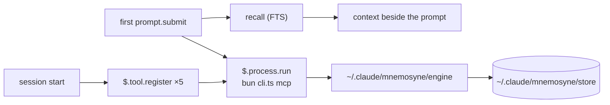

# Design

Everything below was probed on 2026-10-16 against a real install, not read off a
page. Commands that produced each finding are noted where they can be
reproduced. `v0.1.0` implements it; §5 records the decisions taken.

---

## 1. What the Mnemosyne Memory engine is, and what it costs to depend on

[`@oh-my-pi/pi-mnemopi`](https://www.npmjs.com/package/@oh-my-pi/pi-mnemopi) —
MIT, ~153K weekly downloads, source at
[`can1357/oh-my-pi` → `packages/mnemopi`](https://github.com/can1357/oh-my-pi/tree/main/packages/mnemopi).
It is a package inside the oh-my-pi monorepo, published independently, so it can
be consumed on its own.

Do not confuse it with
[`mnemosyne-oss/pi-mnemosyne`](https://github.com/mnemosyne-oss/pi-mnemosyne) —
that is a different thing: a Pi extension that shells out to the Python CLI.
The lineage is:

```
mnemosyne (Python, upstream engine)
   ├── pi-mnemopi    (Bun/TS port, inside the oh-my-pi monorepo)  ← this plugin's backend
   └── pi-mnemosyne  (Pi extension, spawns the Python CLI)
```

## 2. Constraints, with evidence

### 2.1 Bun is mandatory

The package's `exports` map points `import` at `./src/index.ts`; `dist/` ships
`.d.ts` files only. There is no compiled JavaScript.

```
$ node …/@oh-my-pi/pi-mnemopi/src/cli.ts mcp
Error [ERR_UNSUPPORTED_NODE_MODULES_TYPE_STRIPPING]: Stripping types is
currently unsupported for files under node_modules
```

Under `bun` the same command answers:
`{"serverInfo":{"name":"mnemopi","version":"3.1.2"}}`.

This is the single hardest prerequisite. A consumer without `bun` cannot use
this plugin at all, so the implementing version must detect it and say so
rather than failing obscurely.

### 2.2 One request per process works

`mnemopi mcp` speaks MCP over stdio. A bare `tools/call` — **no `initialize`
handshake** — is answered, and a single call costs **0.57 s** measured
end-to-end:

```
$ printf '%s\n' '{"jsonrpc":"2.0","id":1,"method":"tools/call",
  "params":{"name":"mnemopi_recall","arguments":{"query":"ponytail","limit":3}}}' \
  | MNEMOPI_NO_EMBEDDINGS=1 bun …/cli.ts mcp
```

The mods API's `$.process.run` accepts `stdin`, so a hook can run one process
per call. **No long-lived server, no port, no MCP approval prompt.** 0.57 s is
affordable once per conversation and not per turn.

### 2.3 The data dir must be set explicitly

The engine's built-in default is `~/.hermes/mnemopi/data`
(`packages/mnemopi/src/config.ts`). The plugin always sets `MNEMOPI_DATA_DIR`
to its own store, `~/.claude/mnemosyne/store` by default.

Verified with a throwaway `HOME`: a remember wrote only to `MNEMOPI_DATA_DIR`
(plus bun's own cache under `~/Library/Caches/bun`). Nothing under `~/.omp` or
`~/.hermes`. An end-to-end run left the other installation's `mnemopi.db*` mtimes and sizes
unchanged.

### 2.4 Scoping silently returns zero hits — the trap

This is the one that cost the most time and would have shipped as a bug.

`recall` narrows rows by
`(session_id = ? OR scope = 'global' OR channel_id = ?)`
(`core/beam/recall.ts`). Other writers set `session_id = channel_id = <bank>`.
The MCP server defaults its session id to `mcp_<bank>`, which matches neither —
so a naive recall against a populated bank returns **`count: 0`**, with no
error.

Passing the bank on **both** `MNEMOPI_SESSION_ID` and `MNEMOPI_CHANNEL_ID`
returns real hits. Verified against the live `matrixkoder-mk-5` bank:
2 hits for `"mk-builder connect"` with the channel set, **0 without**.

Every call this plugin makes therefore carries both variables. This is not a
tuning detail; it is the difference between working and silently empty.

### 2.5 Embeddings in a spawned process (historical in 0.6.x; solved in 0.7.0)

What was found (0.5.0 and 0.6.x): with fastembed enabled, both the CLI and the
MCP server died repeatedly with a Bun C++ panic when spawned as a standalone
process, and with `MNEMOPI_NO_EMBEDDINGS=1` everything was stable. So the
plugin kept embeddings off, and recall from this plugin was FTS-only. Sessions
of other hosts were unaffected: they attach to a detached embedding server at
`~/.omp/run/mnemopi/`, which a spawned CLI does not, so it loads fastembed
in-process.

What fixed it (0.7.0, §3.8): the panic is onnxruntime's abort in
`process.exit()` after a model session (ORT #24579, fixed from 1.24). fastembed
3.0.0 pins onnxruntime-node 1.21.0, so the engine build overrides it to 1.26.0
(engine change 6), and the CLI now exits naturally on success instead of
calling `process.exit(0)` (change 7), because the override alone is not enough
on the fastembed path. Embeddings are now on by default on macOS arm64 once
`/mnemosyne-setup` has downloaded the model; with the option `off`, or before
setup, `MNEMOPI_NO_EMBEDDINGS=1` still keeps recall FTS-only. §2.6's note about
768-dimension vectors predates this: the model the plugin pins is 384-dimension.

### 2.6 One engine only — keep the TypeScript one

The Python engine (`pip install mnemosyne-memory`) **can read** the
TS-written store: opening the live `matrixkoder-mk-5` bank with
`BeamMemory(session_id=<bank>, channel_id=<bank>)` returned 3/3/1 hits for three
queries. An earlier reading of "incompatible" was wrong — it was the same
scoping trap as §2.4.

But **writes diverge**: the TS engine writes 768-dim vectors, Python defaults to
384, and a Python backfill failed with
`Dimension mismatch … Expected 384 dimensions but received 768`.

So: **one writer, the TypeScript engine.** A second writer on the same file
would corrupt the vector index.

## 3. Where memory lives

The plugin keeps its own engine and store, separate from any other installation, so the two never
share a writer (§2.6) and an upgrade elsewhere cannot change the engine under it.
`/mnemosyne-setup` installs the plugin's own engine copy (§3.1) into
`~/.claude/mnemosyne/engine/`. Each call is one `bun <cli> mcp` process:



### 3.1 The engine lives in the repo: engine/ and UPSTREAM.md (v0.5.0)

Upstream's `mnemopi_update` changes only content and importance, and its recall
always bumps `recall_count`. Tagging an existing memory needs a metadata update,
and a dashboard search must not change counts, so the engine source is now part
of the plugin:

- `engine/` is the npm tarball of `@oh-my-pi/pi-mnemopi` 18.12.3, copied in
  whole (`src/`, `dist/types/`, `package.json`, `LICENSE`, `README.md`,
  `CHANGELOG.md`, `THIRD-PARTY-NOTICES.txt`). Its four `@oh-my-pi`
  dependencies stay npm downloads pinned at exactly 18.12.3.
- `engine/UPSTREAM.md` is the registry: upstream repo and path
  (`can1357/oh-my-pi`, `packages/mnemopi`), tag `v18.12.3` and its commit, the
  tarball URL and sha512 integrity, a numbered list of our changes (what, why,
  files, upstream issue, status), the `engine/src` sha256 of each build, and
  the rebase steps. Today: change 1, `mnemopi_update` shallow-merges a
  `metadata` object in one `BEGIN IMMEDIATE` transaction (a key set to `null`
  is removed; a row whose `metadata_json` is not an object is refused and left
  unchanged); change 2, `mnemopi_recall` takes `update_recall_counts`
  (default true); change 3, the build number in `engine/package.json`; change 4,
  the two knowledge tools `mnemopi_knowledge_prompt` and
  `mnemopi_knowledge_store` (v0.6.0, §3.7); change 5, a dedupe re-save keeps the
  first author and veracity (v0.6.0). Changes 6 to 11 came with v0.7.0 (§3.8)
  and changes 12 to 18 with v0.8.0 (§3.9). The build v0.8.0 expects is
  `18.12.3-mnemosyne.10`; each earlier build number was a revision of the
  changes then listed, and `engine/UPSTREAM.md` lists the `engine/src` hash of
  each build.
- `bun scripts/engine-diff.ts` downloads the tarball, checks its integrity, and
  fails unless every file that differs from `engine/` is listed in a change and
  the recorded `engine/src` hash for the current build is the real one. So an
  unlisted edit, or an edit without a build bump, fails the gate.
- Our engine tests are `engine/test/*.spec.ts` (real temporary stores, real
  engine processes, including two processes merging metadata into one row at
  once). `engine/` is not type-checked by us: upstream checks it with its
  monorepo setup, which the tarball lacks.
- `/mnemosyne-setup` runs `bin/install-engine.ts <plugin root> <engine dir>
  <store>`. It builds `<engine dir>.next` (the copy as `pi-mnemopi/`, a
  `package.json` with `file:./pi-mnemopi`, `bun install --production
  --omit=peer`, since Bun would otherwise install the folder's dev and optional
  peer dependencies, onnxruntime included), checks that the new cli answers
  `tools/list` with the metadata-capable `mnemopi_update`, and only then
  renames the old engine to `.old`, the new one into place, and deletes
  `.old`. Any failure deletes `.next` and leaves the installed engine as it
  was; a test proves it with an unreachable registry. It writes nothing outside
  those three folders and refuses a store inside them, comparing real paths
  (the nearest existing parent through `realpathSync.native`, symlinks
  followed, case-folded on macOS and Windows); `paths()` also refuses a
  `memoryDir` inside `<root>/engine`, `.next` or `.old`, ignoring case. The
  staged install has no lockfile (Bun saves none under `--production`): the
  four `@oh-my-pi` packages are pinned at 18.12.3, their own dependencies
  resolve fresh at each setup, through Bun's global cache or the registry.
  The installer's own limits (240 s install, 30 s check) stay below the
  host's 300 s limit on setup (`hooks/engine-build.ts`). The cli path is
  unchanged: `<engine dir>/node_modules/@oh-my-pi/pi-mnemopi/src/cli.ts`.
- `ENGINE_BUILD` (`hooks/engine-build.ts`, no imports) equals
  `engine/package.json`'s version; a Bun spec fails when they differ.
  `isCurrent` in `register.ts` reads the installed engine's `package.json` with
  `$.fs.read` and compares. Session start with a stale engine shows a toast
  asking for `/mnemosyne-setup`; it does not reinstall on its own (an install
  can take minutes and needs the network). Recall, forget and stats keep working
  on a stale engine; since v0.8.0 `memory_remember` and `memory_update` refuse,
  and so does the proxy (§3.9, §5.8). In
  0.6.0 the dashboard command, the extraction after a save and
  `/mnemosyne-knowledge` refuse too (they need the knowledge tools), each with
  a message that says to run `/mnemosyne-setup`.

### 3.2 The activity log: activity.jsonl (v0.5.0)

Every memory call the plugin makes, and every call through the external MCP
proxy, adds one JSON line to `~/.claude/mnemosyne/activity.jsonl` (`paths()`
gives it as `activity`, `<root>/activity.jsonl`). The dashboard reads it.

- A line: `t` (ISO time), `action` (recall, remember, update, forget, stats,
  rearm, extract), `origin` (hook = first-prompt recall or compaction, trigger = a
  recall or remember term, tool = Claude's tool call, external = the proxy,
  ui = a dashboard search or forget, backfill = `/mnemosyne-tags apply` and `/mnemosyne-knowledge apply`), `owner`, `text`, `ids`, `count`, `ok`, and
  `error` only when not ok. v0.6.0 adds four optional fields (§3.7, C1) and the
  action `extract` (one line per knowledge extraction run: `ids` is the memory,
  `count` the items stored, `error` the reason when it did not store). `ids` holds at most 50; `count` is the full
  number. `hooks/activity-log.ts` builds it and imports nothing, so the hooks,
  the proxy and the server build the same line.
- `text` is the query (as the engine gets it, 300 characters at most), the
  fact, or what an update sets (`tags: a, b`, cleaned as the engine gets
  them). It is cut to 2000 code points (dropping the cut word, so no half
  secret is left), then secret shapes are replaced by `[redacted]`, then it is
  cut to 200 code points. Redaction is pattern-based, so a secret of an
  unknown shape, or a short unnamed one, can get through. It covers API keys
  and tokens by prefix, JWTs, private key blocks, Slack and Discord webhook
  URLs, `scheme://user:password@` (spaces in the password too), `password=`,
  `token:` or `"api_key": "…"` values (quoted values up to the closing
  quote), `password is …` phrases, Bearer values, hex runs of 32+, and
  letter-and-digit runs of 32+ that are not paths (a run with `+` or a
  trailing `=` counts as base64 whatever its slashes). Every pattern that can
  backtrack is bounded: 100 KB and 200 KB inputs redact in a few ms (kit
  test, under 200 ms). A forget logs only the id, in `ids`. A remember term
  logs a `remember`/`trigger` line, and Claude's save that follows logs its
  own `remember`/`tool` line. A `memory_*` tool outside the five is not
  logged.
- The writer is `bin/activity.ts`: `appendActivity(path, lines)` for Bun code,
  or `bun bin/activity.ts <path>` with the lines on stdin. It writes only a
  file whose name ends in `.jsonl`. It creates the folder 0700 and sets the
  file to 0600 at every open, and the backup too (no chmod on Windows), writes
  the batch in one `O_APPEND` write, and drops anything that is not one JSON
  object. Past 1 MB it renames the file to `activity.jsonl.1` (one backup);
  only a writer that creates `activity.jsonl.lock` with `O_EXCL` rotates, and
  it checks the size again under the lock, so two writers rotate once. A lock
  older than 10 s is taken over: the taker first renames it to a name of its
  own, so of two takers only one rename succeeds; if what it renamed turns out
  fresh (another writer had just taken the lock), it links it back and does
  not rotate. A third writer arriving inside that microsecond gap could still
  hold a lock beside another; the size check under the lock keeps even that
  to one rotation unless both check before either renames. That race is not
  tested (it cannot be forced from one process). A line that races a rotation
  lands in `.1`. It never throws, and the script always exits 0 and stops
  itself after 5 s.
- A hook cannot append to a file (`$.fs` has no append, mode or rename), so
  each memory event starts one short Bun process for its lines. The hook waits
  for the paths only (host calls), never for the write; an append that hangs or
  fails leaves the hook's result unchanged (kit tests for both). Measured on an
  Apple M4 with Bun 1.4.3 (40 runs after 3 warm-ups, one line on stdin): one
  append process takes 11 ms wall time at the median (8 ms min, 12–21 ms p90).
  It runs beside the hook, so a prompt or tool call does not wait for it.
- How the hook hands the lines over is `APPEND_MODES` in `hooks/register.ts`:
  - `spawn` (default): a `$.process.spawn` loop drained in a detached task;
    the script's own 5 s cap bounds it.
  - `run`: `$.process.run` with a 5 s timeout, not awaited.
  - `await`: `$.process.run` awaited, capped at 1 s (the hook waits ~11 ms).
  `spawn` is the default (orchestrator decision, 2026-10-23, review r1 MED 2)
  because the plugin API's types document that a spawned child's loop runs on
  after the hook returns ("nothing else does, a hook's return included"),
  while they say nothing either way about an un-awaited `run`. The live check
  (plan LOG.5) has not run yet; it confirms the choice. Caveat: `session.end`
  has a 1.5 s bound and aborts any `$` call still in flight, and leaving the
  loop or the module unloading kills a spawned child, so an append started in
  the last moments of a session can be lost. The hooks that log (prompt, tool
  call, compaction) do not run at session end, so this is a narrow window. To
  switch, start Claude Code with `MNEMOSYNE_ACTIVITY_APPEND=run` (or `await`)
  in its environment; to change the default, edit `DEFAULT_APPEND` in
  `hooks/register.ts` and record the result here.
- The proxy imports `appendActivity` and writes synchronously, so every line is
  on disk before it exits. It keeps the calls it sent by JSON-RPC id and writes
  the line when the reply comes back (ok, ids and count read from it); a call
  it refuses (stale engine, bad tags) is logged at once with `ok: false`; a
  tool outside the five is not a memory call and is not logged; a call the
  engine never answered is logged as failed at exit. The wrapper passes the
  path as `MNEMOSYNE_ACTIVITY_LOG`, empty when the log is off; a log failure
  never changes what the client receives (Bun test).
- The `activityLog` setting (`on` by default, or `off`) turns it all off: the
  hooks read it on each call, and the wrapper is rewritten at session start,
  so the proxy follows from the next session.

### 3.3 The dashboard server: /mnemosyne-ui (v0.5.0)

`/mnemosyne-ui` starts one local web server for the dashboard, or reuses the
one running, and hands its link over without writing the token into the
transcript. It is the plan's main exposure (a network port), so each guard
below has a Bun test in `tests/bun/ui-server.spec.ts` against the real server
and a temporary WAL store made by the real engine.

- Files: `ui/server.ts` (the server, Bun), `ui/index.html`, `ui/style.css` and
  `ui/app.ts` (the page; `app.ts` is built by `Bun.build` into memory at server
  start and served as `/app.js`), `hooks/ui-launch.ts` (the command's start,
  reuse, hand-over and stop), `hooks/engine.ts` (the engine call, shared). The
  page also loads `ui/map.ts`, `ui/map-state.ts`, `ui/map-layout.ts`,
  `ui/map-live.ts`, `ui/stream.ts`, `ui/knowledge.ts`, `ui/health.ts` and
  `ui/escape.ts` (§3.5, §3.7), all bundled into `/app.js`.
- Routes (all `GET` but the last two, all behind the token): `/api/health`
  (the launcher's liveness ping and the header facts), `/api/memories` and
  `/api/memories/<id>`, `/api/activity` and `/api/activity/stream`,
  `/api/galaxy`, `/api/knowledge`, `/api/health-report`, then `POST
  /api/search` and `POST /api/forget`. The v1 `GET /api/map` (one drill level
  per call) was removed in 0.6.0; it now answers 404 like any unknown route.
- One engine-call module: `hooks/engine.ts` exports `buildRequests`,
  `engineEnv(store, owner)` and `parseReplies` and imports nothing (no
  `claude-code`, no Bun API), so the hooks run it through `$.process.run` and
  the server through `Bun.spawn` with its own environment and `engineEnv` laid
  over it. `engineEnv` is the one place the ten engine variables live
  (`MNEMOPI_DATA_DIR`, `SESSION_ID`, `CHANNEL_ID`, `NO_EMBEDDINGS`, the
  blanked `MCP_BANK`, `LLM_BASE_URL`, `HOST_LLM_ENABLED`, and since 0.6.0 the
  blanked `AUTHOR_ID` and `AUTHOR_TYPE`, so the plugin sets the author per
  call, and `POLYPHONIC_RECALL` set to `0`, because that recall path writes
  `consolidated_facts`, which a forget does not purge). `paths()` stays in
  `register.ts`: the hook resolves root, store and cli and passes them to the
  server as `MNEMOSYNE_ROOT`, `MNEMOSYNE_STORE`, `MNEMOSYNE_CLI`,
  `MNEMOSYNE_ACTIVITY_LOG` (empty when the log is off),
  `MNEMOSYNE_PLUGIN_ROOT` and, since 0.6.0, `MNEMOSYNE_EXTRACTION` (§3.7).
- Guards: it binds `127.0.0.1` only, on a port the OS picks. It makes a
  32-byte random token at each start. Every `/api` route wants
  `Authorization: Bearer <token>` (compared in constant time); no token, a
  wrong one, or the token only in the query string gets 401 and no data. A
  `Host` header other than `127.0.0.1:<port>` gets 403 on every route (DNS
  rebinding). Every reply, errors included, carries
  `Content-Security-Policy: default-src 'none'; script-src 'self'; style-src
  'self'; connect-src 'self'; img-src 'self' data:; base-uri 'none';
  form-action 'none'; frame-ancestors 'none'`, `Referrer-Policy: no-referrer`
  and `X-Content-Type-Options: nosniff`; the policy never gets an `unsafe-`
  keyword. No reply carries an `Access-Control-Allow-*` header, and OPTIONS
  gets 405. SQLite (`<store>/mnemopi.db`) is opened read-only with
  `query_only` on; every change goes through the engine. `/favicon.ico` is 204
  with no body. `/vendor/<name>` serves one plain `.js` file name from
  `ui/vendor/` as `text/javascript` (the folder's notices, inputs list, scan
  allowlist and types are not served), so `/vendor/../server.ts` and
  `/vendor/..%2fserver.ts` are 404; it serves only a regular file (never a
  link or a folder) whose real path is inside `ui/vendor/`. The page shell, script and style load
  without the token and hold no data. `ui/index.html` has no inline script or
  style and loads only same-origin files.
- Token flow: the server writes `<root>/ui.json` (`port`, `token`, `pid`) to a
  fresh 0600 file renamed into place, and prints one ready line with port and
  pid only. The hook reads the token from `ui.json` with `$.fs.read`, so the
  token never passes through spawn output. The link is
  `http://127.0.0.1:<port>/#token=<token>`: the fragment is never sent in a
  request. The hook opens it in the default browser (`open`, then
  `xdg-open`, then `cmd /c start`, the first that exits 0), copies it with
  `$.ui.copy`, and shows it in full in the reply, so the token is in the
  transcript (decision 2026-10-23: the user wants the link in the console;
  the key works only on 127.0.0.1 and only until the server stops). The
  opener gets the link as an argument, so it is in a process list for that
  moment. `$.ui.log` never holds the token. The page takes the token from the fragment, removes it from
  the address bar with `history.replaceState`, keeps it in the tab's
  `sessionStorage` for reloads, and sends it only as the Authorization header.
  What other code of the same user can see, within the same-user boundary:
  other plugins' hooks in the same session see the copied link (`ui.copy`),
  the ping's stdin (`process.run`) and `ui.json` (`fs.read`), and any process
  of this user can read `ui.json`. The browser keeps the first URL it opened,
  fragment and token included, in its history, even though the page removes
  it from the address bar; the token is worthless once that server stops.
- One shared server: a later call, in this session or another, reads
  `ui.json` and pings it with `bun ui/server.ts --ping <port> <pid>`
  (`$.process.run`, 3 s timeout, token on stdin, never on the command line).
  The ping never uses a proxy: the hook runs it with `NO_PROXY`/`no_proxy`
  set to `127.0.0.1` and every `HTTP(S)_PROXY`/`ALL_PROXY` variable blanked,
  and the ping drops them itself too (Bun's fetch otherwise sends even a
  127.0.0.1 request, token included, to `HTTP_PROXY`). It follows no redirect
  and counts only a 200 whose `pid` is the one `ui.json` names. If it answers
  (asked twice), the same link is handed over and nothing starts. If not, and
  the server is this session's own and its process still runs (`kill -0`), the
  same link is handed over with a note; nothing is killed for a missed ping.
  Otherwise a new server starts and replaces `ui.json`. If, once the new
  server is ready, `ui.json` names another server that answers (two starts at
  once), that one is handed over and the new one is stopped.
- Lifecycle. The host's `$.process.spawn` closes a child's stdin from the
  start (or after its `input`), so the server cannot be spawned directly with
  stdin as a pipe. The hook spawns `bun ui/server.ts --hold` instead: a small
  holder that starts the server with stdin as a pipe it keeps open and passes
  the server's output through. The spawn loop is the holder's life.
- Shared use (`<root>/ui-users.json`, `bin/ui-users.ts`). Every session that
  opens or reuses the server is listed with its Claude process id (the hook
  walks up the process tree to the nearest `claude`, `hooks/ui-pid.ts`; hook
  code runs inside that process), that process's start time (`ps -o lstart=`)
  and the time; a reuse lists it again with a fresh time, keeping the pid and
  start time already listed when this lookup fails. Each change is one read-modify-write under `ui-users.json.lock`
  (linked into place, so it never exists without its holder's pid; a lock
  whose holder is gone or older than 5 s is broken), so concurrent adds all
  land; there is no reset, so a session that reused a just-started server
  before its starter listed itself stays listed. A user is live while its
  process runs with the recorded start time (a pid reused after a crash does
  not count; with no start time readable, the pid alone counts); one with no
  pid counts for 2 h from its last listing. The
  hook gives each `add` 3 s and one retry, and says in the reply when the
  session could not be listed. `session.end` (any reason, `/clear` included)
  finds the session in `ui-users.json` (so a reloaded hooks module, whose
  memory is empty, still finds it) and runs one `bin/ui-users.ts leave`
  (at most 1 s; about 30 ms warm, 150-200 ms cold, measured): it takes the
  session off and, when no live user is left, sends SIGTERM to the servers
  this session started and the one `ui.json` names, each only while its
  command line is `ui/server.ts`'s, all under the lock, so a concurrent `add`
  lands only after the server is signalled. Beside it the session's own spawn loops
  end (at most 0.6 s), which kills their holders and closes those servers'
  stdin. Both fit the 1.5 s bound with no ping on this path. When `leave`
  gives no answer, nothing is killed: the server decides from the list.
  Backstops, each with a Bun test: when its stdin closes, its parent is gone
  or it gets SIGHUP, the server exits unless the list names a live session,
  and then polls the list and exits once none is; the holder exits when its
  parent is gone (checked every 10 s; `MNEMOSYNE_UI_PARENT_CHECK_MS`
  sets it for tests, held to 100 ms - 10 s). On exit the server removes `ui.json` only while it
  still names its own pid. There is no stop command and no stop route.
- Before it starts anything the command checks Bun, an installed engine and a
  current one (`isCurrent`), and otherwise says to install Bun or run
  `/mnemosyne-setup`.

Manual check (plan SRV.4), in a real terminal session and in the desktop app:

1. Run `/mnemosyne-ui`. The default browser opens the page, and the reply
   shows `Link: http://127.0.0.1:<port>/#token=<token>`. The page
   shows the header, the owners with counts, the store path and "Connected to
   the local Mnemosyne server." Open the browser console: no error and no CSP
   violation.
2. After the page loads, the address bar shows no `#token=`. Reload: the page
   still works (the tab's sessionStorage). Open `http://127.0.0.1:<port>/`
   (no fragment) in a new tab: it says to open the link from /mnemosyne-ui and
   shows no data.
3. Paste the reply's link into a second browser: the page loads there too.
4. Run `/mnemosyne-ui` again: the same address, nothing new starts
   (`lsof -nP -iTCP:<port> -sTCP:LISTEN` shows one `bun`).
5. `/clear` in the starting session: `lsof -nP -iTCP:<port> -sTCP:LISTEN`
   shows nothing and `~/.claude/mnemosyne/ui.json` is gone.
6. Run `/mnemosyne-ui` again, then exit the session: the same two checks show
   nothing.
7. Desktop app, two sessions A and B: start the server in A, run
   `/mnemosyne-ui` in B (same address). Close B: the port still listens. Close
   A: the port is gone and `ui.json` is gone.

That check was written for the four v0.5.0 tabs; the Map, Knowledge and
Health tabs of 0.6.0 are described in §3.7.

Manual check of the four views (plan VIEW.5), in a browser, by the user or a
browser agent. The mockups to compare with are `Memories.dc.html`,
`Activity.dc.html` and `Search.dc.html` in the plan's design folder
(`~/.matrixkoder/projects/claude-mnemosyne/plans/mnemosyne-ui/assets/design/`).
Keep the browser console open throughout: no error and no CSP violation.

1. Run `/mnemosyne-ui` and open the copied link. The page opens on Memories:
   a table (Memory, Project, Tags, Saved, Recalls), "Showing N of M", and a
   detail panel saying "Pick a memory to see it in full." Compare layout,
   copy and colours with `Memories.dc.html` (the mockup's "Save tags" editor
   is not built: tags are shown read-only, editing is not in VIEW).
2. Choose a project in Project: only its rows stay and the count drops. Choose
   Sort "Most recalled": the row with the most recalls is first. Type a word in
   Filter: only rows holding it stay. Click a row (or Tab to it and press
   Enter): the panel shows the full text, Saved, Recalls, Last recalled,
   Source, Importance, Scope and Tags.
3. Activity tab: the Live badge shows "Live", the tiles count today's recalls,
   saves, updates and failures, and the list shows recent lines newest first.
   In Claude Code type a recall term (for example `recall: dashboard`): within
   about a second a new `recall` line with origin `trigger` appears at the top
   without a reload. Press Pause, make another call: nothing new shows; press
   Resume: it appears. Try each filter chip. Compare with `Activity.dc.html`.
4. Search tab: note one memory's Recalls in Memories first. Search a word from
   it with All projects: each hit appears once, with `#rank`, its project, a
   score bar and number, the matched words marked, tags and Open. Search again
   with one project chosen. Back in Memories (or press Open on the hit), the
   row's Recalls is unchanged. Activity shows one `recall` line with origin
   `dashboard` per search (an all-projects search shows "all projects (N)").
   While a search runs the Search button is disabled, and pressing Enter again
   starts nothing. Compare with `Search.dc.html`.
5. Markup stays text: in Claude Code ask it to remember the throwaway fact
   ` dashboard test` (owner global). Reload
   Memories: the row shows the characters `` as
   plain text, no image box, no alert. Open it: the same in the panel.
6. Forget with confirm: in that row's panel press "Forget…". The confirm says
   "Forget this memory for good? This cannot be undone." and names the
   memory's first line in quotes and its id. Press "Keep it": the confirm
   closes and the row is still in the table (reload to be sure). Press
   "Forget…" then "Forget": the status line says "Forgot memory <id>.", the row
   is gone from the table and the header count drops by one, and Activity
   shows a `forget` line with origin `dashboard`.
7. Open the bare address `http://127.0.0.1:<port>/` in a private window: it
   says to open the link from /mnemosyne-ui and shows no data.

### 3.4 Topic tags and /mnemosyne-tags (v0.5.0)

A memory's topics live in one place: `metadata.tags`, a list of short
lowercase strings cleaned by `hooks/tags.ts` (trimmed, lowercased, unique, at
most 5; since v0.8.0 each is `value` or `ns:value`, kebab-case, 1 to 31
characters, with aliases folded from a shared vocabulary, §3.9). There is no side file of tags and no tag
text inside a memory. Tags are written only through the engine:
`memory_remember` takes `tags` for a new fact, and `memory_update` merges them
into an existing one (engine change 1, a shallow metadata merge in one
transaction; an empty list removes the key).

- New memories: the rules text asks Claude for 2 to 5 short topic tags with
  each fact it saves.
- Old memories: `/mnemosyne-tags` tags the existing ones once. With no
  argument it is a dry run: for each untagged memory it sends the memory's
  text (as quoted data, at most 4000 characters) to Haiku through
  `$.model.complete`, 4 calls at a time, and saves the proposals to
  `<root>/tags-proposed.json` (0600): id, owner, tags and a sha256 of the
  text, never the text. Nothing changes in the store. `/mnemosyne-tags apply`
  makes no model call: it re-reads each proposed row and writes only those
  that still exist, still have no tags and whose text hash is unchanged,
  through `mnemopi_update`, one engine process per owner. Each run says how
  many it skipped and why.
- Privacy: the dry run is the only step that sends memory text to a model;
  the user runs it on purpose and reads the proposals before `apply`.
- Files: `bin/memories.ts` (a read-only listing of the store for the
  backfill, which a hook cannot read, and the tag SQL the dashboard shares),
  `hooks/backfill.ts` (the pure parts: the prompt, reading the reply, the
  proposals file, the apply-time re-check and the worker pool; it imports only
  `hooks/tags.ts`), and the command in `hooks/register.ts`. `hooks/backfill.ts`
  was added in the TAGS phase although the plan's TAGS file list did not name
  it; it is recorded here so the file has an owner.
- "Untagged" means no non-empty text in `metadata.tags`: NULL, `{}`, broken
  JSON and `tags: []` all count, in the backfill, the Memories filter and the
  map alike (`untaggedSql()` in `bin/memories.ts`). A real tag named
  `untagged` is a tag like any other; only `untagged=1` asks for rows with none.

### 3.5 The 3D memory map: library and rules (v0.5.0; the map itself is v0.6.0, §3.7)

The Map tab draws the store on the `3d-force-graph` library (three.js). v0.5.0
drew four spheres and drilled down one `GET /api/map` level at a time (projects
→ a project's topics → a topic's memories → one memory). v0.6.0 removed that
route and the drill-down: the map is now the galaxy of §3.7, fed by one
`GET /api/galaxy`. What this section keeps is what did not change with it: the
vendored library, the rule that no label is ever HTML, how the library loads,
and what happens without WebGL.

- Labels are never HTML. The library's own tooltip renders HTML, so it is
  off: `nodeLabel(NO_TOOLTIP)` and `linkLabel(NO_TOOLTIP)`, a function
  returning an empty string, are the only label setters `ui/map.ts` calls (a
  spec holds this). Hover text goes into an app-owned element with
  `textContent`; 3D captions are drawn on a canvas by `three-spritetext`;
  `plainLabel` (`ui/escape.ts`) cuts a label and removes control and
  bidirectional-override characters, and never HTML-escapes, since nothing
  parses it.
- Loading: the page builds `ui/app.ts` with `ui/vendor/` kept external, and
  `ui/map.ts` loads `/vendor/map-lib.js` with `import()` only the first time
  the Map tab opens; the other tabs request nothing under `/vendor/`.
- Without WebGL: `hasWebGL` asks a fresh canvas for a `webgl2` context (three
  needs WebGL2). When it gets none, or when the library cannot load or the
  graph constructor throws, the map area shows a plain message and the other
  tabs are unaffected.
- The page holds a token that can forget memories, and the map adds a
  third-party bundle, so the same CSP applies unchanged (no `'unsafe-*'`),
  the bundle is patched, scanned and pinned (below), and review depth is
  data-loss.

The vendored library (`ui/vendor/`, committed):

- `scripts/vendor-map.ts` runs one `Bun.build` at dev time over the pinned
  devDependencies `3d-force-graph` 1.80.1, `three` 0.186.1 and
  `three-spritetext` 1.10.0 into one minified ESM file, `ui/vendor/map-lib.js`,
  exporting `ForceGraph3D`, `SpriteText` and, since v0.6.0, three's bloom
  pipeline: `EffectComposer`, `RenderPass`, `UnrealBloomPass` and `OutputPass`
  (C3; they come from the same `three` package, so the core is still bundled
  once). It fails when a patch does not
  match exactly as often as listed, when any package comes from two folders,
  or when three's core is not bundled exactly once. Beside it it writes
  `map-lib.d.ts` (the types of the surface `ui/map.ts` uses),
  `map-lib.inputs.json` (every bundled package with version and licence, the
  patches with the CSS they removed, the size and a sha256) and
  `THIRD-PARTY-NOTICES.txt` (each package's licence text). `bun
  scripts/vendor-map.ts --check` rebuilds in memory and fails when a
  committed file differs; `bun run test:bun` ends with it, so a hand edit of
  the bundle (even with `map-lib.inputs.json` edited to match) fails the
  suite.
- Measured (v0.6.0 build, Bun 1.4.3): map-lib.js is 829,100 bytes (809.7 KB),
  219,482 bytes gzipped, from 31 packages (v0.5.0: 816,677 bytes); three's core
  is most of it. Bundled: 3d-force-graph 1.80.1, three 0.186.1, three-spritetext 1.10.0,
  three-forcegraph 1.43.6, three-render-objects 1.43.0, d3-force-3d 3.0.6,
  float-tooltip 1.7.5, kapsule 1.16.3, preact 10.29.8, polished 4.3.1,
  lodash-es 4.18.1, @tweenjs/tween.js 25.0.0, the ngraph packages and the
  d3 helpers; `map-lib.inputs.json` has the full list.
- Patches, applied by the build plugin as each source loads (ids as in
  `map-lib.inputs.json`):
  1. `no-style-3d-force-graph`, `no-style-three-render-objects`,
     `no-style-float-tooltip`: the style element injection is removed. Each
     of these three packages' `dist/*.mjs` calls `styleInject(css_248z)`,
     which creates a `<style>` element; the CSP refuses it, and copying the
     CSS would not make the injected element allowed. The call is replaced by
     a comment, so the bundle holds no `createElement('style')` at all, and
     the CSS each injected is in `ui/style.css` as shipped (a spec checks
     every selector is there).
  2. `tooltip-as-text` (float-tooltip): a string tooltip is set with
     `selection.text()`, not `selection.html()`. A second guard: the map's
     tooltip is always empty (`NO_TOOLTIP`).
  3. `no-webgpu` (three-render-objects): its import of `three/webgpu` (a
     second, 2.2 MB build of three's renderers) is replaced by a null
     constant. The map never asks for WebGPU, so the WebGL renderer is the
     one made, and three stays one copy.

#### Vendored code scan

`tests/bun/vendor-scan.spec.ts` scans every `ui/vendor/*.js` for
`createElement('style')`, `styleInject`, `setAttribute('style')`, `eval(`,
`new Function`, `Function(`, `new Worker`, `createObjectURL`,
`importScripts`, `innerHTML`, `fetch(`, `import(` and every `http(s)://`
literal, and each count
must equal `ui/vendor/scan-allow.json`, where every entry says why the hit is
inert. A new hit, or a count that moves, fails until it is reviewed there. The
reviewed hits of map-lib.js:

1. `Function(` ×7: six are ngraph.forcelayout's code generators (`new
   Function` in its source; the minifier drops the `new`), which run only
   when `forceEngine` is `'ngraph'`; `ui/map.ts` sets `forceEngine('d3')`.
   The seventh is lodash's global lookup, reached only when neither `global`
   nor `self` exists, never in a browser. A static hit is judged by the
   runtime: if one ran, the CSP would refuse it and the console would show it
   (MAP.4 checks the console).
2. `innerHTML` ×9: d3-selection's `html()` (its only caller is patched to
   `text()`), preact's `dangerouslySetInnerHTML` handling (preact renders only
   React elements given to the tooltip, which the map never gives), and two
   `domNode.innerHTML = ''` that clear the map's own container.
3. `fetch(` ×1: three-forcegraph's `jsonUrl` property, which fetches graph
   data from a URL when set. `ui/map.ts` never sets it (it passes
   `graphData`), and the CSP's `connect-src 'self'` would allow only this
   server if it did. There is no `import(` in the bundle.
4. URL literals: XML namespace names (`http://www.w3.org/...`) used with
   `createElementNS`, a citation inside a three.js shader comment, and
   polished's error message text. None is fetched; the CSP's `connect-src
   'self'` would refuse any that were.

A headless Chrome run of the real server on a temporary store (MAP build,
2026-10-23, the v0.5.0 map) loaded the map and logged no CSP violation, while a
deliberately injected `<style>` in the same page was logged as refused (a
control that the logging works). That run is evidence for that build only; the
v0.6.0 map has the manual check in §3.7.

### Dark mode (after v0.6.0)

The dashboard has three themes: Auto (follows the system), Light and Dark, chosen
with the Theme button in the header and remembered in `localStorage`
(`mnemosyne.theme`). Every colour in `ui/style.css` is a variable. The themed
ones are written once as `light-dark(light, dark)` pairs inside an
`@supports (color: light-dark(#000, #000))` block and picked by `color-scheme`:
Auto uses `light dark`, and the button sets `data-theme="light"` or `"dark"` on
`<html>` (Auto removes it). Doing it in CSS keeps it inside the page's
Content-Security-Policy (no inline style or script) and needs no JavaScript for
Auto. A plain light copy of the palette stays outside the block as the fallback
for browsers without `light-dark()`. The map canvas, the data colours (projects,
knowledge kinds, sparks) and the legend dots are the same in both themes.
`tests/bun/ui-views.spec.ts` checks that every pair's light half equals the
fallback, that no literal colour is left outside the token blocks, and that every
text colour reaches 4.5:1 on its surface in both themes. With an explicit choice
that differs from the system setting, the page can show one frame in the other
theme before the script runs.

### 3.6 Release check (MAP.6)

`claude plugin validate .` does not apply the plugin directory's own code
rules, and 0.5.0 adds about 2 MB of engine source and the 800 KB map bundle.
Before 0.5.0 ships, the user runs `claude plugin validate --profile directory
.` and the developer portal's own check on the 0.5.0 tree, and records each
finding here, fixed or explained.

Builder's run (2026-10-23, MAP build; not the user's sign-off):
`claude plugin validate --profile directory .` exits 0 ("Validation
passed") with one directory warning, `ICON_MISSING` (no
`.claude-plugin/icon.png`; the portal takes the icon only the first time the
plugin is saved there, so adding one is the user's choice before
submitting). Its report says it does not run the directory's safety scan
and policy review, nor check code loaded through `hooks.json` modules. The
portal's own check was not run. (The first run also listed the
`mnemosyne-tags` command hook as a gating hook without `.catch`; it now has
one, returning "Mnemosyne: the tag backfill failed.", and the rerun lists it
with `.catch`.)

### 3.7 v0.6.0: the galaxy, live sparks and knowledge

v0.6.0 replaces the v0.5.0 map with a galaxy of every memory, adds live sparks
for recalls and saves, a knowledge extraction that runs after each save, and
the Knowledge and Health tabs. The activity log learns which app and session
made each call. The numbers C1 to C12 are the contracts of the build plan
(`mnemosyne-ui-v2`); C8 (embeddings and the waits for them) shipped in v0.7.0
and is recorded in §3.8. Where the plan and the code disagree, this section
records the code as it was in 0.6.0.

- C1, the activity line (`hooks/activity-log.ts`, which still imports
  nothing). Four optional fields join the line of §3.2: `client` (the app, at
  most 60 code points), `session` (the Claude Code session id, at most 64),
  `author_type` (`human`, `agent` or `system`; anything else is dropped) and
  `veracity` (the engine's labels; anything else is dropped); control,
  bidirectional and zero-width characters are removed from `client` and
  `session`. The hooks stamp `client` `claude-code` and the session id; the
  proxy stamps the `clientInfo.name` the client sent in `initialize` (`unknown`
  until it says; the `initialize` request is still forwarded byte for byte);
  the dashboard server stamps `dashboard`; the two backfills stamp
  `mnemosyne-tags` and `mnemosyne-knowledge`. The action `extract` is one line
  per extraction run. A save records its author: the first save of a turn that
  began with a remember term is `human` with veracity `stated` (consumed
  inside one state update, so of two saves at once only one takes it, and a
  subagent's save never does); Claude's own save is `agent` with author id
  `claude-code`; an outside client's save is `agent` with its client name as
  author id, and the proxy deletes any `veracity` or `trust_tier` it sent. The
  engine keeps the first author on a dedupe re-save (engine change 5). Lines
  written before 0.6.0 have none of these fields.
- C2, `GET /api/galaxy` (`galaxyLevel` in `ui/server.ts`, read-only handle):
  `{ projects: [{ owner, label, count, recalls }], memories: [{ id, owner,
  tags, recalls, lastRecalled, created, label }], knowledge: [{ id:
  '<kind>:<rowid>', kind, text, memory }], meaning, total, shown }`. At most
  `GALAXY_LIMIT` (2000) memories, newest first; `total` and `shown` say how many
  were cut. `label` is the first non-empty line, control characters removed, cut
  to 80 characters; knowledge text is cut the same way. A missing store, a
  missing memoria table or a legacy table without a needed column gives empty
  lists or skips that table, never an error. In 0.6.0 `meaning` was always
  `false` and a memory had no `position` or `similar`; 0.7.0 fills them
  (§3.8, SEMX).
- C3, the bloom passes: `ui/vendor/map-lib.js` exports `EffectComposer`,
  `RenderPass`, `UnrealBloomPass` and `OutputPass` besides `ForceGraph3D` and
  `SpriteText` (§3.5). `ui/map.ts` adds an `UnrealBloomPass` and then an
  `OutputPass` to the library's own composer (`postProcessingComposer()`); if
  the library has no composer, the map draws without bloom and says so in the
  status line. The glow has three levels, set by the Glow control and remembered
  in `localStorage` (`mnemosyne.map.glow`): Soft (the default: strength 0.35,
  radius 0.3, threshold 0.35, so only the brightest cores bloom), Full (the
  0.6.0 values: strength 0.95, radius 0.55, threshold 0.12) and Off (the pass is
  switched off).
- C4, `ui/map-layout.ts`: pure, seeded math with no imports and no three.js.
  `galaxyLayout(data)` returns cores (one per project, on a golden-angle
  sphere), hubs (one per topic, on a ring around its core), stars and bridges;
  a memory's topic is its first tag, lower-cased, or `Untagged`, keyed
  `<owner>/<tag>`, and a bridge joins the same tag name in two projects
  (Untagged never bridges). Every random draw is seeded from the memory or
  topic id (FNV-1a into mulberry32), and the
  input is sorted first, so the same data gives the same numbers in any order.
  `placeOne(layout, memory)` adds one star without moving any other.
  `timelinePosition(node, days)`, `rangeDays(range, oldestDays = 0)` and
  `ticks(range, days)` place the Timeline: today at x = 280, the range 560 wide
  (`all` is the oldest memory's age plus two days), one lane per project, ticks
  every 1, 7 or 14 days for 7 days, 30 days and All. Positions are pinned, so
  layouts are stable and morph into each other.
- C5, `ui/stream.ts` and `ui/map-live.ts`. `createStream({ api })` returns
  `{ subscribe, unsubscribe, status, onStatus, close, polls }`; `api` is the
  page's token-bearing fetch, passed in because the token lives in `ui/app.ts`
  and `ui/stream.ts` never imports it. The first subscriber opens
  `GET /api/activity/stream` (NDJSON; a blank line is the keep-alive; a 404
  means the log is off) and the last one closes it, so the Activity tab and the
  map share one reader. When the stream ends it reconnects with a backoff of 1 s
  doubling to 30 s, re-reads `/api/activity` for a fresh cursor and hands on
  only the lines after the last one it delivered. `toMapEvent(line)` turns a
  line into `{ kind: recall | save | update | forget, ids, client, t, owner?,
  topic?, demo? }`, or null for a failed line and for `stats`, `rearm` and
  `extract`. `simulate(kind, galaxy)` makes a demo event (`demo: true`) from the
  galaxy the page already holds; it makes no request, so the Simulate buttons
  never touch the store or the activity log.
- The map itself (`ui/map.ts` draws, `ui/map-state.ts` holds every rule, no DOM
  and no three.js, tested by `tests/bun/map-state.spec.ts`): stars, cores, hubs
  and the Claude core as glow sprites; topic threads (core to hub, hub to star)
  and gold bridges as the library's links; the Galaxy and Timeline layouts
  (Meaning was in the rail but disabled until 0.7.0; §3.8) with the layout remembered
  in `localStorage`; Find, the path bar, Colour by, project toggles, the
  inspector; knowledge moons (the selected memory's first 8 items on a circle
  of radius 18, flattened to 0.45, turning at 0.45 rad/s) and the Knowledge
  chips (a memory without a picked kind keeps a tenth of its brightness); sparks
  from the Claude core on the Recall and Write layers and a live strip. Under
  reduced motion the moons stand still (speed 0; the build plan says they
  orbit, the code and the design mockup stand still), Live starts paused and Auto-rotate off. The page reads its settings from the state once per frame
  and needs no framework update hook. Every label still goes through
  `textContent` or a canvas (§3.5).
- C6, the knowledge store. Rows are written only by `mnemopi_knowledge_store`,
  replaced per memory in one transaction, owned by `session_id` and purged with
  the memory by the engine's forget. Column map: a fact is
  `memoria_facts.value` (`fact_type` `fact`, `key` NULL, importance 0.7); a
  preference `memoria_preferences.preference`; an instruction
  `memoria_instructions.instruction` (`active` 1); a timeline event
  `memoria_timelines.description` (id column `event_id`, `date` NULL unless the
  text parses as a date, `source` `extraction`); a relation
  `memoria_kg.subject`, `predicate` and `object` (`confidence` 0.7). Every row
  carries `source_memory_id`. Nothing is written to `facts` or `triples` (the
  engine's own writers `insertFactRows` and `insertKg` also write those, so the
  plugin never calls them, and `triples` has no owner for a forget to purge).
- C7, `GET /api/knowledge` and `GET /api/health-report` (`knowledgeList` and
  `healthReport`, read-only, behind the token; `GET /api/health` is unchanged).
  `/api/knowledge` answers `{ extraction, facts, preferences, instructions,
  timelines, relations, kg, items, total, shown }`: per kind the newest 2000
  items, `kg` is `relations` again, `items` all five lists in one, `total` and
  `shown` count per kind. An item is `{ id: '<kind>:<rowid>', kind, text (one
  line, at most 500 characters), owner, source_memory_id, topic (the memory's
  first tag or null), recalls, lastRecalled, active (instructions),
  confidence (relations) }`; `recalls` and `lastRecalled` are the source
  memory's all-time numbers, since the engine keeps no usage count for items.
  `extraction` is the server's `MNEMOSYNE_EXTRACTION` or `unknown`.
  `/api/health-report` answers `{ ok, total, global, projects, owners,
  neverRecalled: { count, list }, mostRecalled, recallsPerDay, recallsByDay,
  daysCovered, sizes: { store, log }, tables, coverage }` (with the never-recalled
  list also flat as `neverRecalledCount` and `neverRecalledList`): the newest 50
  never recalled and the 10 most recalled, recalls per day from the activity log
  and its backup, row counts of every table, and `coverage` as counts of
  memories with tags, with knowledge, with an embedding (`embeddings`, also
  `vectors`; nothing writes embeddings in 0.6.0, and the Health tab shows 0
  whatever the store holds) and with an author (`provenance`, also
  `author_type`).
- C9, order: each UI phase of the build started after the backend phases it
  needed had merged and the full suite was green; nothing in 0.6.0 depends on
  embeddings.
- C10, `createMap()` returns `MapView { visible(shown), show(memoryId) }`. The
  Knowledge and Health tabs call `show` for Show on map; the Map tab then
  selects that star. Open in Memories goes the other way.
- C11, dashboard options. `hooks/ui-launch.ts` starts the server with
  `MNEMOSYNE_EXTRACTION` set to the `extractionModel` setting (`off` when
  off, `unknown` when the hook could not read it); the server reads it for
  `/api/knowledge` and it is fixed for that server's life, so a changed
  setting needs a dashboard restart. The hook records `{ pid, extraction }` in
  `<root>/ui-extraction.json` for the server it started, and `/mnemosyne-ui` on
  a reused server whose recorded value differs says so (a server with no
  record predates the setting). The plan's second option,
  `MNEMOSYNE_EMBEDDINGS`, did not exist in 0.6.0; 0.7.0 adds it (§3.8).
- C12, the extraction flow. The hooks cannot import engine code (it lives in
  the engine's `node_modules`, which an installed plugin's root does not have),
  so the engine has two tools and the plugin only carries text between them.
  `mnemopi_knowledge_prompt { memory_id }` returns `{ prompt, sha256 }` (the
  engine's own prompt over the content clipped to 8192 characters, and the
  hash of the stored content) and is read-only. `mnemopi_knowledge_store {
  memory_id, reply, sha256 }` refuses a reply over 256 KB, parses it with the
  engine's own parser, allows at most 20 items per kind and 60 in all, cleans
  each item (control characters, zero-width and bidirectional marks, whitespace,
  500 characters, duplicates), and answers `{ stored: { facts, preferences,
  instructions, timelines, kg } }` or `{ refused: 'gone' | 'stale' |
  'unparseable' | 'invalid' }`; `stale` is a changed hash. Both act only on the
  caller's own row (`session_id` is `MNEMOPI_SESSION_ID`), and neither is in the
  proxy's allow-list of five tools. After a save (or a `memory_update` that
  changes the text) `hooks/register.ts` replies at once and then, per session in
  the order of the saves: gets the prompt, writes the pending file, calls
  `$.model.complete` with the `extractionModel` (2000 tokens, 60 s, low effort),
  stores the reply and removes the pending file; each outcome (stored, empty,
  failed, stale, gone) is one `extract` line. `hooks/knowledge.ts` takes the
  engine, memory-file and model calls as parameters and imports nothing;
  `register.ts` imports it, never the reverse. A call lost to Esc, a session end
  or a failure usually leaves its pending file, `<root>/knowledge-pending/<memory
  id>.json` (`{ id, owner, sha256 }`, mode 0600 in a 0700 folder, the memory id
  being 1 to 64 hex characters), written, listed and removed by `bin/memories.ts
  pending write|remove|remove-many|list`, and a removal that names a hash leaves
  a newer update's entry alone. The file exists only after two background
  process spawns (the engine's `knowledge_prompt`, then `memories.ts pending
  write`) have finished, which happens after the tool reply, so a save made
  right before exit may leave no pending file and no `extract` line. Nothing is
  lost for good: `/mnemosyne-knowledge` works from `list --no-knowledge` (the
  store state), not only from pending files, and its dry run is the check.
  Making the reply wait for the model would be a one-line change, but the 60 s
  model timeout (`hooks/knowledge.ts`) and the 120 s engine timeout
  (`hooks/register.ts`) would then hold the tool reply, so a timeout change goes
  with it. `/mnemosyne-knowledge` lists the pending files; `apply`
  finishes the pending entries from the memory's current text and hash first,
  then extracts memories with no knowledge, 40 memories to a batch per owner
  and 4 model calls at a time, and notes a memory whose extraction found nothing
  in `<root>/knowledge-empty.json` (`{ empty: [{ id, sha256 }] }`, mode 0600),
  skipped while its hash is unchanged. `<root>` is `~/.claude/mnemosyne` (the
  data root from `paths()`), never `$.plugin.root`, which an update replaces.
  Outside agents' saves reach the engine through the proxy, which has no model
  channel, so they get no extraction until `/mnemosyne-knowledge apply`.
  `extractionModel` `off` stops all of it, and `/mnemosyne-tags` too (it shares
  the setting), with a message instead of a model call.
- C8, shipped in 0.7.0: embeddings (`memory_embeddings`, computed on this
  machine), the Meaning layout, similar-memory links, and the dashboard option
  that turns them on. None of it existed in 0.6.0, where `MNEMOPI_NO_EMBEDDINGS`
  stayed `1` (§2.5); §3.8 records what 0.7.0 built.

The Knowledge tab (`ui/knowledge.ts`) and the Health tab (`ui/health.ts`) are
page code over C7 with no server logic of their own; the Activity tab
(`ui/app.ts`) gains column headers, the Source key, an App filter, a session
filter and the author badges from C1. The Memories and Search tabs behave as in
v0.5.0.

Where the build plan and the code disagree (the code is what these notes
record): under reduced motion the moons stand still; `rangeDays`, `ticks` and
`timelinePosition` take a second argument the plan's C4 line leaves out;
`bin/memories.ts pending` also has `remove-many`, which the plan's C12 does not
list; the hook's `<root>/ui-extraction.json` is not in C11; and C11's
`MNEMOSYNE_EMBEDDINGS` was not passed in 0.6.0, because embeddings came in 0.7.0.

Manual check of the v0.6.0 dashboard, in a browser, by the user, with the
console open throughout (no error and no CSP violation):

1. `/mnemosyne-ui`, then open Map: the galaxy appears with a bloom glow; Reset
   view, Colour by, Find and the project toggles change it at once. Click a
   star: the inspector shows its text, recalls and saved date; Open in Memories
   opens it in the Memories tab.
2. Switch to Timeline and the 7 days, 30 days and All ranges: stars move to
   their saved dates, older ones leave the axis, auto-rotate pauses. Reload:
   the Timeline is still the layout. Meaning and Similar memories are disabled (in 0.6.0; 0.7.0 enables them once
   vectors exist, §3.8).
3. Press Simulate a recall and Simulate a write: sparks fly from the Claude
   core and the live strip lists them; `~/.claude/mnemosyne/activity.jsonl`
   gains no line and the Memories tab's counts do not change.
4. In Claude Code, save a memory (`remember that ...`): an activity line shows
   the app and session, the badge `you said`, and a new star appears. After a
   few seconds an `extract` line follows; reload the page and the memory has
   moons, the Knowledge chips count it, and the Knowledge tab lists its items.
5. Set `extractionModel` to `off` and run `/mnemosyne-ui` again: it says the
   dashboard must be restarted; after a restart the Knowledge tab says
   extraction is off, and `/mnemosyne-tags` and `/mnemosyne-knowledge` refuse.
6. Health: the counts match the Memories tab, and the Embeddings bar reads 0
   (in 0.6.0; in 0.7.0 it counts the memories with a vector, §3.8).

### 3.8 v0.7.0: embeddings and the Meaning layout

v0.7.0 turns local embeddings on (C8 of the build plan `mnemosyne-070`), adds
`/mnemosyne-embed` to fill vectors for older memories, and gives the dashboard
a Meaning layout and Similar memories links over those vectors (SEMX on the
server, SEM in the page). Its engine changes are 6 to 11 in
`engine/UPSTREAM.md`; the build has since moved to `18.12.3-mnemosyne.10`
(§3.9). The code is what these notes record.

- C8, the runtime fix (engine changes 6 and 7, `engine/package.json`,
  `bin/install-engine.ts`, `engine/src/cli.ts`). fastembed 3.0.0 moves from an
  optional dependency to a real one. `overrides` pin `onnxruntime-node` to
  1.26.0 (fastembed pins 1.21.0, whose abort after an ONNX session is ORT
  #24579) and `@anush008/tokenizers` to 0.6.0; `trustedDependencies` lists
  `onnxruntime-node` so its native postinstall runs. Bun applies `overrides`
  only from the install root, so `install-engine.ts` restates them on the
  `.next/package.json` it writes. The CLI no longer calls `process.exit(code)`
  when a command succeeds: it sets `process.exitCode = 0` and lets the loop
  drain, because an explicit `process.exit()` after a model session still
  aborts. A failing command still exits non-zero. Change 8 removes the engine's
  on-demand `bun install` of fastembed: a failed import means embeddings off,
  never a package installed behind the user's back.
- C8, the pins (`hooks/engine.ts` `engineEnv`, both wrapper scripts in
  `hooks/register.ts`, the install-check env in `bin/install-engine.ts`). The
  embedding settings are local-only and fixed: `MNEMOPI_EMBEDDING_API_URL`,
  `MNEMOPI_EMBEDDINGS_VIA_API`, `MNEMOPI_EMBEDDING_API_KEY`,
  `MNEMOPI_EMBEDDING_DIM`, `OPENROUTER_BASE_URL`, `OPENROUTER_API_KEY` and
  `OPENAI_API_KEY` are empty; `MNEMOPI_EMBEDDING_MODEL` is `BAAI/bge-small-en-v1.5`,
  `HF_ENDPOINT` is `https://huggingface.co`, `PI_CONFIG_DIR` is
  `.claude/mnemosyne/model-cache` and `MNEMOPI_EMBEDDINGS_API_OPT_IN` is `0`.
  Why an empty string is not a pin: pi-utils' dotenv pass refills every falsy
  environment key from `~/.env`, `<configRoot>/.env`, `<agentDir>/.env` and
  `<cwd>/.env`, so a key pinned to `''` can be set again by a `.env` line. The
  pins that matter are therefore non-empty (`MNEMOPI_EMBEDDING_MODEL`,
  `HF_ENDPOINT`, `PI_CONFIG_DIR`, `MNEMOPI_EMBEDDINGS_API_OPT_IN=0`), and the
  empty ones are made harmless by the gate below.
- C8, the engine-side API gate (change 10, `engine/src/core/embeddings.ts`
  `isApiModel`). It returns `false` unless `MNEMOPI_EMBEDDINGS_API_OPT_IN` is a
  truthy flag. The plugin pins that to `0`, so an empty
  `MNEMOPI_EMBEDDING_API_URL` can no longer fall back to an inherited
  `OPENROUTER_BASE_URL` (outside agents such as Codex usually carry one, with a
  key) and route memory text to a remote API. Local is the only route.
- C8, the cache folder (change 11). The engine resolves the fastembed cache as
  `<home>/<PI_CONFIG_DIR>/cache/fastembed` directly, not through pi-utils'
  `getFastembedCacheDir()`, which also reads `XDG_CACHE_HOME`, `OMP_PROFILE`,
  `PI_PROFILE` and `PI_CODING_AGENT_DIR` and rebuilds after the dotenv files
  load; there an `XDG_CACHE_HOME=''` pin was not a pin, and a `~/.env` line made
  the engine download the model mid-call. With `PI_CONFIG_DIR` unset (an engine
  run outside the plugin) the `~/.omp/cache/fastembed` default is kept. The
  model lives in `~/.claude/mnemosyne/model-cache/cache/fastembed/`.
- C8, `embeddings` and the setup marker (`hooks/register.ts`). The
  `embeddings` option is `auto` (default), `on` or `off`. `auto` means on only
  on macOS arm64 (`uname -s` is `Darwin` and `uname -m` is `arm64`, asked by the
  hook because it cannot read `process.arch`); elsewhere it is off unless set to
  `on`. `/mnemosyne-setup` downloads the model only when the option resolves to
  on, then writes `<root>/embeddings.json` (0600, renamed over the old file). An
  engine run turns embeddings on (`MNEMOPI_NO_EMBEDDINGS` empty instead of `1`)
  only when the option is not `off`, the marker exists and all five model files
  are present, so no run ever downloads the model outside setup.
- C8, the install check (`bin/install-engine.ts` `check`). With embeddings on,
  the check runs the new engine's `tools/list`, one remember and one recall in
  a throwaway store inside `.next`, with the same pins, and requires a clean
  exit with no onnxruntime panic on stderr and a `memory_embeddings` row for
  the remembered memory (a model that fails to load still answers in full text,
  so a clean exit alone proves nothing). Any failure refuses the swap, keeps the
  old engine, writes no marker, and setup tells the user to set `embeddings` to
  `off` or re-run setup online.
- C8, `reembed` and `/mnemosyne-embed` (change 9, `engine/src/cli.ts`;
  `hooks/register.ts`). The engine's `reembed` has three modes. No argument is
  a dry run: it counts the live memories with no vector for the active model
  and writes nothing (it prints the `apply` hint only when something is
  missing). `apply` runs the engine's own `reconcileEmbeddingModel` backfill and
  drains its background work in one process; it never edits or deletes a
  `working_memory` row and only writes `memory_embeddings`. After the drain it
  recounts and exits non-zero naming how many remain, so a model that failed to
  load cannot report success. `rebuild` is required when the store holds
  vectors from another model, because the reconcile wipes every vector on a
  model mismatch; `reembed` refuses that without `rebuild`, and `rebuild` first
  proves the model loads by embedding one probe text before the wipe.
  `/mnemosyne-embed` runs `bun <cli> reembed [apply|rebuild]` with the same pins
  and a 600 s limit, and answers the last six lines of its output; it refuses
  when the engine is missing or out of date or embeddings are off.
- SEMX, the additions to C2 (`ui/server.ts`, `ui/semantic-worker.ts`).
  `GET /api/galaxy` carries `meaning` (true only when a layout was computed)
  and, on each memory that has a vector, `position` (three numbers) and
  `similar` (`[{ id, score }]`, at most 3, cosine at least 0.65). Below 10
  vectors (`MIN_MEANING_VECTORS`) or with no `memory_embeddings` table the reply
  is the 0.6.0 one with `meaning: false`. The positions are UMAP over the stored
  vectors (3 components, 15 neighbours, minDist 0.1, a fixed seed so the same
  vectors give the same layout), computed in a `Worker`, never on the server's
  loop, one worker per server, restarted if it dies or hangs (30 s per run).
  Concurrent cold requests for one cache key share one run (in-flight
  de-duplication), and a request waits at most 8 s (`MEANING_WAIT_MS`, below
  Bun's 10 s idle timeout): if the layout is not ready it answers the topic
  layout (`meaning: false`) and the run still lands in the cache for the next
  request. The cache is `<root>/meaning.json`, written 0600 by rename and keyed
  by the layout version, the model, the newest vector `created_at` and the ids;
  it is removed when there are too few vectors, so it cannot outlive the
  memories it names. The vector read is bound to the reply's own rows (the same
  `WHERE`, `ORDER` and `LIMIT`, defined once), so `similar` never names a star
  the reply dropped, a memory without a vector does not push out an older one
  that has one, and only the model most vectors carry is used. The database is
  only read.
- C11, the dashboard option. `hooks/ui-launch.ts` passes
  `MNEMOSYNE_EMBEDDINGS` (`on` only when the model is downloaded and the option
  is not `off`, as `engineEnv` would send it); the server fixes it for its life,
  records `{ pid, extraction, embeddings }` in `<root>/ui-extraction.json`, and
  `/mnemosyne-ui` on a reused server whose recorded value differs says it must
  be restarted.
- SEM, the page (`ui/map-state.ts` holds every rule, `ui/map.ts` draws). Meaning
  is the third layout: a memory with a `position` moves to it, a memory without
  one sits on a flat "Not embedded" ring at the edge (radius at least 220, or 1.25
  times the farthest embedded star), and project colours are kept. It reuses
  the Timeline morph (1.4 s, none under reduced motion). The Similar memories
  switch draws faint links between neighbours, and the inspector lists a
  memory's neighbours with their project and a percentage. The Meaning button,
  the switch and the Health tab's "Embeddings (meaning search)" bar show the one
  hint `EMBEDDINGS_HINT`, "Turn on embeddings, then run /mnemosyne-embed apply",
  while the reply says `meaning: false`. The Health bar now counts memories with
  a vector (`coverage.embeddings`, `ui/server.ts` `healthReport`).

Known limits of 0.7.0, recorded as they are:

1. Embeddings are verified on macOS on Apple Silicon only. Windows and Linux
   are not verified; under `auto` they are off.
2. HOME and USERPROFILE on Windows. The hooks resolve the data root from `HOME`
   and, on Windows, `USERPROFILE` (`paths()`); the engine resolves the model
   cache against Node's `os.homedir()`. If the two differ on a machine, the model
   may be looked for in a folder other than the one setup wrote. Not verified.
3. `MNEMOPI_MCP_BANK=''` was an empty-string pin, so a `.env` line could refill
   it and move writes to `<store>/banks/<x>`. This was older than 0.7.0 and was
   left open here; v0.8.0 fixed it by pinning `default` (§3.9, decision 6).
4. The API gate is an engine change: an engine without change 10 (the plain
   npm build) would take the API route from an inherited `OPENROUTER_BASE_URL`.
   The plugin refuses to use an engine that is not its own build for features
   that need the changes (`isCurrent`).

### 3.9 v0.8.0: guardrails on what enters memory

v0.8.0 is the first half of the v3 plan (`docs/plans/mnemosyne-v3.md`: phases
MODEL, GUARD, META, VOCAB and the HARDEN fixes that came out of their reviews).
Its goal: nothing enters memory without passing one check, every memory says
what kind it is and where it came from, project state expires, and tags come
from one vocabulary. The engine build is `18.12.3-mnemosyne.10`
(`engine/UPSTREAM.md`, changes 12 to 18). A user must run `/mnemosyne-setup`
after updating: `isCurrent` compares `ENGINE_BUILD`.

Not in this release, and not described as if it were: the dashboard writes
(create, edit, retire, restore), the Review tab's actions, the importers, the
session summaries and the expiry sweep (all 0.9.0). Their engine side exists
where noted below; nothing in the plugin calls it. The code is what these notes
record; where it differs from the plan, the difference is stated.

#### The trim-by-scope decision (replaces the IMPORTED note of section 5.2)

Until 0.7.x the plugin labelled every save `source: 'imported'`, because the
engine's `trimWorkingMemory` deleted unconsolidated rows older than 24 hours
(or past 1000 per owner) unless their trust tier was `IMPORTED`. The cost was
provenance: all 140 rows of the author's store read `imported` and `unknown`.

Decision (UPSTREAM change 12, MODEL.1): the trim now selects a row only when its
`scope` is `'session'`, in both the age test and the 1000-per-owner ranking. A
row saved as `channel` or `global`, or with a NULL scope, is never trimmed,
whatever its tier. The plugin always names the scope on every save (`global`, or
`channel` in per-project mode), so a save is durable by its scope and can carry
its true `source` and `trust_tier`.

1. A NULL scope is spared, not trimmed. It fails safe: a row is kept, never
   deleted. The column default is `'global'` and every plugin save writes a
   scope, so a NULL scope essentially cannot occur; the spec pins the behaviour
   and `mnemopi_expire_unused` skips NULL scope too, so the two tools agree. An
   `IMPORTED` tier is still spared as before.
2. Rows written before v3 keep `source: 'imported'` (Rohit's decision,
   2026-10-24). They are not relabelled; only a retag (kind where it is
   `unknown`) or the later tools touch their labels, and a re-save keeps them
   (the first-writer rule below).
3. Saves wait for the setup (UPGRADE.1). Running a 0.8.0 plugin on an older
   engine was the one unsafe pairing: the old trim keeps only rows whose tier is
   `IMPORTED` and deletes every other unconsolidated row after 24 hours (or past
   1000 per owner), and the plugin no longer labels saves `imported`, so a save
   made on the old engine would be deleted by the next remember. The first cut
   of this release did not refuse saves on a stale engine and relied on a
   session-start notice and the README; the review's finding changed that. Now
   `memory_remember` is refused exactly like `memory_update` whenever the
   installed engine's build (`package.json`'s `version`) is not `ENGINE_BUILD`,
   including a build that is missing, unreadable or has no version: the plugin
   denies the call with a message that names `/mnemosyne-setup`, before any
   engine run (so no `mnemopi_similar` and no `replaces` retire either, and the
   remember-phrase trigger is not used up), and `bin/mcp-proxy.ts` answers a
   client's `memory_remember` or `memory_update` with JSON-RPC `-32000`, before
   the guard and every engine write, logging no memory text. Recall, forget and
   stats keep working on a stale engine, so nothing is lost and nothing is
   hidden, and a save succeeds as soon as the setup has run. The proxy reads the
   installed build once, when it starts, so a long-running client keeps refusing
   after `/mnemosyne-setup` until it is restarted; the README says so. The
   same change makes a proxy tag update whose tags clean down to only the
   project's name a `-32602` refusal, like the plugin's, instead of erasing the
   stored tags. Since 0.8.2 any non-empty tag list that cleans
   to nothing (punctuation, blanks, the project name) is refused the same way,
   in both the proxy and the plugin. The other commands that write (`/mnemosyne-tags`,
   `/mnemosyne-knowledge`, `/mnemosyne-embed`) already stop on a stale engine.
4. Verified by the MODEL review, not assumed: a probe over every tier (STATED,
   DERIVED, EXTERNAL_WRITE, IMPORTED) by scope (session, channel, global, NULL)
   at 48 hours old found only a non-IMPORTED `session` row trimmed, and with
   1005 `session` rows plus 1005 durable ones at a cap of 1000, exactly 1000
   `session` rows were left and all 1005 durable ones kept. `engine/test/trim-scope.spec.ts`
   holds both.

#### The contracts as built

C1, the guard (`hooks/guard.ts`, GUARD.1 to GUARD.3, META.3). `admit({ content,
kind?, origin }) -> { verdict, hits }` imports nothing, so the hooks, the proxy
and the specs all use it (a spec asserts there is no import line). Verdict
`block` never reaches the engine; `warn` is saved with the hits shown and, in
`strict` mode, refused until the call carries `confirm: true`; `allow` is
silent. Rules:

1. G1 secret blocks: AWS access keys, GitHub tokens, `sk-` keys, Slack tokens,
   JWTs, private key headers, `Bearer` tokens that hold a digit, URLs with
   `user:pass@`, and `password|passwd|secret|api_key|token` assigned a value of
   12 or more characters that is not a path, an environment reference or a
   placeholder. High-entropy runs alone are not secrets (the store is full of
   paths and hashes); a 40-string negative corpus has no G1 hit.
2. G2 size blocks text that is empty, under 15 or over 4000 characters (trimmed
   length) and warns over 1500.
3. G4 chatter warns when a date and a status word (`released`, `merged`,
   `done`, `next`, `overnight`, `round`) appear together, or `today`,
   `tonight` or `this session` appears; it suggests kind `context`. Since 0.8.2
   it is silent when the call names one of the kinds `context`, `event`,
   `instruction`, `preference` and `decision` (rules and decisions quote the
   date they were made); an update that changes only the text is checked with
   no kind, as the stored kind is not read.
4. G3 near-duplicate is not in `admit()`: it needs the engine's embeddings, so
   the caller asks the engine (`mnemopi_similar`, top 3, cosine 0.88) and uses
   the helpers at the end of `guard.ts`. It is advisory and fails open:
   embeddings off, an engine that is not installed or not current, an engine
   error, unreadable JSON or a thrown error all give no matches and the save
   goes on. A match that is the save's own text again (score about 1, same first
   80 characters, same owner) is the engine's dedupe, not a near-duplicate; the
   same text under another owner is one, because the engine dedupes per owner.
   A memory named in `replaces` is excluded from the warning.

Messages name the rule and never the matched text, so a caller can log or show
them. The guard runs in `hooks/register.ts` `tool.call` (for `memory_remember`
and for `memory_update` when it changes `content`) before the trigger step and
before any engine process, and in `bin/mcp-proxy.ts` before the engine (a block
or a strict refusal is a JSON-RPC `-32602` with `data.rules`). A tags-only,
importance-only or kind-only update is not checked. A refused save does not
consume the remember-phrase trigger, so the retry is still the person's. The
activity line of a refusal is `ok: false`, `error: guard:<rule ids>`, empty
text. A warned save stores the rule ids in `metadata.guard` (G3 as
`near-duplicate:<id>`); a content update that now passes clean sends
`guard: null`, which removes the key through the engine's metadata merge. The
wrappers export `MNEMOSYNE_GUARD_MODE` for the proxy. `guardMode` is `strict`
(the default; any unknown value counts as strict) or `warn`; `confirm` is
stripped before the engine in both paths. `bin/guard-audit.ts --store <dir>` is
a read-only audit (`query_only`) that runs G1, G2 and G4 over every stored row
and prints only counts.

Differences from the plan, stated: (a) the guard is wired into Claude's tools
and the proxy only; the dashboard and the importers that the plan lists do not
exist until 0.9.0. (b) G3 does not run in the save's own engine process. The
host's `$.process.run` takes its whole stdin up front, and the save needs the
matches first (they go into `metadata.guard`, and in strict mode may refuse the
save), so a remember with embeddings on starts a second engine process first
(`similar`, then the save). The cost is a model load before each save and up to
the 20 s run limit before it fails open. (c) The proxy does not run G3:
outside agents get G1, G2 and G4 only.

Known limits, recorded from the GUARD review: the G1 assignment rule is literal,
so prose such as `token: refreshAccessToken is the function that rotates it`
or `api_key = OPENAI_API_KEY_FROM_ENVIRONMENT` is refused for good (G1 cannot be
confirmed); `redis://:secretpass@host` (empty user) is allowed; G4's
`next`/`round`/`today` also warn on durable prose, which in strict mode is a
refusal until `confirm: true`. The real-store audit that measures this
(GUARD.4) is Rohit's manual step and is not part of this release's tests.

C2, the engine tools (UPSTREAM changes 12 to 16; MODEL). `mnemopi_remember` takes
`memory_type`, `trust_tier` (STATED, DERIVED, EXTERNAL_WRITE or IMPORTED; any
other value is ignored) and `valid_until`. `mnemopi_update` takes `memory_type`,
`valid_until` (`null` clears it) and `restore: true`, which, in one transaction,
clears `valid_until` and `superseded_by` on the owner's own retired row, replies
`unchanged` for a live one and `not_found` for another owner's. `mnemopi_similar
{ content, top_k, min_score }` is one read-only SELECT over the owner's rows and
global rows that have a vector of the active model, not superseded or expired
(at most 50000 candidates, unordered); it writes nothing, not even a recall
count. `mnemopi_expire_unused { days, kinds, dry_run, limit }` looks only at the
caller's own rows of the kinds `context`, `event`, `error`, `artifact` (the
protected kinds are stripped from any list), never pinned or unreadable-metadata
rows, never scope `session` or NULL, 90 days unused by default and never under
30; a dry run unless `dry_run` is the boolean `false`, and a real run sets only
`valid_until` and the audit row. `mnemopi_invalidate`, `mnemopi_update`,
`mnemopi_validate` and `mnemopi_expire_unused` take an optional `validator`.
None of these tools is in the proxy's allow-list, which still serves five tools. In
0.8.0 the plugin calls `mnemopi_similar` (G3) and `mnemopi_invalidate`
(`replaces`); nothing calls `mnemopi_expire_unused`, and the plugin
never sends `restore`. The proxy does let a client send it: it strips only
`bank`, `metadata`, `memory_type` and `valid_until` from a call, so `memory_update`
with `restore: true` reaches the engine and restores a retired row of the
client's own owner (another owner's row answers `not_found`). The audit row of
such a restore names `unknown`, because the proxy sets a `validator` only for a
text update.

C3, kinds (`hooks/kinds.ts`, META.1). The engine's `memory_type` names, with
plain labels: `fact`, `preference`, `instruction` (rule or runbook), `decision`,
`context` (project state), `error` (bug note), `artifact` (reference), `event`
(session summary), plus `unknown` for old rows, which a caller cannot choose.
A save's `kind` is forwarded as `memory_type`; the proxy drops a client's own
`memory_type`. A remember with no kind is refused, and so is a value outside the list
(`-32602` in the proxy, a deny in the plugin); the refusal holds no memory text,
stores nothing and, in the plugin, leaves the remember phrase for the retry.
`memory_update` needs no kind. A `context` note gets
`valid_until` 14 days out unless `expires_in_days` (1 to 365) says otherwise.

C4, provenance. The paths that exist in 0.8.0:

| Path | source | trust_tier | veracity |
|---|---|---|---|
| Claude save | `claude-code` | DERIVED | unknown (the engine default) |
| Trigger phrase | `user` | STATED | stated |
| Outside agent | `mcp:<client>` | EXTERNAL_WRITE | unknown |

The plan's dashboard (`dashboard`, STATED, stated), doc import and session import
(`import:doc`, `import:session`, IMPORTED, imported) rows arrive with those
paths in 0.9.0. A client's own tier and veracity are dropped by the proxy. Scope
is explicit on all three paths (the trim reads it).

The first-writer rule (UPSTREAM changes 17 and 18, MODEL.7 and MODEL.8). The
META review found that because every path now names its `source` and
`trust_tier`, the engine's dedupe (same text, same owner) overwrote them on a
re-save, leaving a human `STATED` row with source `mcp:cursor` and tier
`EXTERNAL_WRITE` and a human author: self-contradicting provenance. The MODEL
review had found two siblings: a re-save with default arguments lowered a
`global` row to scope `session`, and a re-save as `context` with an expiry made a
fact expirable. The engine now: keeps the stored `source` and `trust_tier`
(a NULL one is filled from the call); lets scope only widen (`session` takes
what the call names, `channel` only `global`, anything else stays); never
changes the kind of a `fact`, `preference`, `instruction` or `decision`, nor
gives it an expiry; keeps the first author and never lowers veracity. A
pre-v3 `imported` row therefore stays `imported` through normal use. One
consequence, accepted: when Claude saves a sentence and the person later states
it with a trigger phrase, the row stays `claude-code` and `DERIVED` and only its
veracity moves to `stated`; a rule that lets a trigger save raise the tier would
be a separate decision.

C5 and C6, the vocabulary and the tag format (`hooks/vocab.ts`, `hooks/tags.ts`,
`bin/vocab.ts`; VOCAB.1 to VOCAB.4). `<root>/vocabulary.json`, mode 0600, shape
`{ version, tags, candidates }`; each tag has `ns`, `description`, `aliases`,
`admitted` (`seed`, `init`, `manual` or `auto`) and `count`. It is written only
by `bin/vocab.ts` (write a temp file with flag `wx`, then rename, so a reader
never sees half a file) and read by the tagger, the cleaner and the proxy. `init`
seeds `agent:claude-code`, `agent:codex`, `agent:opencode` and `agent:agy` and
every tag that is on 2 or more memories once aliases are folded, never a project
name; it reads only tags and counts from the store, through a read-only handle,
and refuses to overwrite without `--force`, which keeps hand-admitted tags and
aliases. A tag is `value` or `ns:value`, `ns` one of `entity`, `agent`, `asset`;
`value` lowercase kebab-case of 1 to 31 characters (every run of anything but
letters and digits becomes one hyphen; the 24-character limit of 0.5.0 is
gone); an alias folds into its tag; a tag equal to the owner's readable project
name is dropped; at most 5 per memory. Only writes are cleaned; stored tags are
never rewritten on read, and `ui/` does not use the cleaner. The tagger prompt
lists up to 150 admitted tags by namespace, asks for 2 to 5 tags and one kind,
and allows one `new:<tag>` per memory; that goes to `candidates`, is not written
as a tag, and is admitted as `auto` at 3 proposals. `/mnemosyne-tags retag`
proposes tags and a kind for every memory; its apply runs `mnemopi_update` with
`metadata.tags` (and `memory_type` only where the kind is `unknown`), skips a
row whose text, owner or tags changed since the dry run, never touches text,
importance, source or tier, and runs at concurrency 2, 20 rows a batch, waiting
2, 5 and 10 s and retrying up to 3 times on a rate limit. Known limits: a
vocabulary file with one bad entry is ignored whole and silently (alias folding
turns off, and the dry run says there is no vocabulary); the writers take no
lock, so two at once can lose one candidate count; a tag update that cleans to
nothing was read as "remove the tags" until 0.8.2, which refuses it in the
plugin and the proxy (only `tags: []` removes tags).

C9, backups (`bin/memories.ts backup`, META.5). `VACUUM INTO
<root>/backups/mnemopi-<UTC stamp>.db`, file mode 0600 (umask 077 and a chmod),
the folder 0700 when the command makes it, refused before copying when free
space is under twice the database plus WAL, the copy read back with
`PRAGMA quick_check`, a partial file removed on any failure, the newest
`BACKUP_KEEP = 10` kept by name pattern (other files in the folder are left
alone). Output is the path and a count, never text. Every command that changes
the store in bulk runs it first through `backupFirst` and stops, saying no
memory was changed, if it fails: `/mnemosyne-tags apply` (tags and retag),
`/mnemosyne-knowledge apply` and `/mnemosyne-embed apply|rebuild`. The first
version covered only the tags apply; the other two were added in VOCAB.4 after
the META review noted the gap against the plan's "every apply" rule. There is no
slash command for a backup on its own.

C10.1 to C10.4, the audit trail (UPSTREAM change 16, MODEL.6). The existing
`memory_validations` table finally has a writer: retire (`mnemopi_invalidate`),
restore, update (a change to `content` only), attest and expire each insert one
row `{ memory_id, validator, action }` in the same transaction as the change and
only when a row actually changed; a no-op, refused or not-found call writes
nothing. `new_content` and `note` are always NULL, so memory text never enters
the trail. `validator` defaults to `unknown` (at most 64 characters, else an
error before the store opens); in 0.8.0 the plugin sends `claude-code` for its
own text updates and for the retire done by `replaces`, and the proxy sends
`mcp:<client>` for a client's text update (a client never picks its own). The
engine's `trim_validations_to_3` trigger is unchanged, so the trail is the last
3 actions per memory, not a history. `forgetWorking`, `mnemopi_validate delete`
and the 24-hour trim purge a memory's rows in the same transaction
(`purgeWorkingMemoryArtifacts`); the same purge means `import --force`
replacing a row of the same id drops that id's trail. `attest` is
owner-checked (see the decisions below). C10.5, the Health tab's "unused by
design" labels, is 0.9.0.

#### Why the seven engine tables stay unused

`episodic_memory`, `consolidation_log`, `gists`, `facts`, `graph_edges`,
`triples` and `scratchpad` (and their `fts_episodes*` and `fts_facts*` search
indexes) are empty by design, not by fault. Only engine tools
the plugin never exposes write them: `mnemopi_sleep`, `mnemopi_graph_link`,
`mnemopi_triple_add`, `mnemopi_scratchpad_*`. Section 5.6 records why they stay
out of reach: `mnemopi_sleep` widens a project's `channel` facts to `global`
when one chunk holds a global row, and leaves episodes that `forget` cannot
remove; triples carry no owner, so they would escape forget; making any of it
safe is engine work (owners and forget-purge on episodes and triples, and
stopping sleep from widening scope), and v3 does not do it. The eighth empty
table, `memory_validations`, was different: dead schema (`handleValidate`
returned a `validator` but inserted nothing); it has a writer now (C10). The
Health tab still lists the seven as plain "empty" in 0.8.0; the labels come in
0.9.0.

#### Decisions made while building

Recorded from the phase reviews; each was a ruling or an accepted deviation.

1. The NULL-scope rule: spared by the trim and by the expiry tool (above).
2. `mnemopi_validate action=attest` became owner-checked: a row of another
   owner, or an episodic row, answers `not_found` and writes no audit row; it
   used to reply `validation_attest` and do nothing. The plugin and the proxy
   never call validate (not in the proxy's allow-list). One older oddity
   remains: `handleValidate` still reads the row with `beam.get(id)` first, which
   reads any owner's row, so the `not_found` reply can carry 200 characters of
   `previous_content`.
3. Two engine runs for G3, and no G3 in the proxy (above).
4. The first-writer rule of C4, as engine changes 17 and 18 and builds `.9` and
   `.10`, instead of a plugin-side workaround (answering an exact match from
   `mnemopi_similar` without sending the save).
5. `replaces` retires after a successful save, as the owner named in `owner`
   (default this project), with `mnemopi_invalidate` and a replacement id: it
   never retires on a refused save, and an unreadable answer, a not-found or a
   save that answered with the old id itself leaves the old row alone and the
   new one saved. The owner string is taken from the model, so Claude can retire
   another project's private row if it knows its owner id, which is the same
   trust as `memory_forget` and `memory_update`. It is a retire started by an
   agent; it is in the plan on purpose, restorable (the plugin's own tools have no restore, but an outside agent
   can restore its own owner's row through the proxy's `memory_update` with
   `restore: true`, and a direct engine call can), and the proxy does not
   offer `replaces`. The dashboard's Restore button arrives in 0.9.0.
6. The bank pin (HARDEN.1). `MNEMOPI_MCP_BANK` was pinned to the empty string,
   which a `.env` in an agent's working folder could refill, moving saves to
   `<store>/banks/<x>`; this was the open item 3 of section 3.8. The engine
   environment (`hooks/engine.ts`), both `mnemosyne-mcp` wrappers and the
   installer now pin it to `default`, and a spec writes a hostile `.env`.
7. Tests never touch the real home (HARDEN.2). A spawned engine writes its logs
   (`omp.*.log`) and caches under `$HOME/.claude/mnemosyne/model-cache`, so every
   spec that starts a process gets a temporary `HOME` and `PI_CONFIG_DIR` from
   `isolatedEnv()` (`tests/bun/helpers.ts`; `engine/test/helpers.ts` does the
   same with `testHome()`). The temp home links to the real, already
   downloaded model cache (a cache, not user data) and `BUN_INSTALL_CACHE_DIR`
   points at Bun's package cache, so tests stay offline-fast; removing a home
   removes the link, never its target. A first version of the guard for this
   was a spec that only grepped for `isolatedEnv()` in each spawn block, and it
   passed on `{ ...isolatedEnv(), ...process.env }`, where the real `HOME` wins
   because later spreads overwrite earlier ones. `tests/bun/no-real-home.spec.ts`
   is the static check now: it masks comments and strings, finds each `spawn` and
   `spawnSync` call, and requires an `env:` whose literal (or helper) has an
   `isolatedEnv()` spread after the last `process.env` spread; a spawn with no
   `env:` is an offender unless it is on a short, commented allow-list of spawns
   that read no HOME (`file:line` keys), and a self-test feeds it a wrong-order,
   a no-env and a correct snippet. It sees `spawn` and `spawnSync` only. `bun
   test` never fires `process.on('exit')`, so a preload (`bunfig.toml`,
   `tests/bun/cleanup-preload.ts`) removes the temp homes in an `afterAll`
   with a long timeout.
8. Backups before every apply, and the vocabulary-first retag, as C9 and C5
   above; the plan's later phases (importers, session summaries) call the same
   backup.

Open items carried to 0.9.0: the dashboard writes and restore, the Review
queue, the importers, session summaries, the expiry sweep (re-check the unused
clock if consolidation is ever turned on: a recall served only by an episodic
copy does not reset it), the Health labels for the unused tables, the near-duplicate
check (G3) for outside agents' saves, a lock for the vocabulary writer,
and a message that names what is wrong with a bad vocabulary file.

## 4. Why a plugin, and why mod tools rather than an MCP server

A skill cannot do this. A skill loads when invoked or when the model decides it
is relevant; it cannot inject context at session start and cannot capture turns.

| Mechanism | Inject at session start | Capture turns | Bundle tools |
|---|---|---|---|
| Skill | ✗ | ✗ | ✗ |
| Settings-file hooks | ✓ | ✓ | needs separate `claude mcp add` |
| **Plugin** | ✓ | ✓ | ✓ |

**Mod-registered tools, not a bundled MCP server.** A server declared in
`mcpServers` or `.mcp.json` loads **whenever the plugin is enabled**. There is no
conditional inclusion, and `${user_config.*}` substitutes into `env`/`args`
only. So a bundled server **cannot be gated on a user's choice** — which
defeats the entire point of an opt-in memory.

`$.tool.register` is code, so the plugin's own enable switch gates everything;
no separate `memory` key is needed.

### 4.1 Two registration rules the engine enforces

Learned by hitting both errors:

- The engine **rejects a second bare `on('session.start')`** in a second module:
  *"on("session.start") is registered twice without a matcher"*. Existing hook
  modules already work around this — `tools.ts` and `wake.ts` register with
  `{ cwd: /.*/ }`.
- Same for `tool.call`. A new module needs a matcher on both:
  `{ cwd: /.*/ }` and `{ tool: /^mcp__mnemosyne__memory_/ }`.

## 5. Decisions (2026-10-16)

Terms: the engine's *bank* is always `default` (`<store>/mnemopi.db`). What
this plugin varies is the row's *owner*, its `session_id`, set from
`MNEMOPI_SESSION_ID` (`MNEMOPI_CHANNEL_ID` carries the same value; for this
plugin's own rows the session id alone suffices, the channel matters only for
rows written elsewhere, §2.4).

1. **Scope: the user picks at install.** `userConfig.scope` is `global` (owner
   `global`, every row `scope: 'global'`) or `per-project` (owner
   `project-<repo name>-<hash of git root>`, rows `scope: 'channel'`;
   `memory_remember` with `global: true` writes `scope: 'global'`, which every
   owner recalls). Forget deletes `WHERE id = ? AND session_id = ?`, so recall
   reports each row's owner and `memory_forget` takes it.
2. **Retain only explicit `memory_remember` calls, durable by scope (changed
   in v0.8.0).** Every remember runs `trimWorkingMemory` (`core/beam/store.ts`),
   which deletes unconsolidated rows older than 24 hours (hard-coded
   `workingMemoryTtlHours`) or past 1000 per owner. Until 0.7.x that left only
   one way to keep a save, the label `source: 'imported'` (tier `IMPORTED`, never
   trimmed), at the cost of all provenance. Since v0.8.0 (engine change 12) the
   trim touches only rows whose `scope` is `'session'`; the plugin always saves
   with scope `global` (or `channel` in per-project mode), so its saves are never
   trimmed and carry their true source and tier (§3.9, the trim-by-scope
   decision). Rows saved before then keep their `imported` label. Recall weight
   is keyed on `veracity`, not trust tier, so it is unaffected.
3. **Recall once per session**, on the first non-command prompt, as
   `prompt.submit` context: that message never changes, so the prompt cache
   holds. `prompt.context` was not used: it fires before any prompt text
   exists to query with. The once-only mark lives in `$.state`. The engine
   drops a row matching under ~22% of the query's words (`minimumRelevance`,
   `core/beam/recall.ts`), so a whole long prompt recalls nothing; the plugin
   sends one recall per sentence (up to 4) to a single engine process and
   merges by id.
   After a main-conversation compaction (not skipped, not a subagent's) the
   once-only mark is cleared, so the next prompt recalls again (a `precompute`
   is left alone: it installs nothing until a real compaction); `/clear` needs
   nothing, since it starts a new session id.
4. **`memoryDir` stays configurable**, defaulting to the plugin's own store. It
   must be absolute or `~/…`, and is refused inside `~/.omp`.

5. **Steering without a skill (2026-10-16, v0.2.0).** A skill loads only when
   the model picks it, which is the judgement being backed up, so instead:
   - `prompt.compose` appends one fixed section, `mnemosyne:rules`, last on the
     `session` side (fixed text: the prompt cache holds). Skipped under the
     `bare` trait and when the request does not offer the memory tools.
   - `prompt.submit` matches configurable `rememberTerms` / `recallTerms`
     (`userConfig` `string` + `multiple`) at the start of prompts a person typed
     (origin `composer`, `bridge`, `sdk`, `slack-ping`), as whole words. A
     remember term attaches a directive and the model calls `memory_remember`
     once: the hook never writes raw text, so wording and the never-secrets
     rule apply. A recall term recalls the first sentence after it, on that
     prompt only.
   Reviewed by a Fable consult; a manual `/mnemosyne` skill is deferred until
   there is a store worth curating.

6. **External clients get a fixed set of tools only (v0.4.0; five since
   v0.5.0).** `externalMcp`'s wrapper runs `bin/mcp-proxy.ts`, which lists and
   serves only `memory_remember/recall/update/forget/stats` (mapped to the
   engine's `mnemopi_*`). Until 0.7.x it pinned remember to `source: 'imported'`;
   since v0.8.0 it writes `source: 'mcp:<client>'` with tier `EXTERNAL_WRITE`
   (§3.9, C4) and runs the save guard first. The engine's other tools were
   verified harmful for   this store: `mnemopi_sleep` widens a project's `channel` facts to `global`
   when a chunk holds one global row, and leaves episodes that `forget` cannot
   remove; `mnemopi_get` reads any owner's row; `mnemopi_export` writes every
   owner to any path; `mnemopi_shared_*` writes STATED rows the 24h trim
   deletes. Every engine run also blanks `MNEMOPI_LLM_BASE_URL` and
   `MNEMOPI_HOST_LLM_ENABLED`: the env is layered over the host's, and either
   would let fact extraction call out.

7. **Visible activity (v0.4.7).** Hooks run silently, so the person never saw
   them fire. `activity()` calls `$.ui.log` (a dim transcript line) and
   `$.ui.status` (one line under the prompt); both are UI only and never reach
   the model. It fires on: engine ready at `session.start`, a first-prompt or
   recall-term recall (with the count), a remember term matched, a compaction
   that re-arms recall, and a failed recall. `recall failed` is the engine call
   failing or every query erroring; `found nothing` is the engine answering
   with no match. The status line shows the last recall's result only, not a
   running total (a total would span `/clear` and sessions). Not on
   `prompt.compose` (runs on every request) or `tool.call` (already shown as a
   tool call). `session.start`
   adds no engine call for a memory count: the first one is awaited, and an
   engine run costs about 0.57 s. `userConfig.showActivity`: `on` (default,
   line and status), `status` (status only), `off`; unknown means `on`.

8. **memory_update, and five external tools (v0.5.0).** A fifth tool,
   `memory_update`, changes a memory in place: `content`, `importance` (clamped
   to 0..1) or `tags`, by `memory_id` and `owner` (it runs as the row's owner,
   like forget). Tags are cleaned by `hooks/tags.ts` (no imports: trimmed,
   lowercased, unique, at most 5 of at most 24 characters in 0.5.0; the format is
   `value` or `ns:value` of 1 to 31 characters since 0.8.0, §3.9) and sent as
   `metadata.tags`; `[]` sends `tags: null`, which removes the key. With none of
   content, importance and tags, or tags that are not an array, it is denied
   before any engine run; on a stale engine it is denied with a message to run
   `/mnemosyne-setup`. The rules text now says to update a fact by id and
   owner, to forget only to delete, and (since 0.8.0) not to save a near-duplicate
   but to update the close memory or save with `replaces`. The proxy
   (§5.6) serves `memory_update` too, so `tools/list` holds five tools; it
   drops `bank` and `metadata` from every client call (a client `bank` would
   move writes to `<store>/banks/<x>`), maps a cleaned `tags` array to
   `metadata.tags` for remember and update, shows `tags` (never `metadata` or
   `bank`) in the schemas, and, since v0.8.0, refuses `memory_remember` and `memory_update` when the
   installed engine's version is not `ENGINE_BUILD`. See engine/UPSTREAM.md for the
   engine side.

## 6. What the matrixkoder side needs (findings only)

Recorded because MatrixKoder is a listed consumer, not a dependency. Nothing here
is implemented in that repo.

- `userConfig` in `plugin.json` is handed to `register(on, options)` and persists
  under `pluginConfigs.<plugin>`. That is the right home for the switch.
- The `/mk setup` wizard is `WIZARD_STEPS` + a `Body()` switch + `Nav()`; its
  confirm step loops `$.config.set({ key, value })`.
- `hooks/settings-io.ts` resolves config keys **by suffix**, so new keys need no
  code change there.
- If the setting must reach MatrixKoder's Python CLIs, it needs a slot in
  `buildYaml()` (`hooks/wizard-core.ts`).
- Adding a wizard step invalidates three tests that pin the step count and the
  input-step range. That is expected maintenance, not a regression.

## 7. Provenance

Probes run against a real machine on 2026-10-16: `bun` 1.x, Node 24.13.0,
`pi-mnemopi` 18.11.0, a second installation using the same engine, and a live store of 8
banks. Claims marked *verified* were observed directly; the rest are marked as
inference where they appear. Re-probed on 2026-10-20 with `pi-mnemopi` 18.12.3:
remember, owner-scoped recall, owner-only forget and stats behave the same.

## v0.8.5: the Settings tab and config.json

`README.md` describes the tab for a person; this section records the contracts. The plan is `docs/plans/mnemosyne-settings.md` (phases CFG, WIRE, SRV, UI, REL85). `engine/` is not touched.

### C14: `config.json` (CFG.1, CFG.2)

1. Two homes. A plugin option stays a plugin option: Claude Code stores it, and the plugin reads it from the hook's options. A knob that used to be a number in the source lives in `<root>/config.json`, where `<root>` is `~/.claude/mnemosyne` (the folder that holds `store/`, `backups/` and `vocabulary.json`). Nothing in the plugin writes `~/.claude/settings.json`.
2. Shape. `{ "version": 1, "guard": {...}, "tags": {...}, "recall": {...}, "expiry": {...}, "tools": {...}, "storage": {...} }`. Only a value that differs from its default is stored; a group left empty is removed; a missing file means all defaults. Keys are written in a fixed order (schema order), so equal settings are equal bytes. A key this version does not know is ignored on read and kept on write.
3. One schema and one resolver. `hooks/settings.ts` holds `SETTINGS` (key, type, default, range or choices, help text and the "applies" badge) and `resolve(raw)`; it imports nothing, so a hook, the proxy, the server and the Bun specs all use it. `resolve` never throws: an unknown key is ignored, a value of the wrong type or out of range gives its default and a warning that names the key and never holds the value. A words list or a tool allow-list keeps its good entries and drops the bad ones, so a typo never switches protection off or widens an allow-list. Rules between keys (min < warn < max length, default <= most recall results, the three weights not all 0) revert the stored keys that break them. The README's settings tables are checked against `SETTINGS` by `tests/bun/readme-settings.spec.ts`.
4. Safe writes. `bin/settings.ts` is the one writer. It checks the whole change first (a refusal names the key and the reason and writes nothing), builds the new file text, writes it to `config.json.<pid>.tmp` with mode `0600` (`wx`, then `chmod`), and renames it over the file, so a crash leaves the old file or the new one. The file it replaces is first copied to `config.json.bak` by the same temp-and-rename. The data folder is created `0700` when missing. A write that changes nothing writes nothing (and "reset all" on a file that is already empty keeps the backup of the first reset). A file that is not valid JSON is read as all defaults plus one warning and is left alone until a real change is written. A file over 64 KiB is not read.
5. Per-call reads. A hook reads the file with `$.fs.read` and parses the text with `parseConfig` on every save, recall and first prompt (`settingsFor` in `hooks/register.ts`). The proxy (`bin/mcp-proxy.ts`), the dashboard routes, the activity log's size cap (`bin/activity.ts`) and the backup's number to keep (`bin/memories.ts`) call `readConfig(root)` each time. So a change applies on the next call, with no restart. The exception is the tool set: tools are registered when a session starts, so `tools.*` applies from the next session, and the rules block and the remember trigger follow the set that session registered (never the file alone), so Claude is never told to call a tool that is not there.
6. Defaults equal the old numbers. With no `config.json`, every save, recall and tag result equals 0.8.4; the tests that pin 1500, 4000, 15, 0.88, 5 and 14 pass unchanged. Texts that quote a number (the rules block, the tool descriptions of the hooks and the proxy) are built from the resolved settings.
7. What no setting can change. The built-in secret rules, the empty-text block and "no override for a secret" run whatever the file says; `guard.neverSave` (plain words, never patterns, so a stored value cannot hang a save) can only add. The ranking weights are passed with each recall (`vec_weight`, `fts_weight`, `importance_weight`, which the engine already accepts) and pinned in `engineEnv` (`MNEMOPI_VEC_WEIGHT`, `MNEMOPI_FTS_WEIGHT`, `MNEMOPI_IMPORTANCE_WEIGHT`), so a shell variable cannot change a ranking silently. The engine's relevance floors and its 0.8/0.2 blend stay engine code.

### C15: the settings routes (SRV.1 to SRV.3; UI.1 to UI.3)

`ui/settings-routes.ts` holds the logic and `ui/server.ts` registers four routes next to the existing ones, so each keeps every protection of the others (§3.3): the `Host` must be the server's own (DNS rebinding), every `/api` route wants the token as `Authorization: Bearer` (never in the query string; 401 without it), a POST wants the page's own `Origin` (403), `application/json` (415) and a body of at most 4096 bytes (413), and the page's content security policy blocks inline script and style.

1. `GET /api/settings`: every setting as a row with `id`, `group`, `label`, `help`, `type`, `home` (`config`, `option` or `read-only`), `applies`, the default, the current value and the range or choices. Config rows come from `SETTINGS`; plugin-option rows come from the schema `claude plugin configure <id> --json` reports (so an option a later version adds appears with no code change; with no plugin id or a CLI that fails the rows come from `plugin.json` and are read-only); read-only rows are the secret rules (G8), the tag format and vocabulary counts (T3), the engine's tools (M3), the setup status (D1) and the backups (D2). Config warnings and the list of options that need a restart ride in the same reply.
2. `POST /api/settings/update`: `{ id, value }`, or `{ id, add }` / `{ id, remove }` for a list. A config setting goes through `writeConfig`. A plugin option goes through `claude plugin configure <id> --values-stdin` with exactly one key per call, after the value passed the schema the CLI gave; the option is read back and a mismatch is a 502 that says so, never hidden. `memoryDir` and `scope` need `confirm` set to the new value typed again, and the reply warns that saved memories are not moved; `memoryDir` also passes the same rules as `paths()` in the hooks (an absolute path or `~/`, no control characters, not inside an engine folder), since a value that function refuses would throw on every save.
3. `POST /api/settings/reset`: `{ id }` for one setting (a config key is removed from the file; an option goes back to its default through the CLI), or `{ all: true, confirm: "reset" }` for every config setting, with the old file kept as `config.json.bak`. Plugin options are not part of "reset all".
4. `POST /api/backup`: `bin/memories.ts backup` in a child process, then the newest `storage.backupsKeep` files are kept; the reply lists the backups. A full disk is a 507, a missing store a 409.
5. One change at a time: a second change while one runs is a 429. The routes wait on the `claude` command (20 s) or a backup (120 s), longer than Bun's idle timeout, so they turn the idle timeout off for themselves. The `claude` command gets stdin on a pipe, never on the command line, and a failure message holds none of it.
6. Logging (C8). A settings change writes one `settings` line to the activity log (`settingsFields` in `hooks/activity-log.ts`) with the setting's key and the kind of value before and after (`guard.maxLength number>default`), never a value, a list item or the token. The `ActivityAction` type gains `settings`; the 0.9.0 plan's CRUDX.0 adds its own actions on top of it.
7. Tests use a stub `claude` command (`tests/bun/fixtures/claude-stub.ts`) and a temporary home and root (`tests/bun/no-real-home.spec.ts`), so none of them reaches the real `settings.json` or store.

### The shared dashboard (59f0440)

The dashboard's lifetime moved from "the session that started it" to "every session that opened or reused it": `<root>/ui-users.json` lists those sessions, and the server stays up until the last live one ends (see §3.3). It shipped in the same release; the README's Dashboard section describes it.

## v0.8.4: the Galaxy page placement

The Galaxy layout follows the mockup's placement: the map runs to the right edge with the Bodies strip under it, and one full-width row holds Details beside Live activity (no right column). The two Simulate buttons moved into Live activity and draw on the solar scene; the Glow card shows only for Timeline and Meaning; the Bodies strip is tall enough for both rows of chips. No data, contract or engine change.

## v0.8.3: the solar-system map

The Map tab is rebuilt as a solar system (MAPX.1 to MAPX.11). `README.md` describes the view; this section records the contracts and the port.

### C11: the solar-system map's data (MAPX.2, MAPX.3)

Written by MAPX.2 and MAPX.3, read only by the map. `activitySource` has one value for the whole reply.

1. `GET /api/galaxy` adds per memory `source`, `sourceInferred`, `kind`, `scope`, `importance`, `pinned`, `state` and `validUntil`.
2. Per project it adds `liveCount`, `kinds: [{ kind, count }]`, `unknown` (live rows of kind unknown), `global` (live rows with scope global), `lastActive` (the newest of `timestamp` and `last_recalled` over the project's live rows, the base of the ice cap), `activity30`, `activitySource`, `recallsTotal`, `medianAgeDays`, `firstSaved`, `tags: [{ tag, count }]` (at most 40, `GALAXY_PLANET_TAGS`) and `tagsTotal`, all over live rows, and `projectKind` and `remoteHost` from C12. The existing `count` and `recalls` keep their meaning (all rows).
3. At the top level it adds `writers: [{ source, count, inferred }]`, `globalLive` (live rows with scope 'global' or owner 'global', for the sun belt) and `links: [{ a, b, pairs: [{ older, newer, score }] }]`.
4. The state rule, written once as the exported helper `memoryState` in `ui/server.ts`: a row is live when `superseded_by` is NULL and `valid_until` is NULL or still in the future. Otherwise take the newest 'retire' or 'expire' row among the audit rows (the table keeps only the last 3 per memory, and a later 'update' row is skipped, not read as the state): 'expire' gives 'expired', 'retire' gives 'retired'; with neither, a row with `superseded_by` set is 'retired' and any other is 'lapsed' (its own expiry date passed). The engine's retire sets `valid_until` to now and `superseded_by` to the replacement or NULL (`engine/src/core/beam/store.ts`, `invalidateRows`) and writes an audit row only when a `validator` was passed, so a retire with no validator and no replacement reads 'lapsed' (a known limit; the dashboard's retire passes `validator: 'dashboard'`). Restore clears both columns (`restoreWorking`), so a restored row is live again whatever its audit rows say. CRUDX.3 (0.9.0) reuses this helper.
5. `<root>/activity-daily.json`, mode 0600, `{ version, days: { <owner>: { <day>: { writes, recalls } } } }`, 90 days, counts only, written only by `appendActivity` (MAPX.3). `activitySource` is 'tally' when the oldest day in the file is 30 or more days ago, else 'lifetime'.

### C12: the project registry (MAPX.8)

`<root>/projects.json`, mode 0600, written only by `bin/projects.ts` and read by MAPX.2: `{ version, projects: { <owner>: { name, kind: 'repo' | 'folder', remoteHost: <host> | null, firstSeen, lastSeen } } }`. `remoteHost` is the remote's host only (for example `github.com`), never the full URL, a user name, a port or a token. A repo with no remote has `remoteHost: null`; a remote with no network host (a local path or a `file://` URL) records `'local'`. A project is recorded the next time a Claude session starts in it (`hooks/register.ts`).

### C13: the scene interface (MAPX.5, MAPX.11)

`ui/solar.ts` exports `createSolarScene(options)` with `canvas`, `three` (from `ui/vendor/map-lib.js`), optional `createRenderer` and `clock`, and callbacks `onHover(tip | null, x, y)`, `onPick(target)` and `onLevel(level)`. It returns `{ setData(galaxy), setView(view), flyTo(target), showView(name), zoom(factor), event(mapEvent), dispose() }`. `galaxy` is the C11 reply; `view` is `{ arrange, colour, hidden, query, rotate, sample, legend }`; `name` is 'top', 'below', 'side' or 'reset'; `mapEvent` is what `toMapEvent` returns (`ui/map-live.ts:47`). `target` and `level` share one shape: `{ level: 'galaxy' } | { level: 'planet', owner } | { level: 'moon', owner, kind } | { level: 'memory', owner, kind, id }`. The page never reaches into the scene's three.js objects and the scene never touches DOM outside its canvas. Find's matching (`searchResults`) lives in `ui/solar-layout.ts` and is shared. A test fake, `tests/bun/solar-scene-fake.ts`, records every call.

### Port approach (mockup → product)

The 3D scene is plain JavaScript on the same three.js version, so it moves over nearly line for line. About two thirds of the code is reused: scene building (`makePlanet`, `makeCraft`, `memoryRing`, `makeHoles`, `circle`, `pointsObject`, `glow`, `label`), procedural textures (`planetTexture`, `sunTexture`, `glowTexture`, `dotTexture`), motion (`frame`, `spreadSwarm`, `satellites`, `recolour`), interaction (`pick`, `act` and the flights) and the rules (`targets`, `orbitSpeed`, `planetR`, `extent`, `styleOf`, `sizeKind`, `describe`, `labelName`, `tagColour`, `dotColour`, `searchResults`, `metric`, `linksOf`). Seeds come from the project label (FNV-1a into mulberry32), and the input is sorted first, so the same data gives the same numbers in any order. What changes: the hard-coded `PROJECTS`, `LINKS` and `WRITERS` become `GET /api/galaxy`; live events use the real activity stream (`ui/stream.ts`, `toMapEvent`); Find uses `POST /api/search`; the rules move into the pure module `ui/solar-layout.ts` with specs. Writers take WRITER_PALETTE in count order; only the nodule's spot is seeded, from the writer's name. The mockup reference stays in `docs/plans/mapx-design/` (unchanged).

### Policy notes

- No inline styles in the page; all styling through `ui/style.css` (§3.5).
- One WebGL context for the map; the scene never touches DOM outside its canvas.
- A fresh canvas per scene; `dispose()` releases it.
- The scene reads its settings from the state once per frame and needs no framework update hook.
- Reduced motion: moons stand still, Auto-rotate off.

### §3.7

§3.7's Galaxy layout (the 0.6.0 force-graph galaxy) is superseded by this solar-system view in 0.8.3. C2 (the 0.6.0 `GET /api/galaxy` shape) is extended by C11. The bloom passes (C3) and `ui/map-layout.ts` (C4) are not removed: `ui/map.ts` still uses them to draw the Timeline and Meaning layouts, while the Galaxy layout now uses `ui/solar-layout.ts` and the scene in `ui/solar.ts`. Timeline, Meaning and their live sparks keep their behaviour.
