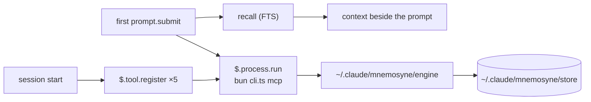

# Design

Everything below was probed on 2026-10-16 against a real install, not read off a
page. Commands that produced each finding are noted where they can be
reproduced. `v0.1.0` implements it; §5 records the decisions taken.

---

## 1. What the Mnemosyne Memory engine is, and what it costs to depend on

[`@oh-my-pi/pi-mnemopi`](https://www.npmjs.com/package/@oh-my-pi/pi-mnemopi) —
MIT, ~153K weekly downloads, source at
[`can1357/oh-my-pi` → `packages/mnemopi`](https://github.com/can1357/oh-my-pi/tree/main/packages/mnemopi).
It is a package inside the oh-my-pi monorepo, published independently, so it can
be consumed on its own.

Do not confuse it with
[`mnemosyne-oss/pi-mnemosyne`](https://github.com/mnemosyne-oss/pi-mnemosyne) —
that is a different thing: a Pi extension that shells out to the Python CLI.
The lineage is:

```
mnemosyne (Python, upstream engine)
   ├── pi-mnemopi    (Bun/TS port, inside the oh-my-pi monorepo)  ← this plugin's backend
   └── pi-mnemosyne  (Pi extension, spawns the Python CLI)
```

## 2. Constraints, with evidence

### 2.1 Bun is mandatory

The package's `exports` map points `import` at `./src/index.ts`; `dist/` ships
`.d.ts` files only. There is no compiled JavaScript.

```
$ node …/@oh-my-pi/pi-mnemopi/src/cli.ts mcp
Error [ERR_UNSUPPORTED_NODE_MODULES_TYPE_STRIPPING]: Stripping types is
currently unsupported for files under node_modules
```

Under `bun` the same command answers:
`{"serverInfo":{"name":"mnemopi","version":"3.1.2"}}`.

This is the single hardest prerequisite. A consumer without `bun` cannot use
this plugin at all, so the implementing version must detect it and say so
rather than failing obscurely.

### 2.2 One request per process works

`mnemopi mcp` speaks MCP over stdio. A bare `tools/call` — **no `initialize`
handshake** — is answered, and a single call costs **0.57 s** measured
end-to-end:

```
$ printf '%s\n' '{"jsonrpc":"2.0","id":1,"method":"tools/call",
  "params":{"name":"mnemopi_recall","arguments":{"query":"ponytail","limit":3}}}' \
  | MNEMOPI_NO_EMBEDDINGS=1 bun …/cli.ts mcp
```

The mods API's `$.process.run` accepts `stdin`, so a hook can run one process
per call. **No long-lived server, no port, no MCP approval prompt.** 0.57 s is
affordable once per conversation and not per turn.

### 2.3 The data dir must be set explicitly

The engine's built-in default is `~/.hermes/mnemopi/data`
(`packages/mnemopi/src/config.ts`). The plugin always sets `MNEMOPI_DATA_DIR`
to its own store, `~/.claude/mnemosyne/store` by default.

Verified with a throwaway `HOME`: a remember wrote only to `MNEMOPI_DATA_DIR`
(plus bun's own cache under `~/Library/Caches/bun`). Nothing under `~/.omp` or
`~/.hermes`. An end-to-end run left the other installation's `mnemopi.db*` mtimes and sizes
unchanged.

### 2.4 Scoping silently returns zero hits — the trap

This is the one that cost the most time and would have shipped as a bug.

`recall` narrows rows by
`(session_id = ? OR scope = 'global' OR channel_id = ?)`
(`core/beam/recall.ts`). Other writers set `session_id = channel_id = <bank>`.
The MCP server defaults its session id to `mcp_<bank>`, which matches neither —
so a naive recall against a populated bank returns **`count: 0`**, with no
error.

Passing the bank on **both** `MNEMOPI_SESSION_ID` and `MNEMOPI_CHANNEL_ID`
returns real hits. Verified against the live `matrixkoder-mk-5` bank:
2 hits for `"mk-builder connect"` with the channel set, **0 without**.

Every call this plugin makes therefore carries both variables. This is not a
tuning detail; it is the difference between working and silently empty.

### 2.5 Embeddings must be off in a spawned process

With fastembed enabled, both the CLI and the MCP server died repeatedly with a
Bun C++ panic when spawned as a standalone process. With
`MNEMOPI_NO_EMBEDDINGS=1` everything is stable.

Sessions of other hosts are unaffected: they attach to a detached embedding server at
`~/.omp/run/mnemopi/`. A spawned CLI does
not, and loads fastembed in-process.

**Consequence: recall from this plugin is FTS-only.** Vector recall stays with
the other hosts. If that is unacceptable, the fix is to talk to their embed server, which is
a larger piece of work and not in scope.

### 2.6 One engine only — keep the TypeScript one

The Python engine (`pip install mnemosyne-memory`) **can read** the
TS-written store: opening the live `matrixkoder-mk-5` bank with
`BeamMemory(session_id=<bank>, channel_id=<bank>)` returned 3/3/1 hits for three
queries. An earlier reading of "incompatible" was wrong — it was the same
scoping trap as §2.4.

But **writes diverge**: the TS engine writes 768-dim vectors, Python defaults to
384, and a Python backfill failed with
`Dimension mismatch … Expected 384 dimensions but received 768`.

So: **one writer, the TypeScript engine.** A second writer on the same file
would corrupt the vector index.

## 3. Where memory lives

The plugin keeps its own engine and store, separate from any other installation, so the two never
share a writer (§2.6) and an upgrade elsewhere cannot change the engine under it.
`/mnemosyne-setup` installs the plugin's own engine copy (§3.1) into
`~/.claude/mnemosyne/engine/`. Each call is one `bun <cli> mcp` process:



### 3.1 The engine lives in the repo: engine/ and UPSTREAM.md (v0.5.0)

Upstream's `mnemopi_update` changes only content and importance, and its recall
always bumps `recall_count`. Tagging an existing memory needs a metadata update,
and a dashboard search must not change counts, so the engine source is now part
of the plugin:

- `engine/` is the npm tarball of `@oh-my-pi/pi-mnemopi` 18.12.3, copied in
  whole (`src/`, `dist/types/`, `package.json`, `LICENSE`, `README.md`,
  `CHANGELOG.md`, `THIRD-PARTY-NOTICES.txt`). Its four `@oh-my-pi`
  dependencies stay npm downloads pinned at exactly 18.12.3.
- `engine/UPSTREAM.md` is the registry: upstream repo and path
  (`can1357/oh-my-pi`, `packages/mnemopi`), tag `v18.12.3` and its commit, the
  tarball URL and sha512 integrity, a numbered list of our changes (what, why,
  files, upstream issue, status), the `engine/src` sha256 of each build, and
  the rebase steps. Today: change 1, `mnemopi_update` shallow-merges a
  `metadata` object in one `BEGIN IMMEDIATE` transaction (a key set to `null`
  is removed; a row whose `metadata_json` is not an object is refused and left
  unchanged); change 2, `mnemopi_recall` takes `update_recall_counts`
  (default true); change 3, the build number (`18.12.3-mnemosyne.2`) in
  `engine/package.json`.
- `bun scripts/engine-diff.ts` downloads the tarball, checks its integrity, and
  fails unless every file that differs from `engine/` is listed in a change and
  the recorded `engine/src` hash for the current build is the real one. So an
  unlisted edit, or an edit without a build bump, fails the gate.
- Our engine tests are `engine/test/*.spec.ts` (real temporary stores, real
  engine processes, including two processes merging metadata into one row at
  once). `engine/` is not type-checked by us: upstream checks it with its
  monorepo setup, which the tarball lacks.
- `/mnemosyne-setup` runs `bin/install-engine.ts <plugin root> <engine dir>
  <store>`. It builds `<engine dir>.next` (the copy as `pi-mnemopi/`, a
  `package.json` with `file:./pi-mnemopi`, `bun install --production
  --omit=peer`, since Bun would otherwise install the folder's dev and optional
  peer dependencies, onnxruntime included), checks that the new cli answers
  `tools/list` with the metadata-capable `mnemopi_update`, and only then
  renames the old engine to `.old`, the new one into place, and deletes
  `.old`. Any failure deletes `.next` and leaves the installed engine as it
  was; a test proves it with an unreachable registry. It writes nothing outside
  those three folders and refuses a store inside them, comparing real paths
  (the nearest existing parent through `realpathSync.native`, symlinks
  followed, case-folded on macOS and Windows); `paths()` also refuses a
  `memoryDir` inside `<root>/engine`, `.next` or `.old`, ignoring case. The
  staged install has no lockfile (Bun saves none under `--production`): the
  four `@oh-my-pi` packages are pinned at 18.12.3, their own dependencies
  resolve fresh at each setup, through Bun's global cache or the registry.
  The installer's own limits (240 s install, 30 s check) stay below the
  host's 300 s limit on setup (`hooks/engine-build.ts`). The cli path is
  unchanged: `<engine dir>/node_modules/@oh-my-pi/pi-mnemopi/src/cli.ts`.
- `ENGINE_BUILD` (`hooks/engine-build.ts`, no imports) equals
  `engine/package.json`'s version; a Bun spec fails when they differ.
  `isCurrent` in `register.ts` reads the installed engine's `package.json` with
  `$.fs.read` and compares. Session start with a stale engine shows a toast
  asking for `/mnemosyne-setup`; it does not reinstall on its own (an install
  can take minutes and needs the network). The four older tools keep working
  on a stale engine; `memory_update` refuses, and so does the proxy (§5.8).

### 3.2 The activity log: activity.jsonl (v0.5.0)

Every memory call the plugin makes, and every call through the external MCP
proxy, adds one JSON line to `~/.claude/mnemosyne/activity.jsonl` (`paths()`
gives it as `activity`, `<root>/activity.jsonl`). The dashboard reads it.

- A line: `t` (ISO time), `action` (recall, remember, update, forget, stats,
  rearm), `origin` (hook = first-prompt recall or compaction, trigger = a
  recall or remember term, tool = Claude's tool call, external = the proxy,
  ui = a dashboard search or forget, backfill = `/mnemosyne-tags apply`), `owner`, `text`, `ids`, `count`, `ok`, and
  `error` only when not ok. `ids` holds at most 50; `count` is the full
  number. `hooks/activity-log.ts` builds it and imports nothing, so the hooks,
  the proxy and the server build the same line.
- `text` is the query (as the engine gets it, 300 characters at most), the
  fact, or what an update sets (`tags: a, b`, cleaned as the engine gets
  them). It is cut to 2000 code points (dropping the cut word, so no half
  secret is left), then secret shapes are replaced by `[redacted]`, then it is
  cut to 200 code points. Redaction is pattern-based, so a secret of an
  unknown shape, or a short unnamed one, can get through. It covers API keys
  and tokens by prefix, JWTs, private key blocks, Slack and Discord webhook
  URLs, `scheme://user:password@` (spaces in the password too), `password=`,
  `token:` or `"api_key": "…"` values (quoted values up to the closing
  quote), `password is …` phrases, Bearer values, hex runs of 32+, and
  letter-and-digit runs of 32+ that are not paths (a run with `+` or a
  trailing `=` counts as base64 whatever its slashes). Every pattern that can
  backtrack is bounded: 100 KB and 200 KB inputs redact in a few ms (kit
  test, under 200 ms). A forget logs only the id, in `ids`. A remember term
  logs a `remember`/`trigger` line, and Claude's save that follows logs its
  own `remember`/`tool` line. A `memory_*` tool outside the five is not
  logged.
- The writer is `bin/activity.ts`: `appendActivity(path, lines)` for Bun code,
  or `bun bin/activity.ts <path>` with the lines on stdin. It writes only a
  file whose name ends in `.jsonl`. It creates the folder 0700 and sets the
  file to 0600 at every open, and the backup too (no chmod on Windows), writes
  the batch in one `O_APPEND` write, and drops anything that is not one JSON
  object. Past 1 MB it renames the file to `activity.jsonl.1` (one backup);
  only a writer that creates `activity.jsonl.lock` with `O_EXCL` rotates, and
  it checks the size again under the lock, so two writers rotate once. A lock
  older than 10 s is taken over: the taker first renames it to a name of its
  own, so of two takers only one rename succeeds; if what it renamed turns out
  fresh (another writer had just taken the lock), it links it back and does
  not rotate. A third writer arriving inside that microsecond gap could still
  hold a lock beside another; the size check under the lock keeps even that
  to one rotation unless both check before either renames. That race is not
  tested (it cannot be forced from one process). A line that races a rotation
  lands in `.1`. It never throws, and the script always exits 0 and stops
  itself after 5 s.
- A hook cannot append to a file (`$.fs` has no append, mode or rename), so
  each memory event starts one short Bun process for its lines. The hook waits
  for the paths only (host calls), never for the write; an append that hangs or
  fails leaves the hook's result unchanged (kit tests for both). Measured on an
  Apple M4 with Bun 1.4.3 (40 runs after 3 warm-ups, one line on stdin): one
  append process takes 11 ms wall time at the median (8 ms min, 12–21 ms p90).
  It runs beside the hook, so a prompt or tool call does not wait for it.
- How the hook hands the lines over is `APPEND_MODES` in `hooks/register.ts`:
  - `spawn` (default): a `$.process.spawn` loop drained in a detached task;
    the script's own 5 s cap bounds it.
  - `run`: `$.process.run` with a 5 s timeout, not awaited.
  - `await`: `$.process.run` awaited, capped at 1 s (the hook waits ~11 ms).
  `spawn` is the default (orchestrator decision, 2026-10-23, review r1 MED 2)
  because the plugin API's types document that a spawned child's loop runs on
  after the hook returns ("nothing else does, a hook's return included"),
  while they say nothing either way about an un-awaited `run`. The live check
  (plan LOG.5) has not run yet; it confirms the choice. Caveat: `session.end`
  has a 1.5 s bound and aborts any `$` call still in flight, and leaving the
  loop or the module unloading kills a spawned child, so an append started in
  the last moments of a session can be lost. The hooks that log (prompt, tool
  call, compaction) do not run at session end, so this is a narrow window. To
  switch, start Claude Code with `MNEMOSYNE_ACTIVITY_APPEND=run` (or `await`)
  in its environment; to change the default, edit `DEFAULT_APPEND` in
  `hooks/register.ts` and record the result here.
- The proxy imports `appendActivity` and writes synchronously, so every line is
  on disk before it exits. It keeps the calls it sent by JSON-RPC id and writes
  the line when the reply comes back (ok, ids and count read from it); a call
  it refuses (stale engine, bad tags) is logged at once with `ok: false`; a
  tool outside the five is not a memory call and is not logged; a call the
  engine never answered is logged as failed at exit. The wrapper passes the
  path as `MNEMOSYNE_ACTIVITY_LOG`, empty when the log is off; a log failure
  never changes what the client receives (Bun test).
- The `activityLog` setting (`on` by default, or `off`) turns it all off: the
  hooks read it on each call, and the wrapper is rewritten at session start,
  so the proxy follows from the next session.

### 3.3 The dashboard server: /mnemosyne-ui (v0.5.0)

`/mnemosyne-ui` starts one local web server for the dashboard, or reuses the
one running, and hands its link over without writing the token into the
transcript. It is the plan's main exposure (a network port), so each guard
below has a Bun test in `tests/bun/ui-server.spec.ts` against the real server
and a temporary WAL store made by the real engine.

- Files: `ui/server.ts` (the server, Bun), `ui/index.html`, `ui/style.css` and
  `ui/app.ts` (the page; `app.ts` is built by `Bun.build` into memory at server
  start and served as `/app.js`), `hooks/ui-launch.ts` (the command's start,
  reuse, hand-over and stop), `hooks/engine.ts` (the engine call, shared).
- One engine-call module: `hooks/engine.ts` exports `buildRequests`,
  `engineEnv(store, owner)` and `parseReplies` and imports nothing (no
  `claude-code`, no Bun API), so the hooks run it through `$.process.run` and
  the server through `Bun.spawn` with its own environment and `engineEnv` laid
  over it. `engineEnv` is the one place the seven engine variables live
  (`MNEMOPI_DATA_DIR`, `SESSION_ID`, `CHANNEL_ID`, `NO_EMBEDDINGS` and the
  blanked `MCP_BANK`, `LLM_BASE_URL`, `HOST_LLM_ENABLED`). `paths()` stays in
  `register.ts`: the hook resolves root, store and cli and passes them to the
  server as `MNEMOSYNE_ROOT`, `MNEMOSYNE_STORE`, `MNEMOSYNE_CLI`,
  `MNEMOSYNE_ACTIVITY_LOG` (empty when the log is off) and
  `MNEMOSYNE_PLUGIN_ROOT`.
- Guards: it binds `127.0.0.1` only, on a port the OS picks. It makes a
  32-byte random token at each start. Every `/api` route wants
  `Authorization: Bearer <token>` (compared in constant time); no token, a
  wrong one, or the token only in the query string gets 401 and no data. A
  `Host` header other than `127.0.0.1:<port>` gets 403 on every route (DNS
  rebinding). Every reply, errors included, carries
  `Content-Security-Policy: default-src 'none'; script-src 'self'; style-src
  'self'; connect-src 'self'; img-src 'self' data:; base-uri 'none';
  form-action 'none'; frame-ancestors 'none'`, `Referrer-Policy: no-referrer`
  and `X-Content-Type-Options: nosniff`; the policy never gets an `unsafe-`
  keyword. No reply carries an `Access-Control-Allow-*` header, and OPTIONS
  gets 405. SQLite (`<store>/mnemopi.db`) is opened read-only with
  `query_only` on; every change goes through the engine. `/favicon.ico` is 204
  with no body. `/vendor/<name>` serves one plain `.js` file name from
  `ui/vendor/` as `text/javascript` (the folder's notices, inputs list, scan
  allowlist and types are not served), so `/vendor/../server.ts` and
  `/vendor/..%2fserver.ts` are 404; it serves only a regular file (never a
  link or a folder) whose real path is inside `ui/vendor/`. The page shell, script and style load
  without the token and hold no data. `ui/index.html` has no inline script or
  style and loads only same-origin files.
- Token flow: the server writes `<root>/ui.json` (`port`, `token`, `pid`) to a
  fresh 0600 file renamed into place, and prints one ready line with port and
  pid only. The hook reads the token from `ui.json` with `$.fs.read`, so the
  token never passes through spawn output. The link is
  `http://127.0.0.1:<port>/#token=<token>`: the fragment is never sent in a
  request. It goes to the clipboard with `$.ui.copy`; the toast says it was
  copied and shows the bare address; only when the clipboard did not take it
  does a toast (60 s) show the full link. The reply text and `$.ui.log` never
  hold the token. The page takes the token from the fragment, removes it from
  the address bar with `history.replaceState`, keeps it in the tab's
  `sessionStorage` for reloads, and sends it only as the Authorization header.
  What other code of the same user can see, within the same-user boundary:
  other plugins' hooks in the same session see the copied link (`ui.copy`),
  the ping's stdin (`process.run`) and `ui.json` (`fs.read`), and any process
  of this user can read `ui.json`. The browser keeps the first URL it opened,
  fragment and token included, in its history, even though the page removes
  it from the address bar; the token is worthless once that server stops.
- One shared server: a later call, in this session or another, reads
  `ui.json` and pings it with `bun ui/server.ts --ping <port> <pid>`
  (`$.process.run`, 3 s timeout, token on stdin, never on the command line).
  The ping never uses a proxy: the hook runs it with `NO_PROXY`/`no_proxy`
  set to `127.0.0.1` and every `HTTP(S)_PROXY`/`ALL_PROXY` variable blanked,
  and the ping drops them itself too (Bun's fetch otherwise sends even a
  127.0.0.1 request, token included, to `HTTP_PROXY`). It follows no redirect
  and counts only a 200 whose `pid` is the one `ui.json` names. If it answers
  (asked twice), the same link is handed over and nothing starts. If not, and
  the server is this session's own and its process still runs (`kill -0`), the
  same link is handed over with a note; nothing is killed for a missed ping.
  Otherwise a new server starts and replaces `ui.json`. If, once the new
  server is ready, `ui.json` names another server that answers (two starts at
  once), that one is handed over and the new one is stopped.
- Lifecycle. The host's `$.process.spawn` closes a child's stdin from the
  start (or after its `input`), so the server cannot be spawned directly with
  stdin as a pipe. The hook spawns `bun ui/server.ts --hold` instead: a small
  holder that starts the server with stdin as a pipe it keeps open and passes
  the server's output through. The spawn loop is the holder's life: the hook's
  `session.end` handler ends the loop of the session that started the server
  (any reason, `/clear` included), which kills the holder and so closes the
  server's stdin. Then, in case the host has not killed the holder, it also
  runs `kill <pid>` on the server (the ready line's pid; the holder exits with
  it). Waiting for the loop takes at most 0.6 s and the kill at most 0.5 s,
  inside the 1.5 s bound. Another session's
  end leaves it running; that session runs `/mnemosyne-ui` again after the
  starter ends to get a fresh one. Backstops, each with a Bun test: the server
  exits when its stdin closes, and both the holder and the server exit when
  their parent is gone (checked every 10 s; `MNEMOSYNE_UI_PARENT_CHECK_MS`
  sets it for tests, held to 100 ms - 10 s). On exit the server removes `ui.json` only while it
  still names its own pid. There is no stop command and no stop route.
- Before it starts anything the command checks Bun, an installed engine and a
  current one (`isCurrent`), and otherwise says to install Bun or run
  `/mnemosyne-setup`.

Manual check (plan SRV.4), in a real terminal session and in the desktop app:

1. Run `/mnemosyne-ui`. The reply and the toast show only
   `http://127.0.0.1:<port>/`. Paste the clipboard into a browser: the page
   shows the header, the owners with counts, the store path and "Connected to
   the local Mnemosyne server." Open the browser console: no error and no CSP
   violation.
2. After the page loads, the address bar shows no `#token=`. Reload: the page
   still works (the tab's sessionStorage). Open `http://127.0.0.1:<port>/`
   (no fragment) in a new tab: it says to open the link from /mnemosyne-ui and
   shows no data.
3. Search the transcript for the token (it is in `~/.claude/mnemosyne/ui.json`):
   `grep -c "$(bun -e "console.log(require(process.env.HOME + '/.claude/mnemosyne/ui.json').token)")" <transcript .jsonl>`
   finds 0.
4. Run `/mnemosyne-ui` again: the same address, nothing new starts
   (`lsof -nP -iTCP:<port> -sTCP:LISTEN` shows one `bun`).
5. `/clear` in the starting session: `lsof -nP -iTCP:<port> -sTCP:LISTEN`
   shows nothing and `~/.claude/mnemosyne/ui.json` is gone.
6. Run `/mnemosyne-ui` again, then exit the session: the same two checks show
   nothing.
7. Desktop app, two sessions A and B: start the server in A, run
   `/mnemosyne-ui` in B (same address). Close B: the port still listens. Close
   A: the port is gone and `ui.json` is gone.

Manual check of the four views (plan VIEW.5), in a browser, by the user or a
browser agent. The mockups to compare with are `Memories.dc.html`,
`Activity.dc.html` and `Search.dc.html` in the plan's design folder
(`~/.matrixkoder/projects/claude-mnemosyne/plans/mnemosyne-ui/assets/design/`).
Keep the browser console open throughout: no error and no CSP violation.

1. Run `/mnemosyne-ui` and open the copied link. The page opens on Memories:
   a table (Memory, Project, Tags, Saved, Recalls), "Showing N of M", and a
   detail panel saying "Pick a memory to see it in full." Compare layout,
   copy and colours with `Memories.dc.html` (the mockup's "Save tags" editor
   is not built: tags are shown read-only, editing is not in VIEW).
2. Choose a project in Project: only its rows stay and the count drops. Choose
   Sort "Most recalled": the row with the most recalls is first. Type a word in
   Filter: only rows holding it stay. Click a row (or Tab to it and press
   Enter): the panel shows the full text, Saved, Recalls, Last recalled,
   Source, Importance, Scope and Tags.
3. Activity tab: the Live badge shows "Live", the tiles count today's recalls,
   saves, updates and failures, and the list shows recent lines newest first.
   In Claude Code type a recall term (for example `recall: dashboard`): within
   about a second a new `recall` line with origin `trigger` appears at the top
   without a reload. Press Pause, make another call: nothing new shows; press
   Resume: it appears. Try each filter chip. Compare with `Activity.dc.html`.
4. Search tab: note one memory's Recalls in Memories first. Search a word from
   it with All projects: each hit appears once, with `#rank`, its project, a
   score bar and number, the matched words marked, tags and Open. Search again
   with one project chosen. Back in Memories (or press Open on the hit), the
   row's Recalls is unchanged. Activity shows one `recall` line with origin
   `dashboard` per search (an all-projects search shows "all projects (N)").
   While a search runs the Search button is disabled, and pressing Enter again
   starts nothing. Compare with `Search.dc.html`.
5. Markup stays text: in Claude Code ask it to remember the throwaway fact
   ` dashboard test` (owner global). Reload
   Memories: the row shows the characters `` as
   plain text, no image box, no alert. Open it: the same in the panel.
6. Forget with confirm: in that row's panel press "Forget…". The confirm says
   "Forget this memory for good? This cannot be undone." and names the
   memory's first line in quotes and its id. Press "Keep it": the confirm
   closes and the row is still in the table (reload to be sure). Press
   "Forget…" then "Forget": the status line says "Forgot memory <id>.", the row
   is gone from the table and the header count drops by one, and Activity
   shows a `forget` line with origin `dashboard`.
7. Open the bare address `http://127.0.0.1:<port>/` in a private window: it
   says to open the link from /mnemosyne-ui and shows no data.

### 3.4 Topic tags and /mnemosyne-tags (v0.5.0)

A memory's topics live in one place: `metadata.tags`, a list of short
lowercase strings cleaned by `hooks/tags.ts` (trimmed, lowercased, unique, at
most 5, each at most 24 characters). There is no side file of tags and no tag
text inside a memory. Tags are written only through the engine:
`memory_remember` takes `tags` for a new fact, and `memory_update` merges them
into an existing one (engine change 1, a shallow metadata merge in one
transaction; an empty list removes the key).

- New memories: the rules text asks Claude for 2 to 5 short topic tags with
  each fact it saves.
- Old memories: `/mnemosyne-tags` tags the existing ones once. With no
  argument it is a dry run: for each untagged memory it sends the memory's
  text (as quoted data, at most 4000 characters) to Haiku through
  `$.model.complete`, 4 calls at a time, and saves the proposals to
  `<root>/tags-proposed.json` (0600): id, owner, tags and a sha256 of the
  text, never the text. Nothing changes in the store. `/mnemosyne-tags apply`
  makes no model call: it re-reads each proposed row and writes only those
  that still exist, still have no tags and whose text hash is unchanged,
  through `mnemopi_update`, one engine process per owner. Each run says how
  many it skipped and why.
- Privacy: the dry run is the only step that sends memory text to a model;
  the user runs it on purpose and reads the proposals before `apply`.
- Files: `bin/memories.ts` (a read-only listing of the store for the
  backfill, which a hook cannot read, and the tag SQL the dashboard shares),
  `hooks/backfill.ts` (the pure parts: the prompt, reading the reply, the
  proposals file, the apply-time re-check and the worker pool; it imports only
  `hooks/tags.ts`), and the command in `hooks/register.ts`. `hooks/backfill.ts`
  was added in the TAGS phase although the plan's TAGS file list did not name
  it; it is recorded here so the file has an owner.
- "Untagged" means no non-empty text in `metadata.tags`: NULL, `{}`, broken
  JSON and `tags: []` all count, in the backfill, the Memories filter and the
  map alike (`untaggedSql()` in `bin/memories.ts`). A real tag named
  `untagged` is a tag like any other; only `untagged=1` asks for rows with none.

### 3.5 The 3D memory map (v0.5.0)

The Map tab draws the store as a 3D map on the `3d-force-graph` library
(three.js). It drills down one level at a time: all projects (an owner is a
project; a sphere's size follows its memory count) → one project's topics
(its tags, plus an Untagged group) orbiting it, with the other projects drawn
small aside → one topic's memories orbiting it, with the sibling topics small
aside → one memory in the inspector (its text, tags, recalls, saved date and
"Open in Memories"). A path bar goes back up and Reset view returns to All
memories. The look follows the plan's `design/Main.dc.html` mockup.

- Data: `GET /api/map` answers one level per call, through the read-only
  handle, with every value bound as a SQL parameter: no parameter gives the
  projects (id, label, count, recall total, newest saved date; the owner
  `global` is labelled Global); `?project=<owner>` that project's topics
  (tags grouped lower-cased, with counts) and one `Untagged` node when any
  memory has no tag; `?project=<owner>&tag=<t>` or `&untagged=1` that
  topic's memories (id, first line as label, at most 80 characters, tags,
  recall_count, timestamp; at most 500 per topic, newest first, with the
  topic's `total` and the `limit`, so the rail says "Showing 500 of N"). Tags
  are lower-cased by SQLite's `lower()` on both sides, when topics are
  grouped and when a topic's memories are asked for, so every topic finds its
  own memories (`lower()` folds ASCII only; a non-ASCII upper-case tag stays
  its own topic). `min_recalls` (digits
  only, else 400) drops memories below it at every level, and a project or
  topic left with none is omitted. An unknown project or tag is an empty list.
  Tested in `tests/bun/map-api.spec.ts` on a real store.
- Logic: `ui/map-state.ts` holds every rule with no DOM and no three.js, so
  `tests/bun/map-state.spec.ts` tests it directly: the levels, what each level
  draws and where (positions are fixed by the level, not by forces), the path
  bar, Reset view, auto-rotate (on at first, paused when the browser asks for
  reduced motion), colour-by (project, recalls or age), project toggles, the
  min-recalls slider (0 - 20), the rail list, the inspector, which request
  each level still needs, and `hasWebGL`. Sibling data comes from the cached
  reply of the level above; a reply the state no longer needs is dropped.
- The rail list is the keyboard and screen-reader route: it holds exactly the
  nodes drawn (the children first, then Other projects or Other topics, then
  In focus), and pressing an item is the same call as clicking its sphere.
  After a level change, focus moves to the list's heading and an aria-live
  region names the level and its count; a redraw keeps focus on the control
  that had it. Every rail control, the path bar, Reset view and the rotate
  button are buttons, checkboxes or a range input with visible focus.
- Labels are never HTML. The library's own tooltip renders HTML, so it is
  off: `nodeLabel(NO_TOOLTIP)` and `linkLabel(NO_TOOLTIP)`, a function
  returning an empty string, are the only label setters `ui/map.ts` calls (a
  spec holds this). Hover text goes into an app-owned element with
  `textContent`; 3D captions are drawn on a canvas by `three-spritetext`;
  `plainLabel` (`ui/escape.ts`) cuts a label and removes control and
  bidirectional-override characters, and never HTML-escapes, since nothing
  parses it.
- Loading: the page builds `ui/app.ts` with `ui/vendor/` kept external, and
  `ui/map.ts` loads `/vendor/map-lib.js` with `import()` only the first time
  the Map tab opens; the other tabs request nothing under `/vendor/`.
- Without WebGL: `hasWebGL` asks a fresh canvas for a `webgl2` context (three
  needs WebGL2). When it gets none, or when the graph constructor throws, the
  map area shows a plain message, the library is not loaded, and the rail
  list still drills down to the inspector.
- The page holds a token that can forget memories, and the map adds a
  third-party bundle, so the same CSP applies unchanged (no `'unsafe-*'`),
  the bundle is patched, scanned and pinned (below), and review depth is
  data-loss.

The vendored library (`ui/vendor/`, committed):

- `scripts/vendor-map.ts` runs one `Bun.build` at dev time over the pinned
  devDependencies `3d-force-graph` 1.80.1, `three` 0.186.1 and
  `three-spritetext` 1.10.0 into one minified ESM file, `ui/vendor/map-lib.js`,
  exporting `ForceGraph3D` and `SpriteText`. It fails when a patch does not
  match exactly as often as listed, when any package comes from two folders,
  or when three's core is not bundled exactly once. Beside it it writes
  `map-lib.d.ts` (the types of the surface `ui/map.ts` uses),
  `map-lib.inputs.json` (every bundled package with version and licence, the
  patches with the CSS they removed, the size and a sha256) and
  `THIRD-PARTY-NOTICES.txt` (each package's licence text). `bun
  scripts/vendor-map.ts --check` rebuilds in memory and fails when a
  committed file differs; `bun run test:bun` ends with it, so a hand edit of
  the bundle (even with `map-lib.inputs.json` edited to match) fails the
  suite.
- Measured (2026-10-23, Bun 1.4.3): map-lib.js is 816,677 bytes (797.5 KB),
  216,581 bytes gzipped, from 31 packages; three's core is about 0.69 MB of
  it. Bundled: 3d-force-graph 1.80.1, three 0.186.1, three-spritetext 1.10.0,
  three-forcegraph 1.43.6, three-render-objects 1.43.0, d3-force-3d 3.0.6,
  float-tooltip 1.7.5, kapsule 1.16.3, preact 10.29.8, polished 4.3.1,
  lodash-es 4.18.1, @tweenjs/tween.js 25.0.0, the ngraph packages and the
  d3 helpers; `map-lib.inputs.json` has the full list.
- Patches, applied by the build plugin as each source loads (ids as in
  `map-lib.inputs.json`):
  1. `no-style-3d-force-graph`, `no-style-three-render-objects`,
     `no-style-float-tooltip`: the style element injection is removed. Each
     of these three packages' `dist/*.mjs` calls `styleInject(css_248z)`,
     which creates a `<style>` element; the CSP refuses it, and copying the
     CSS would not make the injected element allowed. The call is replaced by
     a comment, so the bundle holds no `createElement('style')` at all, and
     the CSS each injected is in `ui/style.css` as shipped (a spec checks
     every selector is there).
  2. `tooltip-as-text` (float-tooltip): a string tooltip is set with
     `selection.text()`, not `selection.html()`. A second guard: the map's
     tooltip is always empty (`NO_TOOLTIP`).
  3. `no-webgpu` (three-render-objects): its import of `three/webgpu` (a
     second, 2.2 MB build of three's renderers) is replaced by a null
     constant. The map never asks for WebGPU, so the WebGL renderer is the
     one made, and three stays one copy.

#### Vendored code scan

`tests/bun/vendor-scan.spec.ts` scans every `ui/vendor/*.js` for
`createElement('style')`, `styleInject`, `setAttribute('style')`, `eval(`,
`new Function`, `Function(`, `new Worker`, `createObjectURL`,
`importScripts`, `innerHTML`, `fetch(`, `import(` and every `http(s)://`
literal, and each count
must equal `ui/vendor/scan-allow.json`, where every entry says why the hit is
inert. A new hit, or a count that moves, fails until it is reviewed there. The
reviewed hits of map-lib.js:

1. `Function(` ×7: six are ngraph.forcelayout's code generators (`new
   Function` in its source; the minifier drops the `new`), which run only
   when `forceEngine` is `'ngraph'`; `ui/map.ts` sets `forceEngine('d3')`.
   The seventh is lodash's global lookup, reached only when neither `global`
   nor `self` exists, never in a browser. A static hit is judged by the
   runtime: if one ran, the CSP would refuse it and the console would show it
   (MAP.4 checks the console).
2. `innerHTML` ×9: d3-selection's `html()` (its only caller is patched to
   `text()`), preact's `dangerouslySetInnerHTML` handling (preact renders only
   React elements given to the tooltip, which the map never gives), and two
   `domNode.innerHTML = ''` that clear the map's own container.
3. `fetch(` ×1: three-forcegraph's `jsonUrl` property, which fetches graph
   data from a URL when set. `ui/map.ts` never sets it (it passes
   `graphData`), and the CSP's `connect-src 'self'` would allow only this
   server if it did. There is no `import(` in the bundle.
4. URL literals: XML namespace names (`http://www.w3.org/...`) used with
   `createElementNS`, a citation inside a three.js shader comment, and
   polished's error message text. None is fetched; the CSP's `connect-src
   'self'` would refuse any that were.

A headless Chrome run of the real server on a temporary store (MAP build,
2026-10-23) loaded the map, drilled down through the rail and by Enter, and
logged no CSP violation, while a deliberately injected `<style>` in the same
page was logged as refused (a control that the logging works). That run is
evidence for this build, not a substitute for the manual check below.

Manual check of the Map tab (plan MAP.4), by the user, with the browser's
network panel and console open, against `Main.dc.html` in the plan's design
folder:

1. Open the dashboard on Memories: the network panel shows no request under
   `/vendor/`. Open Map: `map-lib.js` loads once (switching tabs does not load
   it again). Turn the network off and repeat the clicks below: no failed
   request and no CSP violation.
2. Click a project: it moves to the centre, its topics orbit it and the other
   projects shrink aside; the path bar reads All memories › project. Click a
   topic: its memories orbit it. Click a memory: the inspector shows its text,
   tags, recalls and saved date; "Open in Memories" opens it in the Memories
   view. Go back with the path bar, then Reset view.
3. Keyboard only: Tab through colour-by, the project toggles, the rail list,
   the slider, the path bar, Reset view and the rotate button; each shows
   focus. Enter on a rail item drills in, focus moves to the list heading, and
   a screen reader announces the level.
4. Turn Auto-rotate off and on again (one label; its pressed state shows
   whether it is on), change colour-by, hide a project, move the
   min-recalls slider: the map changes at once.
5. A memory holding `` shows those characters as
   text in the hover text, the rail list and the inspector.
6. Firefox with `webgl.disabled = true` in `about:config` (or Chrome started
   with `--disable-3d-apis`): the map area says the map needs WebGL, and the
   rail list still drills down to the inspector.
7. With the system's reduce-motion setting on, the map opens with rotation
   off: the Auto-rotate button is not pressed.

### 3.6 Release check (MAP.6)

`claude plugin validate .` does not apply the plugin directory's own code
rules, and 0.5.0 adds about 2 MB of engine source and the 800 KB map bundle.
Before 0.5.0 ships, the user runs `claude plugin validate --profile directory
.` and the developer portal's own check on the 0.5.0 tree, and records each
finding here, fixed or explained.

Builder's run (2026-10-23, MAP build; not the user's sign-off):
`claude plugin validate --profile directory .` exits 0 ("Validation
passed") with one directory warning, `ICON_MISSING` (no
`.claude-plugin/icon.png`; the portal takes the icon only the first time the
plugin is saved there, so adding one is the user's choice before
submitting). Its report says it does not run the directory's safety scan
and policy review, nor check code loaded through `hooks.json` modules. The
portal's own check was not run. (The first run also listed the
`mnemosyne-tags` command hook as a gating hook without `.catch`; it now has
one, returning "Mnemosyne: the tag backfill failed.", and the rerun lists it
with `.catch`.)

## 4. Why a plugin, and why mod tools rather than an MCP server

A skill cannot do this. A skill loads when invoked or when the model decides it
is relevant; it cannot inject context at session start and cannot capture turns.

| Mechanism | Inject at session start | Capture turns | Bundle tools |
|---|---|---|---|
| Skill | ✗ | ✗ | ✗ |
| Settings-file hooks | ✓ | ✓ | needs separate `claude mcp add` |
| **Plugin** | ✓ | ✓ | ✓ |

**Mod-registered tools, not a bundled MCP server.** A server declared in
`mcpServers` or `.mcp.json` loads **whenever the plugin is enabled**. There is no
conditional inclusion, and `${user_config.*}` substitutes into `env`/`args`
only. So a bundled server **cannot be gated on a user's choice** — which
defeats the entire point of an opt-in memory.

`$.tool.register` is code, so the plugin's own enable switch gates everything;
no separate `memory` key is needed.

### 4.1 Two registration rules the engine enforces

Learned by hitting both errors:

- The engine **rejects a second bare `on('session.start')`** in a second module:
  *"on("session.start") is registered twice without a matcher"*. Existing hook
  modules already work around this — `tools.ts` and `wake.ts` register with
  `{ cwd: /.*/ }`.
- Same for `tool.call`. A new module needs a matcher on both:
  `{ cwd: /.*/ }` and `{ tool: /^mcp__mnemosyne__memory_/ }`.

## 5. Decisions (2026-10-16)

Terms: the engine's *bank* is always `default` (`<store>/mnemopi.db`). What
this plugin varies is the row's *owner*, its `session_id`, set from
`MNEMOPI_SESSION_ID` (`MNEMOPI_CHANNEL_ID` carries the same value; for this
plugin's own rows the session id alone suffices, the channel matters only for
rows written elsewhere, §2.4).

1. **Scope: the user picks at install.** `userConfig.scope` is `global` (owner
   `global`, every row `scope: 'global'`) or `per-project` (owner
   `project-<repo name>-<hash of git root>`, rows `scope: 'channel'`;
   `memory_remember` with `global: true` writes `scope: 'global'`, which every
   owner recalls). Forget deletes `WHERE id = ? AND session_id = ?`, so recall
   reports each row's owner and `memory_forget` takes it.
2. **Retain only explicit `memory_remember` calls**, written with
   `source: 'imported'`. Any other source lands as trust tier STATED, and every
   remember runs `trimWorkingMemory` (`core/beam/store.ts`), which deletes
   unconsolidated STATED rows older than 24 hours (hard-coded
   `workingMemoryTtlHours`) or past 1000 per owner. IMPORTED rows are never
   trimmed. Verified: a row backdated weeks survived 5 more remembers in 3 of 3
   scratch runs as IMPORTED; as STATED it was gone after one. Recall weight is
   keyed on `veracity`, not trust tier, so it is unchanged.
3. **Recall once per session**, on the first non-command prompt, as
   `prompt.submit` context: that message never changes, so the prompt cache
   holds. `prompt.context` was not used: it fires before any prompt text
   exists to query with. The once-only mark lives in `$.state`. The engine
   drops a row matching under ~22% of the query's words (`minimumRelevance`,
   `core/beam/recall.ts`), so a whole long prompt recalls nothing; the plugin
   sends one recall per sentence (up to 4) to a single engine process and
   merges by id.
   After a main-conversation compaction (not skipped, not a subagent's) the
   once-only mark is cleared, so the next prompt recalls again (a `precompute`
   is left alone: it installs nothing until a real compaction); `/clear` needs
   nothing, since it starts a new session id.
4. **`memoryDir` stays configurable**, defaulting to the plugin's own store. It
   must be absolute or `~/…`, and is refused inside `~/.omp`.

5. **Steering without a skill (2026-10-16, v0.2.0).** A skill loads only when
   the model picks it, which is the judgement being backed up, so instead:
   - `prompt.compose` appends one fixed section, `mnemosyne:rules`, last on the
     `session` side (fixed text: the prompt cache holds). Skipped under the
     `bare` trait and when the request does not offer the memory tools.
   - `prompt.submit` matches configurable `rememberTerms` / `recallTerms`
     (`userConfig` `string` + `multiple`) at the start of prompts a person typed
     (origin `composer`, `bridge`, `sdk`, `slack-ping`), as whole words. A
     remember term attaches a directive and the model calls `memory_remember`
     once: the hook never writes raw text, so wording and the never-secrets
     rule apply. A recall term recalls the first sentence after it, on that
     prompt only.
   Reviewed by a Fable consult; a manual `/mnemosyne` skill is deferred until
   there is a store worth curating.

6. **External clients get four tools only (v0.4.0).** `externalMcp`'s wrapper
   runs `bin/mcp-proxy.ts`, which lists and serves only
   `memory_remember/recall/forget/stats` (mapped to the engine's
   `mnemopi_*`) and pins remember to
   `source: 'imported'`. The engine's other tools were verified harmful for
   this store: `mnemopi_sleep` widens a project's `channel` facts to `global`
   when a chunk holds one global row, and leaves episodes that `forget` cannot
   remove; `mnemopi_get` reads any owner's row; `mnemopi_export` writes every
   owner to any path; `mnemopi_shared_*` writes STATED rows the 24h trim
   deletes. Every engine run also blanks `MNEMOPI_LLM_BASE_URL` and
   `MNEMOPI_HOST_LLM_ENABLED`: the env is layered over the host's, and either
   would let fact extraction call out.

7. **Visible activity (v0.4.7).** Hooks run silently, so the person never saw
   them fire. `activity()` calls `$.ui.log` (a dim transcript line) and
   `$.ui.status` (one line under the prompt); both are UI only and never reach
   the model. It fires on: engine ready at `session.start`, a first-prompt or
   recall-term recall (with the count), a remember term matched, a compaction
   that re-arms recall, and a failed recall. `recall failed` is the engine call
   failing or every query erroring; `found nothing` is the engine answering
   with no match. The status line shows the last recall's result only, not a
   running total (a total would span `/clear` and sessions). Not on
   `prompt.compose` (runs on every request) or `tool.call` (already shown as a
   tool call). `session.start`
   adds no engine call for a memory count: the first one is awaited, and an
   engine run costs about 0.57 s. `userConfig.showActivity`: `on` (default,
   line and status), `status` (status only), `off`; unknown means `on`.

8. **memory_update, and five external tools (v0.5.0).** A fifth tool,
   `memory_update`, changes a memory in place: `content`, `importance` (clamped
   to 0..1) or `tags`, by `memory_id` and `owner` (it runs as the row's owner,
   like forget). Tags are cleaned by `hooks/tags.ts` (no imports: trimmed,
   lowercased, unique, at most 5 of at most 24 characters) and sent as
   `metadata.tags`; `[]` sends `tags: null`, which removes the key. With none of
   content, importance and tags, or tags that are not an array, it is denied
   before any engine run; on a stale engine it is denied with a message to run
   `/mnemosyne-setup`. The rules text now says to update a fact by id and
   owner, to forget only to delete, and never to save a duplicate. The proxy
   (§5.6) serves `memory_update` too, so `tools/list` holds five tools; it
   drops `bank` and `metadata` from every client call (a client `bank` would
   move writes to `<store>/banks/<x>`), maps a cleaned `tags` array to
   `metadata.tags` for remember and update, shows `tags` (never `metadata` or
   `bank`) in the schemas, and refuses `memory_update` when the installed
   engine's version is not `ENGINE_BUILD`. See engine/UPSTREAM.md for the
   engine side.

## 6. What the matrixkoder side needs (findings only)

Recorded because MatrixKoder is a listed consumer, not a dependency. Nothing here
is implemented in that repo.

- `userConfig` in `plugin.json` is handed to `register(on, options)` and persists
  under `pluginConfigs.<plugin>`. That is the right home for the switch.
- The `/mk setup` wizard is `WIZARD_STEPS` + a `Body()` switch + `Nav()`; its
  confirm step loops `$.config.set({ key, value })`.
- `hooks/settings-io.ts` resolves config keys **by suffix**, so new keys need no
  code change there.
- If the setting must reach MatrixKoder's Python CLIs, it needs a slot in
  `buildYaml()` (`hooks/wizard-core.ts`).
- Adding a wizard step invalidates three tests that pin the step count and the
  input-step range. That is expected maintenance, not a regression.

## 7. Provenance

Probes run against a real machine on 2026-10-16: `bun` 1.x, Node 24.13.0,
`pi-mnemopi` 18.11.0, a second installation using the same engine, and a live store of 8
banks. Claims marked *verified* were observed directly; the rest are marked as
inference where they appear. Re-probed on 2026-10-20 with `pi-mnemopi` 18.12.3:
remember, owner-scoped recall, owner-only forget and stats behave the same.
