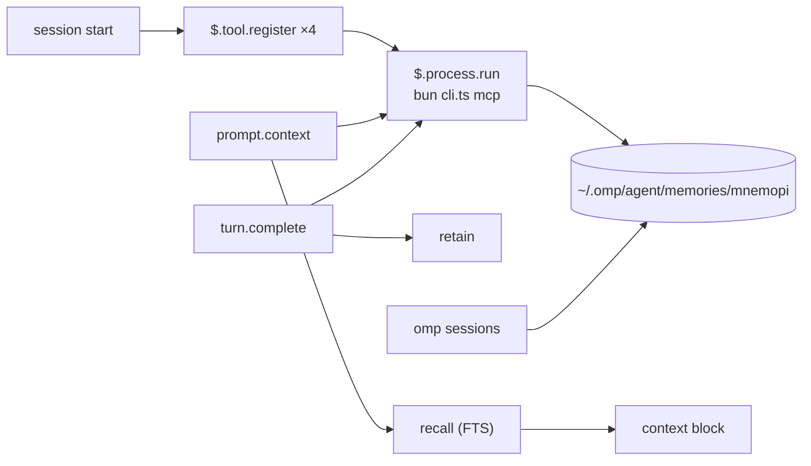

# Design

Everything below was probed on 2026-10-16 against a real install, not read off a
page. Commands that produced each finding are noted where they can be
reproduced. `v0.0.1` implements none of it.

---

## 1. What Mnemopi is, and what it costs to depend on

[`@oh-my-pi/pi-mnemopi`](https://www.npmjs.com/package/@oh-my-pi/pi-mnemopi) —
MIT, ~153K weekly downloads, source at
[`can1357/oh-my-pi` → `packages/mnemopi`](https://github.com/can1357/oh-my-pi/tree/main/packages/mnemopi).
It is a package inside the oh-my-pi monorepo, published independently, so it can
be consumed without installing omp.

Do not confuse it with
[`mnemosyne-oss/pi-mnemosyne`](https://github.com/mnemosyne-oss/pi-mnemosyne) —
that is a different thing: a Pi extension that shells out to the Python CLI.
The lineage is:

```
mnemosyne (Python, upstream engine)
   ├── pi-mnemopi    (Bun/TS port, inside the oh-my-pi monorepo)  ← this plugin's backend
   └── pi-mnemosyne  (Pi extension, spawns the Python CLI)
```

## 2. Constraints, with evidence

### 2.1 Bun is mandatory

The package's `exports` map points `import` at `./src/index.ts`; `dist/` ships
`.d.ts` files only. There is no compiled JavaScript.

```
$ node …/@oh-my-pi/pi-mnemopi/src/cli.ts mcp
Error [ERR_UNSUPPORTED_NODE_MODULES_TYPE_STRIPPING]: Stripping types is
currently unsupported for files under node_modules
```

Under `bun` the same command answers:
`{"serverInfo":{"name":"mnemopi","version":"3.1.2"}}`.

This is the single hardest prerequisite. A consumer without `bun` cannot use
this plugin at all, so the implementing version must detect it and say so
rather than failing obscurely.

### 2.2 One request per process works

`mnemopi mcp` speaks MCP over stdio. A bare `tools/call` — **no `initialize`
handshake** — is answered, and a single call costs **0.57 s** measured
end-to-end:

```
$ printf '%s\n' '{"jsonrpc":"2.0","id":1,"method":"tools/call",
  "params":{"name":"mnemopi_recall","arguments":{"query":"ponytail","limit":3}}}' \
  | MNEMOPI_NO_EMBEDDINGS=1 bun …/cli.ts mcp
```

The mods API's `$.process.run` accepts `stdin`, so a hook can run one process
per call. **No long-lived server, no port, no MCP approval prompt.** 0.57 s is
affordable once per conversation and not per turn.

### 2.3 The data dir must be set explicitly

Mnemopi's built-in default is `~/.hermes/mnemopi/data`
(`packages/mnemopi/src/config.ts`), which does not exist on a machine where
only omp has run. omp writes to `~/.omp/agent/memories/mnemopi/`. Without
`MNEMOPI_DATA_DIR` pointing there, the plugin reads an empty store and looks
broken.

### 2.4 Scoping silently returns zero hits — the trap

This is the one that cost the most time and would have shipped as a bug.

`recall` narrows rows by
`(session_id = ? OR scope = 'global' OR channel_id = ?)`
(`core/beam/recall.ts`). omp writes rows with `session_id = channel_id = <bank>`.
The MCP server defaults its session id to `mcp_<bank>`, which matches neither —
so a naive recall against a populated bank returns **`count: 0`**, with no
error.

Passing the bank on **both** `MNEMOPI_SESSION_ID` and `MNEMOPI_CHANNEL_ID`
returns real hits. Verified against the live `matrixkoder-mk-5` bank:
2 hits for `"mk-builder connect"` with the channel set, **0 without**.

Every call this plugin makes therefore carries both variables. This is not a
tuning detail; it is the difference between working and silently empty.

### 2.5 Embeddings must be off in a spawned process

With fastembed enabled, both the CLI and the MCP server died repeatedly with a
Bun C++ panic when spawned as a standalone process. With
`MNEMOPI_NO_EMBEDDINGS=1` everything is stable.

omp's own sessions are unaffected: they attach to a detached embedding server at
`~/.omp/run/mnemopi/` (`omp://mnemosyne-memory-backend.md`). A spawned CLI does
not, and loads fastembed in-process.

**Consequence: recall from this plugin is FTS-only.** Vector recall stays inside
omp. If that is unacceptable, the fix is to talk to omp's embed server, which is
a larger piece of work and not in scope.

### 2.6 One engine only — keep the TypeScript one

The Python engine (`pip install mnemosyne-memory`) **can read** the
TS-written store: opening the live `matrixkoder-mk-5` bank with
`BeamMemory(session_id=<bank>, channel_id=<bank>)` returned 3/3/1 hits for three
queries. An earlier reading of "incompatible" was wrong — it was the same
scoping trap as §2.4.

But **writes diverge**: the TS engine writes 768-dim vectors, Python defaults to
384, and a Python backfill failed with
`Dimension mismatch … Expected 384 dimensions but received 768`.

So: **one writer, the TypeScript engine.** A second writer on the same file
would corrupt the vector index.

## 3. Where memory lives

Each call is one `bun <cli> mcp` process:



## 4. Why a plugin, and why mod tools rather than an MCP server

A skill cannot do this. A skill loads when invoked or when the model decides it
is relevant; it cannot inject context at session start and cannot capture turns.

| Mechanism | Inject at session start | Capture turns | Bundle tools |
|---|---|---|---|
| Skill | ✗ | ✗ | ✗ |
| Settings-file hooks | ✓ | ✓ | needs separate `claude mcp add` |
| **Plugin** | ✓ | ✓ | ✓ |

**Mod-registered tools, not a bundled MCP server.** A server declared in
`mcpServers` or `.mcp.json` loads **whenever the plugin is enabled**. There is no
conditional inclusion, and `${user_config.*}` substitutes into `env`/`args`
only. So a bundled server **cannot be gated on a user's choice** — which
defeats the entire point of an opt-in memory.

`$.tool.register` is code, so it sits behind `if (options.memory !== true) return`
and costs nothing when off.

### 4.1 Two registration rules the engine enforces

Learned by hitting both errors:

- The engine **rejects a second bare `on('session.start')`** in a second module:
  *"on("session.start") is registered twice without a matcher"*. Existing hook
  modules already work around this — `tools.ts` and `wake.ts` register with
  `{ cwd: /.*/ }`.
- Same for `tool.call`. A new module needs a matcher on both:
  `{ cwd: /.*/ }` and `{ tool: /(^|__)memory_/ }`.

## 5. Open questions — settle before writing code

These change the design and are not obvious. **No answers yet.**

1. **Scope: one shared bank, or per-repo + shared?**
   `scope: 'global'` writes a row every bank can recall — verified: stored with
   `scope:"global"`, then recalled from a *different* session id in a different
   process. That gives literally one central memory, which is the stated goal.
   The cost is that the store has one retrieval budget for every project.
   The alternative (omp's `per-project-tagged`) layers a project bank under a
   shared one.

2. **What gets retained?** Every completed turn is the obvious rule and probably
   wrong: it drowns recall in transcript noise. Options: every turn;
   only turns that used tools; only explicit `memory_remember` calls.

3. **Recall cadence and prompt-cache stability.** A recall block that differs on
   every request invalidates the prompt cache. Once per conversation, keyed by a
   stable id, is the safe shape. Per-turn is not.

4. **Does `memoryDir` need to be configurable at all?** If the whole point is one
   shared store, a configurable path invites divergence. It is declared in the
   manifest for the wizard's benefit; it may be better to drop it.

## 6. What the matrixkoder side needs (findings only)

Recorded because MatrixKoder is a listed consumer, not a dependency. Nothing here
is implemented in that repo.

- `userConfig` in `plugin.json` is handed to `register(on, options)` and persists
  under `pluginConfigs.<plugin>`. That is the right home for the switch.
- The `/mk setup` wizard is `WIZARD_STEPS` + a `Body()` switch + `Nav()`; its
  confirm step loops `$.config.set({ key, value })`.
- `hooks/settings-io.ts` resolves config keys **by suffix**, so new keys need no
  code change there.
- If the setting must reach MatrixKoder's Python CLIs, it needs a slot in
  `buildYaml()` (`hooks/wizard-core.ts`).
- Adding a wizard step invalidates three tests that pin the step count and the
  input-step range. That is expected maintenance, not a regression.

## 7. Provenance

Probes run against a real machine on 2026-10-16: `bun` 1.x, Node 24.13.0,
`pi-mnemopi` 18.11.0, omp with `memory.backend: mnemopi`, and a live store of 8
banks. Claims marked *verified* were observed directly; the rest are marked as
inference where they appear.
