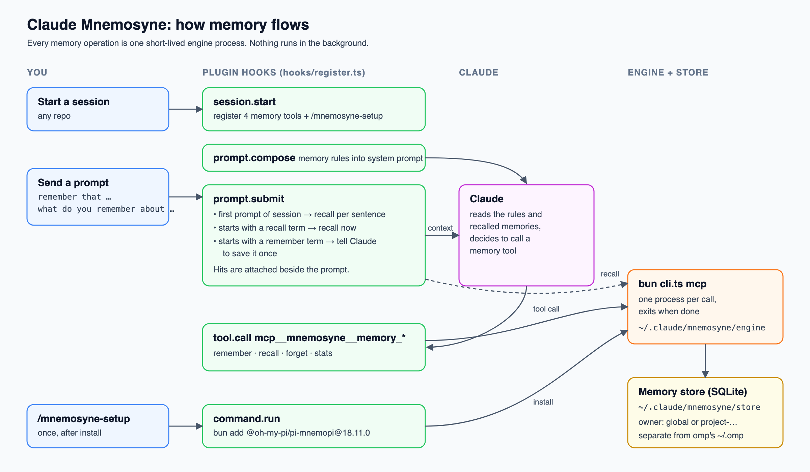

# Claude Mnemosyne

Long-term memory for Claude Code. A fact you save in one session is there in the next one, in any repo.



## Install

You need [Bun](https://bun.sh) on your `PATH`. At the prompt of a Claude Code session:

```
/plugin install mnemosyne --marketplace Interstellar-code/claude-mnemosyne
```

Or from a shell:

```sh
claude plugin install mnemosyne --marketplace Interstellar-code/claude-mnemosyne
```

Answer `y` to add the marketplace, then pick a scope (user scope for every project). The install then asks for the settings below; leave the empty ones empty. Claude Code's install screen shows values only for the scope picker and the on/off switch, so `/mnemosyne-setup` saves the defaults into any empty setting, and after a restart `/plugin` → Mnemosyne → configure shows them, ready to edit.

Works on macOS, Linux and Windows. On Windows, `~` means `%USERPROFILE%`.

> The marketplace install has not been tested end to end yet. Every test so far loaded the plugin from a checkout (`claude --plugin-dir <repo>`). If the install fails, use that instead and [open an issue](https://github.com/Interstellar-code/claude-mnemosyne/issues).

## Update

```sh
claude plugin update mnemosyne@mnemosyne
```

Restart Claude Code afterwards. The plugin carries its own copy of the engine; when an update brings a new engine build, session start shows a notice, and `/mnemosyne-setup` installs it. Until then recall, forget and stats keep working on the older engine, but saves and updates are refused with a message that asks for `/mnemosyne-setup` (see below).

After updating to 0.8.0, **run `/mnemosyne-setup` before you save anything**: it installs engine build `18.12.3-mnemosyne.10`. Until it has run, the plugin refuses `memory_remember` and `memory_update` with a message that names `/mnemosyne-setup`, and an outside agent's save through the MCP proxy is refused the same way. Nothing is lost by this: recall, forget and stats keep working on the older engine, and Claude can save again as soon as the setup is done. The refusal is there because the older engine's 24-hour trim deletes every memory that is not labelled `imported`, and 0.8.0 no longer labels saves that way (see [How long a memory lasts](#how-long-a-memory-lasts)); the same refusal applies when the installed engine's build cannot be read. After the setup, restart any other MCP client (Cursor, Codex) that uses the memory: its proxy read the old build when it started and keeps refusing saves until the client is restarted. The 0.8.0 changes that live in the engine need that build: the trim that spares durable memories by scope, the memory kind and expiry, the near-duplicate check, `replaces`, the audit trail and the first-writer rule. The same build carries what 0.7.0 added (the knowledge tools, local embeddings and `/mnemosyne-embed`); without it extraction, `/mnemosyne-knowledge` and the dashboard stay off and say so, and embeddings stay off (see [What 0.7.0 does not do yet](#what-070-does-not-do-yet)). Then, if you want meaning-based recall for the memories you already have, run `/mnemosyne-embed apply` (see [Embeddings](#embeddings-meaning-based-recall)). What changes for you in 0.8.0 is in [What 0.8.0 adds](#what-080-adds).

## Uninstall

```sh
claude plugin uninstall mnemosyne@mnemosyne
```

This leaves the engine and your memories in `~/.claude/mnemosyne/`. To delete them too (this erases every memory, permanently):

```sh
rm -rf ~/.claude/mnemosyne
```

## Setup

In a Claude Code session, run once:

```
/mnemosyne-setup
```

This installs the Mnemosyne Memory engine into `~/.claude/mnemosyne/engine/` (about 135 MB, and about 280 MB more when embeddings are on) and creates the store at `~/.claude/mnemosyne/store/`. The engine comes from the plugin's own copy (the `engine/` folder of this repo: the `@oh-my-pi/pi-mnemopi` 18.12.3 source with a few changes, listed in [engine/UPSTREAM.md](engine/UPSTREAM.md)); only its four `@oh-my-pi` dependencies are downloaded from npm. Setup builds the new engine next to the old one and swaps it in only once it answers, so a failed setup leaves the old engine working.

If you use the memory from other MCP clients (see below), restart them after setup: a client keeps the engine it started with, and an outside agent's proxy that started before the setup keeps refusing saves until its client is restarted.

## Use

| You type | What happens |
|---|---|
| `remember that we deploy on Fridays` | Claude saves the fact. |
| `what do you remember about deploys?` | Matching memories are looked up and shown to Claude. |
| the first prompt of a session, and the first after a compaction | Memories matching it are looked up automatically. |
| `we now deploy on Thursdays` | Claude updates the saved fact in place (`memory_update`). |
| `forget the memory about deploys` | Claude finds it and deletes it. |

Claude also saves and recalls on its own: lasting preferences, conventions, decisions. Each save names its kind and passes the [save guard](#the-save-guard). To change a fact, or give it topic tags or another kind, Claude updates it in place with `memory_update`; it keeps its id and recall history, and no duplicate is saved. A fact that replaces an older one is saved with `replaces` (see [Near-duplicates and replacing a memory](#near-duplicates-and-replacing-a-memory)).

With embeddings off, recall matches words, not meaning: "deploy Fridays" finds the fact above, "release schedule" does not. With embeddings on (see below), a memory can also be found by what it says.

## What 0.8.0 adds

0.8.0 is about what goes into the memory. Every save now passes one check, every memory says what kind it is and where it came from, project-state notes expire, and tags come from a shared vocabulary. **Run `/mnemosyne-setup` before you save anything after updating**: the changes below need engine build `18.12.3-mnemosyne.10`. Until you do, saves are refused, not lost: `memory_remember` and `memory_update` answer with a message that names `/mnemosyne-setup` (the same when the engine's build is missing or unreadable), outside agents get a JSON-RPC error (`-32000`) for the same calls, and recall, forget and stats keep working. The reason is that the older engine's 24-hour trim keeps only memories labelled `imported`, and 0.8.0 stops labelling saves that way (see [How long a memory lasts](#how-long-a-memory-lasts)), so a save made on the older engine would be deleted. Memories saved before the update carry the `imported` label and are safe. After the setup, restart your other MCP clients: a proxy that started before the setup keeps refusing until its client is restarted. Session start also shows a notice asking for the setup.

A save must name its kind: `memory_remember` (Claude's tool, and the MCP proxy for outside agents) refuses a call with no `kind` instead of storing it as `unknown`, and the refusal does not use up a remember phrase. See [Kinds](#kinds).

Dashboard writes (create, edit, retire and restore on the page), the Review queue's actions, importers for documents and past sessions, session summaries and the sweep that expires unused memories are not in 0.8.0; they are planned for 0.9.0 (see [What 0.8.0 does not do yet](#what-080-does-not-do-yet)).

### The save guard

Every save made through Claude (`memory_remember`, and `memory_update` when it changes the text) and every save from an outside agent (through the MCP proxy) is checked before it reaches the engine. Four rules:

| Rule | Looks for | What happens |
|---|---|---|
| G1 secret | an AWS key, GitHub token, `sk-` API key, Slack token, JWT, private key header, `Bearer` token, a URL with `user:password@`, or `password`, `secret`, `api_key` or `token` set to a value of 12 or more characters | refused, always |
| G2 size | empty text, or under 15 characters | refused, always |
| G2 size | over 4000 characters | refused, always |
| G2 size | over 1500 characters | warning |
| G3 near-duplicate | a stored memory that says almost the same (cosine score 0.88 or more) | warning |
| G4 chatter | text that reads like dated progress (a date next to `released`, `merged`, `done`, `next`, `overnight` or `round`, or the words `today`, `tonight`, `this session`) | warning |

The numbers in the table are the defaults; the size and near-duplicate limits, the chatter check and extra "never save" words can be changed in the Settings tab (see [Settings](#settings)). The secret rules and the empty-text block cannot.

A refusal or warning names the rule and says what to do; it never repeats the matched text. A secret refusal says to remove the credential and save the fact without it. A chatter warning suggests saving the note as kind `context`, which expires. Since 0.8.2 G4 is silent when the save names one of the kinds `context`, `event`, `instruction`, `preference` and `decision` (a text-only `memory_update` is checked with no kind, so pass the kind there too): a rule or decision often quotes the date it was made ("user 2026-10-13: ..."), and that is not progress chatter.

Settings → `guardMode` picks what a warning does:

1. `strict` (the default): the save is refused, with the rules named, until the same call is sent again with `confirm: true`. Claude does that only when the memory is wanted as it is.
2. `warn`: the save goes in at once, the rule ids are stored in the memory's metadata (`guard`), and the reply shows the warnings.

Secret and size refusals cannot be confirmed in either mode, and any other value of the setting counts as `strict`. A refused save does not use up a remember phrase, so the retry still counts as yours. An update that changes only tags, importance or kind is not checked, and a clean rewrite of a warned memory clears its flag.

G3 needs embeddings on (it asks the engine's local `mnemopi_similar` tool, which does not change any memory's recall count). With embeddings off, an engine that is not current, or any engine error, it says nothing and the save goes on. It applies to Claude's saves only: outside agents get G1, G2 and G4. Saving the same text again is the engine's own duplicate check (one row, no warning), not a near-duplicate; and a text that is already stored by a different owner counts as a near-duplicate. When Claude is told about a near-duplicate it is asked to update that memory (`memory_update` with the id and owner shown) or to save the new one with `replaces`.

The refusals show in the activity log as a failed call with the rule ids and no text.

The rules are patterns, not understanding. An unusual secret can pass, and some prose is refused: a note such as `token: refreshAccessToken is the function that rotates it` looks like a secret assignment to G1, and a plain sentence with `today` saved as a fact warns under G4. Memories saved before 0.8.0 are not checked again. To see what the guard would say about your own store, run `bun bin/guard-audit.ts --store ~/.claude/mnemosyne/store` from the plugin folder: it opens the database read-only and prints counts per rule (G1, G2, G4) and per verdict, never a memory's text, id or owner. It reads each memory's kind, so G4 counts match what a save of that memory would get.

### Kinds

A save names what kind of memory it is (`kind`). The rules text Claude gets asks for it, and outside agents see the same `kind` argument.

| Kind | Plain label |
|---|---|
| `fact` | fact |
| `preference` | preference |
| `instruction` | rule or runbook |
| `decision` | decision |
| `context` | project state |
| `error` | bug note |
| `artifact` | reference |
| `event` | session summary |

A save with no kind is refused (`memory_remember` and an outside agent's save alike; the reply names the eight kinds and nothing is stored), as is a kind that is not in the list; `memory_update` needs no kind. Memories saved before 0.8.0 stay `unknown`. `memory_update` can change a kind. The kinds `fact`, `preference`, `instruction` and `decision` are protected: saving the same text again never relabels them or gives them an expiry.

### Where a memory comes from

Since 0.8.0 a save says honestly who wrote it and through what. The engine's `source`, `trust_tier` and `veracity` fields are filled per write path:

| Path | source | trust tier | veracity |
|---|---|---|---|
| Claude saves on its own | `claude-code` | `DERIVED` | `unknown` |
| You, with a remember phrase | `user` | `STATED` | `stated` |
| An outside agent through the proxy | `mcp:<client name>` | `EXTERNAL_WRITE` | `unknown` |

Memories saved before 0.8.0 keep `source` `imported` (that was the only label the old trim allowed); they are not relabelled, and a later retag changes tags and, where the kind is `unknown`, the kind, nothing else. An outside agent cannot set its own trust tier, veracity or a `valid_until` date (the proxy drops them); it can ask for an expiry with `expires_in_days` (1 to 365) on a save. The dashboard and the importers will add rows for their own paths in 0.9.0.

If the same text is saved again, the first writer's `source` and trust tier stay (and the first author and veracity, as before); the scope only widens, and a protected kind keeps its kind. So a fact you stated and an agent later repeats still reads as yours. The reverse also holds: if Claude saved a sentence first and you later say it with a remember phrase, the row keeps `claude-code` and `DERIVED` and only its veracity moves to `stated`.

### How long a memory lasts

1. **Trim by scope.** The engine used to delete any memory not labelled `imported` after 24 hours (or past 1000 per owner). That is why every save used to carry that label. Now the trim only touches memories whose scope is `session`. The plugin always saves with scope `global` (or `channel` in per-project mode), so none of its saves is trimmed, and each can carry its true source. A memory with no scope is also spared.
2. **Project state expires.** A `context` note gets an expiry 14 days after the save (`expiry.contextDays`). Any save can pass `expires_in_days` (1 to 365). Recall stops returning an expired memory; it is not deleted.
3. **Restore.** The engine can bring a retired or expired memory back (`mnemopi_update` with `restore: true`, for the owner's own row). An outside agent can do it through the proxy: `memory_update` with `restore: true` is passed to the engine, and it restores a retired row that belongs to the agent's own owner (the engine answers `not_found` for another owner's row, and `unchanged` for a row that is not retired). Claude's own `memory_update` tool does not offer `restore`, and the dashboard has no button for it yet; a Restore button is planned for 0.9.0.
4. **Unused memories.** The engine also has `mnemopi_expire_unused`, which expires memories of the kinds `context`, `event`, `error` and `artifact` that nobody recalled for 90 days (a dry run by default). Nothing in the plugin calls it in 0.8.0. The sweep itself arrives in 0.9.0.

### Near-duplicates and replacing a memory

When a close memory exists, Claude is told to update it. When the new text supersedes an old one, Claude saves it with `replaces` (the old memory's id, and its `owner` from recall if it belongs to another project). After the new memory is saved, the old one is retired: recall stops returning it, nothing is deleted, and it can be restored through the engine. If the save is refused, or the old id cannot be found, nothing is retired. `replaces` is a Claude tool only; outside agents cannot retire a memory.

### The audit trail

Each retire, restore, text update, attest and expiry writes one row to the engine's `memory_validations` table: which memory, who did it, what was done and when. The row never holds memory text. The "who" is `claude-code` for Claude's own text updates and for retires made through `replaces`, `mcp:<client name>` for an outside agent's text update, and `unknown` otherwise (a restore made through the proxy is recorded as `unknown`). The engine keeps only the last 3 rows per memory, so it is the last three actions, not a full history. Forgetting a memory deletes its rows. The dashboard does not show the trail yet.

### Backups

`bun bin/memories.ts --store <store folder> backup` (run from the plugin folder) copies the database to `~/.claude/mnemosyne/backups/mnemopi-<time>.db` with `VACUUM INTO`, owner-only, checks the copy, and keeps the newest 10 (`storage.backupsKeep`; the Settings tab also has a Back up now button). It stops without copying when the disk has less free space than twice the store. You rarely need to run it: every command that changes the store in bulk backs it up first and stops if the backup fails, saying that no memory was changed. These are `/mnemosyne-tags apply` (a tag run and a retag), `/mnemosyne-knowledge apply` and `/mnemosyne-embed apply` or `rebuild`. Try each on a copy of the store first, as before.

### Tags: vocabulary and namespaces

Tags now follow one format, and Claude, the tagger and outside agents all use it:

1. A tag is `value` or `ns:value`. `ns` is `entity`, `agent` or `asset` (for example `agent:codex`); any other prefix is just punctuation inside the value.
2. `value` is lowercase, hyphen-separated, 1 to 31 characters: `Code Review` becomes `code-review`.
3. A tag that is only the project's own name is dropped, a memory keeps at most 5 tags (`tags.maxPerMemory`), and duplicates are removed.
4. An alias in the vocabulary folds into its tag (`CR` into `code-review`).

Tags already stored are not rewritten when read; they change only when you retag or update a memory.

The shared vocabulary is `~/.claude/mnemosyne/vocabulary.json` (owner-only). Create it once from the tags your memories already use:

```sh
bun bin/vocab.ts --store ~/.claude/mnemosyne/store init
```

It starts with the agents `agent:claude-code`, `agent:codex`, `agent:opencode` and `agent:agy`, plus every tag that is on at least 2 memories once names are folded (never a project name). `init` will not overwrite an existing file unless you pass `--force`, which keeps the tags and aliases you added by hand. Then `list` prints it, `admit <tag>` adds a tag and `alias <from> <to>` adds an alias. Nothing reads the memories' text to build it. `/mnemosyne-tags` prints the command with the plugin's path when the file is missing; fill in your store folder.

The tagger is shown up to 150 admitted tags by namespace, asked for 2 to 5 tags and one kind, and may propose at most one new tag per memory. A proposed new tag is counted, not written; once `/mnemosyne-tags apply` has written it for 3 memories it is admitted. A vocabulary file with a bad entry is ignored whole without a message about the file: alias folding is off, and the tag dry runs then say there is no vocabulary (although a file exists) until it is fixed.

`/mnemosyne-tags retag` re-proposes tags and a kind for every memory, not only the untagged ones (see [Topic tags](#topic-tags-mnemosyne-tags)).

### What leaves your machine

Nothing new leaves it in 0.8.0. The guard, the near-duplicate check, the vocabulary, the backup and the audit trail all run on your machine. Memory text goes to one place, as before: the `extractionModel` (Haiku by default), through Claude Code's own model channel, for the tag dry runs, the retag dry run and knowledge extraction. A retag dry run sends the text of every memory (a plain tag run sends only the untagged ones), so it costs one model call per memory. `extractionModel` set to `off` stops all of it.

### Saves cannot move to another bank

A `.env` file in the folder where an agent runs used to be able to point the engine at a different bank, and so a different database folder. The engine environment, both `mnemosyne-mcp` wrappers and the installer now pin the bank to `default`, so a hostile or stray `.env` cannot divert saves.

### What 0.8.0 does not do yet

1. The dashboard is read-only apart from Forget (and, since 0.8.5, the Settings tab): no create, edit, retire or restore, no tag vocabulary page, and the Review tab keeps its list with Open and Forget. All of that is planned for 0.9.0.
2. No importers for documents or past sessions, and no session summaries.
3. No expiry sweep for unused memories; the engine tool exists but nothing runs it.
4. Claude's own tools and the dashboard cannot restore a retired or expired memory. Only an outside agent (`memory_update` with `restore: true` through the proxy, on its own owner's row) or a direct engine call can; the dashboard's Restore button is planned for 0.9.0.
5. The Health tab still shows the engine's unused tables (`episodic_memory`, `consolidation_log`, `gists`, `facts`, `graph_edges`, `triples`, `scratchpad` and their search indexes) as plain "empty". They stay empty on purpose, because the plugin never uses the engine tools that fill them (see [DESIGN.md](DESIGN.md)).
6. A tag update whose tags all clean away (only punctuation or blanks such as `["!!!"]`, or only the project's own name) is refused since 0.8.2, from Claude and from an outside agent alike, and the stored tags stay; send `tags: []` to remove tags on purpose.
7. Embeddings, and so G3, are tested on macOS on Apple Silicon only.

## Embeddings (meaning-based recall)

Since 0.7.0 the engine can also compare memories by meaning, using a small local model, BAAI/bge-small-en-v1.5 (384 dimensions, about 63 MB). It runs on your machine. The engine's route to a remote embedding API is closed: it needs an engine-only opt-in (`MNEMOPI_EMBEDDINGS_API_OPT_IN`) that the plugin pins to `0`, so memory text is never sent to an embedding API. The API URL and key, `OPENROUTER_BASE_URL`, `OPENROUTER_API_KEY` and `OPENAI_API_KEY` are also emptied, and the model name, the download host and the cache folder are pinned to fixed values. A `.env` file or a shell variable cannot send text to an embedding API, change the model or move the model cache.

- **Where it comes from.** `/mnemosyne-setup` downloads the model once from `huggingface.co` (the `Qdrant/bge-small-en-v1.5-onnx-Q` repository; setup prints the host and size first). The model is cached under `~/.claude/mnemosyne/model-cache/`, not the shared `~/.omp` cache, and is only ever downloaded during setup. After updating to this version, run `/mnemosyne-setup` once to install the engine build `18.12.3-mnemosyne.10` and fetch the model; until then embeddings stay off and recall is keyword-only. A later update that brings a new engine build also needs a fresh `/mnemosyne-setup`.
- **The option.** `embeddings` in the plugin settings is `auto` by default: on only on macOS on Apple Silicon (the tested platform), off elsewhere unless you set it to `on`. `off` keeps recall keyword-only. Changing it needs `/mnemosyne-setup` (to download the model) and a dashboard restart. Windows and Linux are not verified.
- **The install check.** With embeddings on, setup proves the model works before it swaps the engine in: it saves and recalls a test memory in a throwaway store and requires a stored vector for it. If the model cannot produce a vector (for example the download failed), setup refuses to swap the engine, keeps the old one, writes no setup marker, and says embeddings are off. Then set `embeddings` to `off` and run `/mnemosyne-setup` again, or run `/mnemosyne-setup` again when you are online.
- **The cost.** Embedding a memory adds about 0.3 s per engine call that embeds, and each engine process that embeds uses about 0.4 GB of memory (peak, from the EMB research). The engine install grows by about 280 MB (fastembed and its ONNX runtime, which overrides onnxruntime-node to 1.26.0 so the process no longer aborts on exit under Bun). On Linux x64, setup also skips the GPU (CUDA) download from `api.nuget.org` that onnxruntime-node would otherwise try on every install: only those CUDA/TensorRT files are skipped, the CPU runtime ships inside the package.
- **The backfill cost.** Filling the vectors of an existing store costs far more than one save or recall: on a copy of a real store, `/mnemosyne-embed apply` took 27 s and about 3 GB of memory (peak) for 139 memories, and 198 s and about 4.2 GB for 695 memories — about 0.2 to 0.3 s per memory. It runs as one engine process with a 10-minute (600 s) limit, so a store of roughly 2000 memories or more may stop at the limit. Run `/mnemosyne-embed apply` again to continue: progress is saved per batch. Close memory-heavy apps before running it on a big store.
- **How recall changes.** A memory's keyword score is blended with its meaning score: for the working-memory tiers the score becomes 0.8 × the keyword score plus 0.2 × the similarity, and a candidate with too little word overlap still surfaces when its similarity is at least 0.65. Recall still answers within its timeout.
- **Older memories.** Memories saved before embeddings were on have no vector until you fill them:

```
/mnemosyne-embed
```

That is a dry run: it counts the memories with no vector. Then `/mnemosyne-embed apply` fills them, in one engine process, and changes no memory text (only its vector). Running it again adds nothing; it counts again afterwards and reports an error if any memory is still missing a vector. If you changed the model the vectors are refused unless you pass `/mnemosyne-embed rebuild`, which first checks that the model loads, then wipes and rebuilds every vector.

## Dashboard

```
/mnemosyne-ui
```

Starts a small local web page for your memories and opens it in your default browser. The reply shows the full link, with its key after `#`, and the link is on the clipboard too, so you can open it in another browser. The page has eight tabs and opens on Map:

- **Map:** the solar-system Galaxy view: the sun and writer nodules, planets and crafts with their styles, land, moons, asteroids, belts, black holes, satellites, comets and beams, clouds and ice cap (see [The galaxy](#the-galaxy)). Arrange by, Find, the Bodies strip, the Details panel (read-only until the 0.9.0 dashboard writes), and the live events; Timeline and Meaning unchanged. Two new files in the Mnemosyne root: `activity-daily.json` (counts only) and `projects.json` (project names and the remote's host only); a project is recorded the next time a Claude session starts in it.
- **Memories:** every memory, with a project filter, sorting (newest, most recalled, never recalled), a text and tag filter. A memory opens in a panel that slides up from the bottom, with a Forget button that asks before it deletes. Knowledge and Search open memories in the same panel.
- **Activity:** the activity log, live, one plain sentence per call, with the app and the session that made it; click a line for its details (see [Activity log](#activity-log)).
- **Search:** the same recall Claude uses, with scores and the top 20 results. Match by Keyword, or Keyword + meaning when embeddings are on; each result says whether it matched on words, meaning or both. Searching here does not change any memory's recall count.
- **Knowledge:** the facts, preferences, instructions, dated events and relations that extraction pulled out of your memories (see [The Knowledge and Health tabs](#the-knowledge-and-health-tabs)).
- **Review:** memories to look at again: never recalled, no tags, not recalled in 30 days, or low importance, each with Open and Forget.
- **Health:** how much of your memory is used, how much has never been recalled, and which features are switched on.
- **Settings:** every setting of the memory system with its value and default, where you change, reset and back up (see [Settings](#settings)). It is the one tab that writes: to `~/.claude/mnemosyne/config.json` and, through the `claude` command, to the plugin options.

The Theme button in the header switches the whole dashboard between Auto (follows your system), Light and Dark, and remembers your choice. The header shows the plugin version the dashboard runs (for example `v0.8.0`) beside the engine's. The block at the bottom of the Health tab shows the store, the server process and whether the activity log is on.

One dashboard runs at a time: running `/mnemosyne-ui` again, in this session or another, hands over the same link. It keeps running until every session that opened or reused it has ended (`/clear` counts as an end), so a session ending does not take it away from another one; a session that crashed does not hold it up. Run `/mnemosyne-ui` again for a fresh one.

**Security.** The server binds `127.0.0.1` only, so nothing outside your machine can reach it. It makes a new random token each time it starts; the link carries it after `#`, which a browser never sends, and the page sends it only in a request header. Without it, every data route answers 401. The page loads no outside files, and a strict content security policy blocks inline script and style. The server reads the database read-only: a forget or a search goes through the engine, as Claude's would. Anyone who can run programs as your user can read the token from `~/.claude/mnemosyne/ui.json`, as they could read the database itself.

The dashboard and the activity log are tested on macOS and Linux, not on Windows.

**Working on the dashboard.** From a checkout of this repo, `bun run dev:ui` starts a second dashboard straight from the checkout on `127.0.0.1:47175` (another port with `MNEMOSYNE_UI_PORT`) and opens it. It reads the same store as the installed one, which keeps running, and keeps its own `ui.json` under `~/.claude/mnemosyne/dev-ui`. The page reloads itself within a second when a file in `ui/` changes, and an edit to `ui/server.ts` restarts the server on the same port and token, so there is no plugin update between edits. The footer shows "Mode: dev". Ctrl-C stops it.

### The galaxy

The Map tab draws the solar system of your memories: the sun is the store, writer nodules orbit it, each project is a planet or a craft, and each memory is an asteroid in a swarm around its project's kind moon. Timeline and Meaning layouts are unchanged.

The mapping (how a thing on the map comes from the store):

| On the map | From the store |
|---|---|
| Sun | the memory store (all live memories) |
| Writer nodules | the writers (claude-code, dashboard, …), sized by count |
| Planets (gas 30+, ice 10–29, rocky, dwarf <3) | git repos, styled by live memory count |
| Crafts (space station 5+, starship under 5) | plain folders (no git repo) |
| Land masses / bands | a project's tags (top 12 by uses) |
| Moons | memory kinds present (one per kind; none for dwarfs and crafts, never for kind unknown; at most 8; size = count) |
| Asteroids | that kind's memories (size = importance, brightness = recalls, colour = writer or recalls or age) |
| Planet asteroid belt | memories of kind `unknown` (old untyped rows; a dwarf's memories) |
| Sun asteroid belt | global memories (scope global) |
| Outer galaxy belt | retired, expired, lapsed memories (faded; Restore brings them back) |
| Black-hole pair | similar memories across two projects (2+ pairs, cosine ≥ 0.80) |
| Satellites | the knowledge items mined from the selected memory |
| Recall comet / save comet | a live recall (planet → sun nodule, gold) / a live save (sun nodule → planet, blue) |
| Update beam / forget laser | a live update (green beam) / a live forget (red laser; the memory fades) |
| Clouds / ice cap | needs review / idle 30+ days (clouds when more than a quarter of live memories are kind unknown) |

Arrange by re-orders the planets' orbits: activity (busier = closer, the default), size, age, or recalls. Each keeps its angle. At most 10 orbits. Find dims every body except those whose tag, project or label holds the text. The Bodies strip lists what matches. The Details panel shows a body's facts and is read-only until the dashboard's write controls (0.9.0) land. A memory's text, tags, writer, provenance, dates, state, pin, history and similar memories all show there.

Meaning and Similar memories. With embeddings on and vectors filled (see [Embeddings](#embeddings-meaning-based-recall)), the Meaning layout places every memory that has a vector by its meaning: the engine's vectors are laid out in 3D with UMAP, so memories that say similar things sit near each other, across projects. Project colours stay. A memory without a vector waits on a ring at the edge, labelled "Not embedded", until `/mnemosyne-embed apply` fills it. Meaning needs at least 10 memories with a vector; below that the map keeps the topic layout. The first layout over a new set of vectors takes a moment and is cached in `~/.claude/mnemosyne/meaning.json` (owner-only); if it is not ready within 8 seconds the map shows the topic layout and the layout appears on the next load. The Similar memories switch draws faint links between a memory and its closest neighbours (up to 3, at a cosine of at least 0.65), and the Details panel lists them with a percentage. In Meaning every star shows its links. The Meaning button and the Similar memories switch are disabled, with the hint "Turn on embeddings, then run /mnemosyne-embed apply", until there are enough vectors.

Simulate. The Demo button opens "Simulate a recall" and "Simulate a write", which play demo events on the map so you can see the live view on a quiet day. They are demo only: they make no request, never touch the store and never write a line to the activity log. Each press plays one event; nothing repeats on its own.

### The Knowledge and Health tabs

Knowledge lists what extraction pulled out of your memories (see [Knowledge extraction](#knowledge-extraction-what-claude-learned)), one table per kind: Facts, Preferences, Instructions, Timeline and Relations. A row shows the item, its topic (the memory's first tag), its project, the memory it came from, its status for instructions and relations (an instruction is active or retired, a relation shows its confidence), how many times that memory was recalled and when it was last used. A bar above the table filters by project, finds text, sorts, and shows only the items never used. Click a row to open its memory; Map ↗ selects the source star on the Map tab. A notice at the top says when extraction is off, or when the store holds no items yet.

Health shows four numbers (memories, never recalled, recalls in the log, store size), the share of memories that have topic tags, knowledge, a recorded author and at least one recall, recalls per day over the last 14 days, and the projects; the days before the activity log starts are greyed out. The never-recalled list moved to the Review tab. Storage folds into one line and filters its tables by All, Has data or Empty. The "Embeddings (meaning search)" bar counts the memories that have a vector; while there are none it reads 0 and shows the hint "Turn on embeddings, then run /mnemosyne-embed apply".

### Topic tags: /mnemosyne-tags

Claude is asked to add 2 to 5 topic tags when it saves a new memory, in the format and from the vocabulary described in [Tags: vocabulary and namespaces](#tags-vocabulary-and-namespaces). To tag the memories you saved before, run:

```
/mnemosyne-tags
```

This is a dry run: it sends the text of each untagged memory to the `extractionModel` (Haiku by default), shows the tags it proposes, and saves the proposals (ids, tags and a hash of each text, never the text) to `~/.claude/mnemosyne/tags-proposed.json`. It changes no memory. Read the proposals, then write them:

```
/mnemosyne-tags apply
```

`apply` makes no model call. It backs the store up first (see [Backups](#backups)) and stops if that fails. It writes the saved tags through `memory_update`, and skips any memory that was deleted, already got tags, or whose text changed since the dry run.

To bring the tags you already have onto the vocabulary, create the vocabulary file once (see above) and run:

```
/mnemosyne-tags retag
```

Another dry run, now for every memory, tagged or not: it proposes tags from the vocabulary and a kind, and shows each memory's current tags beside the proposal. It sends the text of every memory to the model, a few at a time, and waits and retries when the model channel is rate-limited. `/mnemosyne-tags apply` then backs up, replaces the tags only on memories unchanged since the dry run, and sets the proposed kind only on a memory whose kind is `unknown`. It never changes text, importance, source or trust tier.

### Knowledge extraction: what Claude learned

After each save, and after an update that changes a memory's text, Mnemosyne asks the `extractionModel` (Haiku by default) to pull out the facts, preferences, instructions, dated events and relations in that memory. The save returns at once; the call runs in the background. The engine's own prompt builds the request, and the engine checks and stores the answer. Every run is one line in the activity log, action `extract`.

Only the memory's text goes to the model, through Claude Code's own model channel; nothing leaves your machine for another service. One model call per save is the cost. The setting `extractionModel` picks the model (a short name such as `haiku`, the default, or a full model id). It also drives `/mnemosyne-tags`. Set it to `off` and nothing is extracted, no model call is made, and `/mnemosyne-tags` and `/mnemosyne-knowledge` say that extraction is off.

If Claude Code cancels the background call (Esc on that turn, or the session ends), a small pending file under `~/.claude/mnemosyne/knowledge-pending/` usually records which memory needs it. The file is written by two background steps that start after the save's reply, so a save made right before the session ends may leave no pending file and no `extract` line at all. Nothing is lost for good: `/mnemosyne-knowledge` also lists every memory with no knowledge, whether or not it has a pending file, and its dry run is the check. Finish the pending ones, and extract the older memories, with:

```
/mnemosyne-knowledge
```

That is a dry run: it counts, per project, the memories with no knowledge and the pending entries, and changes nothing. Then:

```
/mnemosyne-knowledge apply
```

`apply` finishes the pending entries first (each from its current text and hash, so a memory you edited is redone, never stored stale), then extracts the older memories with no knowledge. It makes one model call per memory (a few at a time), batches the engine work per project, 40 memories at a time, and never edits or deletes a memory. A memory whose extraction found nothing is noted in `~/.claude/mnemosyne/knowledge-empty.json` and skipped while its text is unchanged. Only `apply` makes that note: a live extraction that finds nothing is not recorded as tried, so the first `apply` after many such saves may make one more model call for each of those memories. Saving text that already exists (a dedupe) starts a fresh extraction for the same memory and replaces its knowledge rows with equal ones; that costs one model call and changes nothing you see.

Outside agents' saves (Codex, Cursor and other clients, through the MCP proxy) get no automatic extraction: the proxy has no model channel. Run `/mnemosyne-knowledge apply` to cover them.

Try `apply` on a copy of the store first.

The extracted items are stored in the engine's own tables (facts, preferences, instructions, timelines, relations), replaced whenever a memory is extracted again, and deleted with the memory when you forget it. The Map and Knowledge tabs show them.

### What 0.7.0 does not do yet

1. Moons for a memory saved or extracted after the page loaded show only after you reload the dashboard page: the map reads the knowledge once, when the page loads.
2. The dashboard keeps the `extractionModel` and the `embeddings` setting it started with. After you change either, `/mnemosyne-ui` on the running dashboard says it must be restarted: end every session that opened or reused it (`/clear` counts), then run `/mnemosyne-ui` again.
3. Saves by outside agents (Codex, Cursor and others, through the proxy) get no automatic extraction. They need `/mnemosyne-knowledge apply`.
4. This update needs the plugin's newer engine build (`18.12.3-mnemosyne.10`, which has the knowledge tools, local embeddings and `reembed`): run `/mnemosyne-setup` once after updating. Until then extraction stays off and says so in the activity log (`engine out of date`), and embeddings are off: they switch on only after setup has downloaded the model.
5. Embeddings are tested on macOS on Apple Silicon only. On Windows and Linux they are off under `auto`, and turning them on is not verified there.

### Who wrote a memory

A save records who wrote it (and, since 0.8.0, through what: see [Where a memory comes from](#where-a-memory-comes-from)). When a prompt starts with a remember term, the first save that turn is yours: it is stored with `author_type` `human` and veracity `stated`. Claude's own saves are `agent`; so are outside agents' saves, named by their MCP client. `stated` ranks a little higher in recall than the default `unknown` (1.0 against 0.8), which is why a fact you asked for is found first.

### Activity log

With `activityLog` on (the default), each memory call adds one line to `~/.claude/mnemosyne/activity.jsonl`: recalls, saves, updates, forgets and stats, from Claude, from the plugin's own lookups, from the dashboard and from other MCP clients, plus one `extract` line for every knowledge extraction run. Since 0.6.0 a line also names the app that made the call (`client`, for example Claude Code, or the name an MCP client gave when it connected) and the Claude Code session (`session`), and a save records who wrote it (`author_type` and `veracity`, see above). Older lines have none of these.

The Activity tab reads the log and follows it live. Its list has column headers (Time, Action, Source, Project, What, Result) and a key under the list that says what each Source means (`hook`, `tool`, `trigger`, `external`, `ui`, `backfill`). The filter chips pick one action, or Outside agents; the App drop-down picks one app (Claude Code, Codex, Cursor, Dashboard, or another client by its own name); pressing the short session id on a line shows only that session, and a chip clears it. A saved memory carries a badge for who wrote it: "you said" for a save you asked for with a remember term, "Claude" for Claude's own save, the app's name for another agent's, and no badge for a save that does not say. An older memory takes the author of the first save after the update: after any re-save of the same text, a memory from 0.5.1 reads "Claude" or the app's name, even if you wrote it. Four tiles count today's recalls, saves, updates and failed calls.

Privacy: a line holds the query or the start of the memory text (at most 200 characters). Text that looks like a secret (API keys, tokens, `password=` values, long hex or base64 runs) is replaced by `[redacted]` before it is written, by pattern, so an unusual secret can slip through. The file is owner-only, capped at 1 MB (`storage.activityLogMaxBytes`) with one older copy kept. Set `activityLog` to `off` to write nothing. A change made in the Settings tab adds a `settings` line naming the setting and the kind of value before and after, never the value.

## Settings

Since 0.8.5 the dashboard has a Settings tab (the last one, after Health) where you can see, change and reset every setting of the memory system, without editing JSON or remembering command-line flags. Each row shows the setting's name, a plain-words help text, its current value and its default, an editor for its type (a switch, a choice, a number with its range, text or a list), and a "Reset to default" link. A change is checked against the allowed range before it is saved, and the row says when it takes effect. A box above the list filters the rows by name.

### Two homes for settings

1. **Mnemosyne config** (`~/.claude/mnemosyne/config.json`). Every number that used to be fixed in the code lives here: the save guard's limits, the tag counts, the recall counts and weights, the expiry days, the activity-log size, the backups kept and which memory tools exist. The hooks, the outside-agent wrapper and the dashboard read the file on every call, so a change applies on the next save or recall, with no restart. Only the values that differ from the default are stored, and with no file every setting is at its default and Mnemosyne behaves exactly as in 0.8.4. The file is owner-only (`0600`) and is written safely (a new file is moved over the old one, and the old one is kept as `config.json.bak`). You can edit it by hand: a value that is the wrong type or outside its range is ignored (the default is used), and the Settings tab shows a warning naming the setting.
2. **Plugin options** (the ten options in the second table below, also reached through `/plugin` → Mnemosyne → configure or `/config`). Claude Code stores these. The Settings tab reads and changes them only through the official `claude plugin configure` command, one option per change, and reads the value back to confirm it. A change takes effect after the plugin reloads or Claude Code restarts, and the tab says so ("Restart needed for: ..."). An install started with `--plugin-dir` has no plugin id, so there the options are read-only and the tab points to `/config`.

Each row carries badges: where it is stored (Mnemosyne config, Plugin option, Read-only) and when a change takes effect:

| Badge | Meaning |
|---|---|
| Applies now | Read from `config.json` on the next save or recall. |
| Applies next session | The five memory tools are registered when a session starts, so turning one on or off shows from the next session. |
| Applies after restart | A plugin option: after the plugin reloads or Claude Code restarts. |

### The settings in `config.json`

Defaults and ranges are the ones in the schema (`hooks/settings.ts`); a spec (`tests/bun/readme-settings.spec.ts`) fails when this table and the schema disagree. A key is written `group.name`, which is where it sits in `config.json` (`{ "guard": { "maxLength": 6000 } }`).

| Setting | Default | Allowed | Applies | What it does |
|---|---|---|---|---|
| `guard.warnLength` | 1500 | 200 to 7999 | now | Text longer than this is saved with a warning to split it into one fact per call. |
| `guard.maxLength` | 4000 | 201 to 8000 | now | Text longer than this is refused. The ceiling is 8000 because the embedding model reads at most 8192 characters. |
| `guard.minLength` | 15 | 5 to 100 | now | Text shorter than this is refused. Empty text is always refused. |
| `guard.nearDuplicate` | on | on, off | now | Look for a stored memory that says almost the same before a save. Needs embeddings. |
| `guard.nearDuplicateScore` | 0.88 | 0.8 to 0.99 | now | How close two memories must be to count as near-duplicates. Higher flags fewer. |
| `guard.chatter` | warn | strict, warn, off | now | The dated-progress check. `warn`: flag it, and `guardMode` decides whether a flag needs a confirm. `strict`: always ask for a confirm. `off`: no check. |
| `guard.neverSave` | none | up to 100 entries of 3 to 80 characters | now | Extra words or phrases that block a save, like a secret. Plain text, not patterns. It can only add to the built-in rules. |
| `tags.maxPerMemory` | 5 | 1 to 10 | now | A memory keeps at most this many tags. |
| `tags.autoAdmitCount` | 3 | 1 to 10 | now | A new tag proposed for this many memories joins the vocabulary on its own. |
| `recall.defaultLimit` | 5 | 1 to 20 | now | How many memories `memory_recall` returns when the call gives no limit. |
| `recall.maxLimit` | 50 | 20 to 100 | now | The most one `memory_recall` may return. |
| `recall.firstPrompt` | on | on, off | now | Look up related memories on the first prompt of a session. Off means no automatic recall; the remember and recall terms still work. |
| `recall.firstPromptCount` | 5 | 1 to 10 | now | How many memories the first-prompt recall adds. |
| `recall.firstPromptSentences` | 4 | 1 to 6 | now | How many sentences of the first prompt are searched. |
| `recall.vectorWeight` | 0.5 | 0 to 1 | now | Advanced. How much closeness in meaning counts in a ranking. |
| `recall.keywordWeight` | 0.3 | 0 to 1 | now | Advanced. How much matching words count in a ranking. |
| `recall.importanceWeight` | 0.2 | 0 to 1 | now | Advanced. How much the saved importance counts in a ranking. |
| `expiry.contextDays` | 14 | 1 to 365 | now | A project-state (`context`) note stops being recalled this many days after it is saved, unless the save names another number. It is not deleted. |
| `tools.memory_remember` | on | on, off | next session | Saves a memory. Off also removes the remember trigger and the rules block from the session, so Claude is never told to call a missing tool. |
| `tools.memory_recall` | on | on, off | next session | Looks memories up. |
| `tools.memory_update` | on | on, off | next session | Changes a saved memory. |
| `tools.memory_forget` | on | on, off | next session | Deletes a memory for good. |
| `tools.memory_stats` | on | on, off | next session | Shows counts of what is stored. |
| `tools.externalAllow` | all 5 tools | any of the 5 tool names | now | Which of the five tools the outside-agent wrapper serves (see [Use the memory from other tools](#use-the-memory-from-other-tools)). Needs `externalMcp` on. |
| `storage.activityLogMaxBytes` | 1048576 | 262144 to 16777216 | now | The activity log rolls over to its one backup file past this many bytes (1 MiB by default; 256 KiB to 16 MiB). |
| `storage.backupsKeep` | 10 | 3 to 50 | now | A backup keeps this many of the newest files and removes older ones. |

Rules between settings are checked together: `guard.minLength` must stay below `guard.warnLength`, and that below `guard.maxLength`; `recall.defaultLimit` cannot be above `recall.maxLimit`; the three ranking weights cannot all be 0, and they are scaled to add up to 1. A change that would break a rule is refused and the message names the setting.

The ranking weights are sent with every recall and also pinned in the engine's environment, so a shell variable can no longer change a ranking without you knowing.

### The plugin options

| Option | Default | Allowed | What it does |
|---|---|---|---|
| `scope` | global | global, per-project | `global`: one memory for every repo. `per-project`: each repo keeps its own; ask for "global" to share a fact. |
| `showActivity` | on | on, status, off | `on`: a dim line in the conversation when Mnemosyne recalls, plus a status line under the prompt. `status`: the status line only. `off`: silent. |
| `activityLog` | on | on, off | `on`: each memory call adds one line to `~/.claude/mnemosyne/activity.jsonl` (see [Activity log](#activity-log)). `off`: nothing is written. |
| `guardMode` | strict | strict, warn | `strict`: a save the guard warns about is refused until it is sent again with `confirm: true`. `warn`: it is saved at once, flagged, and the reply shows the warnings (see [The save guard](#the-save-guard)). Secrets and empty, very short or over-length text are refused in both. |
| `memoryDir` | ~/.claude/mnemosyne/store | text | Where memories are stored: an absolute path or one starting with `~/`. |
| `rememberTerms` | remember:, remember that, note that, save to memory | list of terms | A prompt that starts with one of these is saved. `none` turns it off. |
| `recallTerms` | recall:, what do you remember about, check memory | list of terms | A prompt that starts with one of these looks up memories. `none` turns it off. |
| `externalMcp` | off | on, off | Lets other MCP clients use the same memory (see [Use the memory from other tools](#use-the-memory-from-other-tools)). |
| `extractionModel` | haiku | text | The model that pulls facts, preferences, instructions, dated events and relations out of each saved memory in the background (an alias or a full model id). It also drives `/mnemosyne-tags`. `off` turns extraction off: no model call, and `/mnemosyne-tags` and `/mnemosyne-knowledge` say so. |
| `embeddings` | auto | auto, on, off | `auto`: meaning-based recall on only on macOS on Apple Silicon, off elsewhere. `on`: always on. `off`: keyword-only recall. Local only; `/mnemosyne-setup` downloads the model once (see [Embeddings](#embeddings-meaning-based-recall)). |

The tab draws the plugin options from the schema the `claude` command reports, so an option a later version adds appears there by itself, in an "Other plugin options" group. In 0.8.5 the tab also shows a placeholder for `expireUnusedDays`, which arrives in 0.9.0.

Changing `memoryDir` or `scope` changes which memories you see, and the memories already saved are not moved to the new place. So the tab asks you to type the new value again before it saves, and warns you.

### Reset, back up and the other rows

1. "Reset to default" on a row sends that one setting back to its default; for a `config.json` setting this removes its key from the file.
2. "Reset all" (at the top, after a confirm) puts every `config.json` setting back to its default and keeps the old file as `config.json.bak`. It does not touch the plugin options; reset those one at a time.
3. "Back up now" copies the database to `~/.claude/mnemosyne/backups/` (see [Backups](#backups)) and lists the backups; it keeps the newest `storage.backupsKeep`.
4. The Setup card shows whether the engine is installed and current, whether the embedding model is downloaded, whether the outside-agent wrapper exists and which Bun runs, with a button that copies each setup command. Running setup and rebuilding vectors stay commands (`/mnemosyne-setup`, `/mnemosyne-embed`); the page never runs them.
5. Theme and the search mode are per browser and live in that browser only.

Every change from the tab adds one `settings` line to the activity log, naming the setting and only the kind of value before and after (for example `guard.maxLength number>default`), never a value or a list item.

### What cannot be changed, and why

1. The built-in secret rules (an AWS key, a GitHub token, an `sk-` API key, a Slack token, a JWT, a private key header, a `Bearer` token, a URL with a password, and `password`, `secret`, `api_key` or `token` set to a value). The tab lists them read-only. No setting can switch one off or weaken it, and nothing can override a secret refusal; the `guard.neverSave` list can only add words.
2. The block on empty text. Empty text is refused whatever `guard.minLength` says.
3. The engine's relevance floors and its 0.8/0.2 blend of keyword and meaning scores. They are engine code, and the plugin does not change the engine. The three ranking weights above are the part that is yours to set.
4. The embedding model (BAAI/bge-small-en-v1.5, running on your machine). It is pinned so that memory text can never be sent to an embedding service (see [Embeddings](#embeddings-meaning-based-recall)).
5. The tag format (length, the namespaces `entity`, `agent` and `asset`) and the tag vocabulary's contents. The tab shows their counts; tag aliases are edited with `bun bin/vocab.ts` (see [Tags: vocabulary and namespaces](#tags-vocabulary-and-namespaces)).
6. The engine's own 27 tools. They are hidden from Claude and from outside agents; the tab lists them read-only.

## Use the memory from other tools

Turn on `externalMcp`, start a new session, and the plugin writes `~/.claude/mnemosyne/bin/mnemosyne-mcp`: the engine as a stdio MCP server, with the right store and settings baked in. Add it to any MCP client:

```sh
claude mcp add mnemosyne-memory -- ~/.claude/mnemosyne/bin/mnemosyne-mcp
```

On Windows the file is `%USERPROFILE%\.claude\mnemosyne\bin\mnemosyne-mcp.cmd`.

For Cursor, Codex and others, use the same path as the server command. It offers the same five tools as the plugin (`memory_remember`, `memory_recall`, `memory_update`, `memory_forget`, `memory_stats`) and nothing else of the engine's. The setting `tools.externalAllow` picks which of the five it serves (see [Settings](#settings)); any other tool answers "Tool not available". Remember and update take topic `tags` (in the [vocabulary format](#tags-vocabulary-and-namespaces)), a `kind` and `confirm`; remember also takes `expires_in_days`, and update also takes `restore: true` (see [How long a memory lasts](#how-long-a-memory-lasts)). Every save passes the [save guard](#the-save-guard) (G1, G2 and G4; not the near-duplicate check) and is recorded as written by `mcp:<your client's name>`. A client cannot pick an engine bank, set its own trust tier or write other metadata, and it has no `replaces`. `memory_remember` and `memory_update` need the engine build this plugin ships and are refused with a JSON-RPC error until `/mnemosyne-setup` has run, so after a plugin update run `/mnemosyne-setup` once, then restart your other MCP clients: a server that is already running keeps the engine it started with. It reads and writes `global` memories by default; set `MNEMOSYNE_OWNER` to a `project-…` owner to use a project's. Turning the option off deletes the file.

**Security.** There is no token because there is no network port: the client starts the server itself over stdin/stdout, and nothing listens on the network. Access is whoever can run programs as your user, the same people who could read the database file directly. To keep other accounts on the machine out, the plugin sets `~/.claude/mnemosyne` and the store to owner-only (`700`) on macOS and Linux; on Windows your user profile's permissions already do. Don't wrap the server in an HTTP bridge without adding authentication there.

## How it works

The plugin hooks into Claude Code at four points:

- **Session start:** adds the memory tools and the `/mnemosyne-setup`, `/mnemosyne-ui`, `/mnemosyne-tags`, `/mnemosyne-knowledge` and `/mnemosyne-embed` commands, and says so if the installed engine is older than the plugin's.
- **System prompt:** adds a short, fixed set of rules telling Claude when to save and recall.
- **Your prompt:** on the first prompt (again after a compaction), or one starting with a term above, looks up memories and attaches them to that prompt.
- **Tool calls:** when Claude calls a memory tool, checks a save with the guard, runs the engine and returns the answer.

Mnemosyne shows a dim line in the conversation when it recalls and a status line under the prompt; `showActivity` quiets them.

Where an organization manages Claude Code, the system-prompt rules are skipped unless the organization lists this plugin in its managed settings; the tools and trigger terms still work.

Memories live in a local SQLite file. Mnemosyne runs on its own private copy of the Mnemosyne Memory engine, built from the plugin's `engine/` folder. Design notes: [DESIGN.md](DESIGN.md).

## License

MIT
