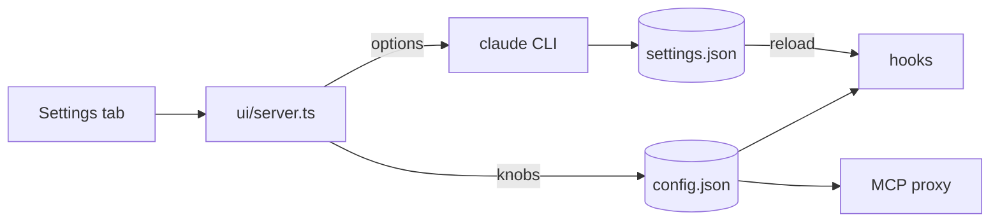

# mnemosyne-settings: a Settings tab where Rohit can view, change and reset every setting of the memory system (0.8.5)

Status: decided, ready to build (Rohit accepted all 13 proposed answers, 2026-10-25; see Decisions). Created 2026-10-25. Baseline: `main` at `59d1f3e` (0.8.4). Release: 0.8.5, before the 0.9.0 half of `docs/plans/mnemosyne-v3.md` (waves 4-7) starts, so the 0.9.0 lanes branch from a `main` that already has this. Delivery: each phase on a short branch off `main`, merged into `main` after its review; nothing is pushed until the release task.

Research reference: `research/settings-research.md` (next to this plan; read-only homework, 2026-10-25). Section numbers below ("R1.3") point into it.

## Summary

Today every Mnemosyne setting is either a plugin option that can only be changed through `/config`, `/plugin` or `claude plugin configure`, or a number hard-coded in the source (the guard's 1500/4000/15 character limits, the 0.88 near-duplicate threshold, 5 tags per memory, 5 recall results, the 14-day context expiry, and more). The dashboard shows none of them.

This plan adds a Settings tab to the dashboard with full create, read, update and delete over settings:

1. Read: every setting with its current value, its default, where it is stored, and when a change takes effect.
2. Update: change a value, checked against its allowed range before it is saved.
3. Create and delete: add or remove list items (remember and recall terms, extra "never save" words), and set a knob that has no stored value yet.
4. Reset: one setting back to its default, or all of them, with a confirm.

The plan has 5 phases (CFG, WIRE, SRV, UI, REL85) holding 14 tasks (one of them Rohit's manual check), in 4 waves.

## How to use this plan (for the coordinator)

1. Each task below is written to be pasted as a worker prompt. A worker prompt is: the "Standing constraints for every worker" section, the phase block, and the task block.
2. Task ids are stable. Build the Orca task DAG from the task graph table.
3. Tasks inside one phase run in the listed order. Phases in the same wave have disjoint file scopes and can run side by side (WIRE and SRV in wave 2).
4. Tasks marked "Rohit" are manual: do not dispatch them.

---

## Goal

Rohit controls his memory system from one page: the guard limits, tags, recall, expiry, storage, which memory tools exist, and the setup state, without editing JSON or remembering CLI flags. Each change is checked, saved safely, and the page says when it takes effect.

Why: "so that the user has more and more control over their memory settings and config" (Rohit, 2026-10-25). The research found 10 plugin options and about 20 hard-coded numbers a user may want to tune (R3, R4, R5), and no route in the dashboard that reads or writes any of them (R7.1.5).

---

## Design / context

### Two homes for settings

1. Plugin options (the 10 `userConfig` fields in `.claude-plugin/plugin.json`: `scope`, `showActivity`, `activityLog`, `guardMode`, `memoryDir`, `rememberTerms`, `recallTerms`, `externalMcp`, `extractionModel`, `embeddings`). Claude Code stores them in `~/.claude/settings.json` under `pluginConfigs["mnemosyne@mnemosyne"].options` (R1.1). The dashboard reads and writes them only through the official CLI, `claude plugin configure mnemosyne@mnemosyne --json` and `--values-stdin`, the route `fillDefaults` already uses (`hooks/register.ts:632-644`). It never edits `settings.json` by hand. A change takes effect when the plugin reloads or Claude Code restarts, and the page says so (R1.3.2).
2. Mnemosyne config (new): a plugin-owned file `~/.claude/mnemosyne/config.json` (mode 0600, written by temp file and rename, like `vocabulary.json`) for every knob that is hard-coded today. The hooks, the outside-agent proxy and the dashboard server read it per call, so a change takes effect on the next save or recall with no restart (R1.3.6).

The Settings tab draws plugin options from the CLI's schema (title, description, default, allowed values), so the options 0.9.0 adds (`sessionSummary`, `expireUnusedDays`) appear by themselves with no 0.8.5 code change (R1.3.5).



### What a setting row shows

Name, plain-words help, current value, default, an editor for its type (switch, choice, number with range, text, list), "Reset to default", and an "applies" badge: "now" (config.json), "next session" (tool on/off, wrapper), or "after restart" (plugin options, dashboard start values).

### The settings list (from R "Recommended settings list")

Legend: option = plugin option via the CLI; config = key in `config.json`; read-only = shown, not editable.

| Id | Group | Setting | Home |
|---|---|---|---|
| G1 | Guard | `guardMode` strict/warn | option |
| G2 | Guard | warn length (1500; 200 to max-1) | config |
| G3 | Guard | max length (4000; up to 8000) | config |
| G4 | Guard | min length (15; 5 to 100) | config |
| G5 | Guard | near-duplicate on/off, threshold (0.88; 0.80-0.99) | config |
| G6 | Guard | chatter check strict/warn/off | config |
| G7 | Guard | extra "never save" words (add-only list) | config |
| G8 | Guard | built-in secret rules | read-only |
| T1 | Tags | max tags per memory (5; 1 to 10) | config |
| T2 | Tags | auto-admit count (3; 1 to 10) | config |
| T3 | Tags | tag length, namespaces, vocabulary counts | read-only |
| R1 | Recall | `embeddings` auto/on/off, model status | option |
| R2 | Recall | `memory_recall` default (5) and max (50) | config |
| R3 | Recall | first-prompt recall on/off, count, sentences | config |
| R4 | Recall | `rememberTerms`, `recallTerms` | option |
| R5 | Recall | ranking weights 0.5/0.3/0.2 (Advanced) | config |
| E1 | Expiry | context-note days (14; 1 to 365) | config |
| E2 | Expiry | `expireUnusedDays` (arrives in 0.9.0) | option |
| S1 | Storage | `memoryDir` (typed confirm) | option |
| S2 | Storage | `scope` (typed confirm) | option |
| S3 | Storage | `activityLog`, `showActivity` | option |
| S4 | Storage | activity log size cap (1 MiB) | config |
| S5 | Storage | backups to keep (10; 3 to 50) | config |
| S6 | Storage | `extractionModel` | option |
| M1 | Tools | per-tool on/off (5 tools) | config |
| M2 | Tools | `externalMcp`, outside-tools allow-list | option + config |
| M3 | Tools | the 27 hidden engine tools | read-only |
| D1 | Setup | setup status card, copyable commands | read-only |
| D2 | Setup | back up now, backup list | action |
| B1 | Browser | theme, search mode | this browser |

Notes:

1. G7 is a plain words and phrases list, not regexes: a user regex can hang a save (ReDoS, R3.1). Regex patterns are parked (Decision 5).
2. M1: switching `memory_remember` off also stops the remember trigger and the rules block, so Claude is never told to call a missing tool (R6.1). Effect at the next session start.
3. R5: the weights are passed per recall call (`vec_weight`, `fts_weight`, `importance_weight`, already accepted by the engine, `engine/src/mcp-tools.ts:89-91`) and pinned in `engineEnv` so a shell variable can no longer change recall silently (R5.2). No `engine/` change.
4. The relevance floors and the 0.8/0.2 blend are engine code and stay out (R5.2).

### Contracts

1. C1 config file: `~/.claude/mnemosyne/config.json`, `{ "version": 1, "guard": {...}, "tags": {...}, "recall": {...}, "expiry": {...}, "tools": {...}, "storage": {...} }`. Only keys that differ from the default are stored. A missing file means all defaults.
2. C2 one resolver: `hooks/settings.ts` (new, import-free like `hooks/guard.ts`) holds the schema (key, type, default, min, max, allowed values, help text, "applies" badge) and `resolve(raw) -> Settings`. Every reader uses it. An unknown key is ignored; an invalid or out-of-range value falls back to its default and is reported as a warning, never a crash.
3. C3 defaults do not change behaviour: with no `config.json`, every save, recall and tag result is identical to 0.8.4. The existing tests that pin 1500, 4000, 15, 0.88, 5 and 14 keep passing unchanged.
4. C4 secret blocks stay fixed: the built-in G1 secret rules, the empty-text block and "no override for a secret" cannot be changed or switched off by any setting. G7 can only add.
5. C5 safe writes: `config.json` is written by temp file plus rename, 0600, and the previous version is kept as `config.json.bak`. Plugin options are written only through `claude plugin configure --values-stdin`, one key per call, and read back to confirm.
6. C6 texts follow values: every text that quotes a number (`RULES_SECTION`, tool descriptions in `hooks/register.ts` and `bin/mcp-proxy.ts`, the `guardMode` description) is built from the resolved settings (R3.3.3, R4).
7. C7 server routes keep today's protections: token, Host, Origin, JSON only, body cap, CSP (R7.1.2). New routes: `GET /api/settings`, `POST /api/settings/update`, `POST /api/settings/reset`, `POST /api/backup`.
8. C8 the activity log records a settings change by key name and old/new kind of value only (for example `guard.maxLength`), never a list item's text.
9. C9 no engine change: `engine/` is not touched.

### Out of scope

1. Editing tag aliases and admitting tags: that is the 0.9.0 Vocabulary panel (v3 CRUDX.4, CRUD.3). Settings shows counts and a pointer only.
2. Running setup, rebuilding vectors or running the expiry sweep from the browser. Setup stays `/mnemosyne-setup`; the page shows status and a copy button (R2.4).
3. Live reload of plugin options (needs a server-to-hook channel; Decision 2).
4. User regexes for secrets (Decision 5), the engine's relevance floors, the embedding model choice (local-only privacy rule).
5. Moving memories when `memoryDir` or `scope` changes: the page warns that rows are not moved.

### Risks

1. A bad value breaks saving or recall. Guard: C2 range checks on write and on read, C3 defaults, reset per setting and reset all.
2. A write damages `~/.claude/settings.json`. Guard: CLI only (C5), never a direct edit; tests use a stub CLI and a temp HOME (`tests/bun/no-real-home.spec.ts`).
3. Turning tools off leaves Claude calling a missing tool. Guard: M1 note 2 and a spec.
4. Merge clash with 0.9.0: `hooks/register.ts`, `ui/server.ts`, `ui/app.ts`, `.claude-plugin/plugin.json`, `hooks/activity-log.ts` are also 0.9.0 files (R9). Guard: 0.8.5 ships first; edits to shared files are kept to small hunks (one resolver call in `register()`, a 2-line route registration, a `VIEWS` entry), with the logic in new files; v3's CRUDX.0 adds its activity actions on top of the `settings` action added here.

---

## Task graph (build the Orca DAG from this)

| Wave | Phase | Needs first | Tasks in order |
|---|---|---|---|
| 1 | CFG | nothing | CFG.1, CFG.2 |
| 2 | WIRE | CFG | WIRE.1, WIRE.2, WIRE.3, WIRE.4 |
| 2 | SRV | CFG | SRV.1, SRV.2, SRV.3 |
| 3 | UI | SRV | UI.1, UI.2, UI.3, then UI.4 (Rohit) |
| 4 | REL85 (0.8.5) | WIRE, UI | REL85.1 |

Task counts: CFG 2, WIRE 4, SRV 3, UI 4 (UI.4 is Rohit's), REL85 1 = 14 tasks in 5 phases.

---

## Lanes, workers and models (Rohit's decision, 2026-10-25)

| Lane | Worktree | Phases | Worker |
|---|---|---|---|
| A | Orca worktree `settings-lane-a` | CFG, WIRE, REL85 | Claude Sonnet, high effort |
| B | Orca worktree `settings-lane-b` | SRV, UI | Claude Sonnet, medium effort |

Each worker prompt states that the worker never orchestrates, never picks or switches models, efforts or agents, and uses its own default model for any subagent. Review of each phase is by a separate reviewer (opus for CFG and SRV, which touch every save path and the user's settings file).

---

## Wave 1: CFG (plugin)

### Phase CFG: one schema and one resolver for every setting

1. Delivers: `hooks/settings.ts` (schema, defaults, `resolve()`, `validate()`), the `config.json` reader and writer, and the `settings` activity action.
2. Needs first: nothing.
3. Read first: `research/settings-research.md` sections 3-8 and "Recommended settings list"; `hooks/guard.ts`, `hooks/tags.ts`, `hooks/kinds.ts`, `hooks/vocab.ts` (file pattern for `vocabulary.json`).
4. May touch: `hooks/settings.ts`, `bin/settings.ts`, `hooks/activity-log.ts`, `tests/settings.test.ts`, `tests/bun/settings.spec.ts`, `tsconfig.bun.json`.
5. Must not touch: `engine/`, `ui/`, `hooks/register.ts`, `bin/mcp-proxy.ts`, `tests/bun/helpers.ts`.
6. Review level: standard. Hazards: a default that differs from today's hard-coded number (C3); a config file a crash can leave half-written (C5).
7. Suggested commit message: `feat(settings): one schema and resolver for Mnemosyne settings`

#### CFG.1: hooks/settings.ts: schema, defaults and resolve() (critical)

1. Goal: one import-free module that lists every config setting of the table above (ids G2-G7, T1-T2, R2-R3, R5, E1, S4-S5, M1, M2 allow-list) with type, default, range, help text and "applies" badge, and turns raw JSON into a checked `Settings` object.
2. Acceptance:
   1. every default equals today's hard-coded value (a spec imports the old constants, for example `MAX_TAGS`, `CONTEXT_EXPIRY_DAYS`, `RECALL_LIMIT`, `NEAR_DUPLICATE_SCORE`, and compares);
   2. `resolve({})` returns all defaults; an unknown key is ignored; an out-of-range or wrong-typed value falls back to its default and appears in `warnings` by key name;
   3. cross-field rules hold: warn length < max length, min length < warn length, max length <= 8000, the three weights each 0 to 1;
   4. G7 words: at most 100 entries, each 3 to 80 characters, plain text (no regex meaning);
   5. no setting can name, remove or weaken a built-in secret rule (C4): the schema has no such key and a spec says so;
   6. the module imports nothing.
3. Refs: R3.1, R4, R5.2, R5.3, R6.1, R8.
4. Gate: `claude plugin test .` (600 s).
5. Scope: phase CFG.

#### CFG.2: read and write config.json safely, plus the `settings` activity action

1. Goal: `readConfig(root)` and `writeConfig(root, patch)` (in `hooks/settings.ts` for reading, `bin/settings.ts` for the writer the server calls), and a `settings` activity action.
2. Acceptance:
   1. write = validate, then temp file plus rename, mode 0600, previous file kept as `config.json.bak`; a value that fails validation is refused with the key and the reason, nothing written;
   2. only non-default keys are stored; "reset key" deletes the key; "reset all" writes `{ "version": 1 }` after keeping the `.bak`;
   3. a missing or unreadable file reads as all defaults plus one warning, never a throw;
   4. `bun bin/settings.ts get|set <key> <value>|reset <key>|reset-all --root <dir>` works on a temp root (spec with a temp dir);
   5. `hooks/activity-log.ts` gains action `settings`; the line holds key names only, never list item text (C8).
3. Refs: `hooks/vocab.ts` and `bin/vocab.ts` (writer pattern); `bin/activity.ts`.
4. Gate: `claude plugin test . && bun run test:bun` (900 s).
5. Scope: phase CFG.

---

## Wave 2: WIRE (plugin) and SRV (server), side by side

### Phase WIRE: the hooks and the proxy read their numbers from settings

1. Delivers: the guard, tags, recall, expiry, tool registration and backups take their values from `resolve(readConfig())`, read per call.
2. Needs first: CFG.
3. Read first: `hooks/register.ts` (`register()` top, `tool.call` near 1500, `prompt.submit` near 1690-1740, `RULES_SECTION` 72-82, tool definitions 104-195), `bin/mcp-proxy.ts`, `hooks/guard.ts`, `hooks/engine.ts:24-80`.
4. May touch: `hooks/guard.ts`, `hooks/tags.ts`, `hooks/kinds.ts`, `hooks/register.ts`, `hooks/engine.ts`, `bin/mcp-proxy.ts`, `bin/guard-audit.ts`, `bin/memories.ts`, `bin/activity.ts`, `bin/vocab.ts`, `tests/guard.test.ts`, `tests/tags.test.ts`, `tests/register.test.ts`, `tests/bun/mcp-proxy.spec.ts`, `tests/bun/guard-audit.spec.ts`, `tests/bun/memories.spec.ts`.
5. Must not touch: `engine/`, `ui/`, `hooks/settings.ts` (ask the coordinator for a schema change), `tests/bun/helpers.ts`.
6. Review level: data-loss (every save path changes). Hazards: a behaviour change with no config file (C3); a tool turned off while the trigger still names it; a secret slipping through a loosened rule (C4).
7. Suggested commit message: `feat(settings): guard, tags, recall and tools follow config.json`

#### WIRE.1: guard limits and extra words come from settings (critical)

1. Goal: `admit()` takes a resolved guard config as a second argument; G2-G7 use it; G7 words block like a secret (message names the rule, never the word).
2. Acceptance:
   1. with no config every existing guard test passes unchanged;
   2. specs for a raised max length, a lowered warn length, near-duplicate off, a 0.92 threshold, chatter off, and a G7 word blocking;
   3. the built-in secret rules still block with every possible config (spec loops over extreme configs);
   4. the proxy reads `config.json` per call (as it reads the vocabulary) and applies the same config;
   5. texts that quote the limits are built from the config (C6).
3. Refs: R3.1, R3.3.
4. Gate: `claude plugin test . && bun run test:bun` (900 s).
5. Scope: phase WIRE.

#### WIRE.2: tags, recall counts, first-prompt recall, weights and context expiry come from settings

1. Goal: T1, T2, R2, R3, R5, E1 are read per call.
2. Acceptance:
   1. `cleanTags` keeps at most T1 tags; the "2 to 5" and "at most 5" texts follow T1;
   2. `memory_recall` default and clamp follow R2; first-prompt recall follows R3 (off means no automatic recall, terms still work);
   3. R5 weights are passed on every recall call and `engineEnv` pins `MNEMOPI_*_WEIGHT` so a shell variable cannot change them;
   4. a context note gets E1 days; `bin/vocab.ts candidates` uses T2;
   5. with no config, results equal 0.8.4 (specs).
3. Refs: R4, R5.2, R5.3.
4. Gate: `claude plugin test . && bun run test:bun` (900 s).
5. Scope: phase WIRE.

#### WIRE.3: per-tool on/off for Claude and for outside agents (critical)

1. Goal: M1 decides which of the 5 tools are registered at session start; M2 allow-list decides which the proxy serves.
2. Acceptance:
   1. a tool switched off is not registered at the next session start; the others are;
   2. with `memory_remember` off, the remember trigger and the rules block are not added (spec);
   3. the proxy answers `-32601 Tool not available` for a tool outside the allow-list;
   4. all on by default (C3).
3. Refs: R6.1, R6.2.
4. Gate: `claude plugin test . && bun run test:bun` (900 s).
5. Scope: phase WIRE.

#### WIRE.4: activity log cap and backups to keep come from settings

1. Goal: S4 and S5 are read by `bin/activity.ts` and `bin/memories.ts`.
2. Acceptance: the log rolls at S4 bytes (256 KiB to 16 MiB); `backup` keeps S5 files (3 to 50); defaults equal 1 MiB and 10 (specs).
3. Refs: R5.3.5, R8.
4. Gate: `bun run test:bun` (900 s).
5. Scope: phase WIRE.

### Phase SRV: the dashboard server reads and writes settings

1. Delivers: `ui/settings-routes.ts` (new) with the settings routes, registered in `ui/server.ts` with 2 lines; the CLI writer for plugin options; the setup status; a backup action.
2. Needs first: CFG.
3. Read first: `ui/server.ts` (`post()` near 2160, route table 2231-2283, guards near 2300), `hooks/ui-launch.ts:136-165`, `hooks/register.ts:632-644` (`fillDefaults`), R1.3, R2, R7.1.
4. May touch: `ui/settings-routes.ts`, `ui/server.ts` (route registration and env only), `hooks/ui-launch.ts` (pass the plugin id and CLI path), `tests/bun/settings-routes.spec.ts`, `tests/bun/fixtures/claude-stub.ts`.
5. Must not touch: `engine/`, `hooks/register.ts`, `ui/app.ts`, `~/.claude/settings.json` in any test, `tests/bun/helpers.ts`.
6. Review level: data-loss (writes the user's settings file through the CLI). Hazards: a write reaching the real home in a test; a value passed to the CLI unchecked; the token or a list item in a log.
7. Suggested commit message: `feat(ui): settings routes for options and config`

#### SRV.1: GET /api/settings

1. Goal: one reply with every setting: id, group, help, type, range or choices, default, current value, home (option/config/read-only), applies badge, and "restart needed" when the dashboard's start values differ from the current ones.
2. Acceptance:
   1. plugin options come from `claude plugin configure mnemosyne@mnemosyne --json` (stub CLI in tests); an option the schema adds later (for example `expireUnusedDays`) appears with no code change (spec with a stub schema that has an extra field);
   2. config settings come from `resolve(readConfig())`, with its warnings;
   3. read-only facts included: built-in secret rule names, tag length and namespaces, vocabulary counts, the 27 hidden engine tools, setup status (engine build matches `ENGINE_BUILD`, model files present, wrapper present), backup list (name, size, date);
   4. a `--plugin-dir` install with no plugin id shows options read-only with "change them in /config";
   5. no memory text in the reply.
3. Refs: R1.3, R2.4, R7.1.
4. Gate: `bun run typecheck && bun run test:bun` (900 s).
5. Scope: phase SRV.

#### SRV.2: POST /api/settings/update and /api/settings/reset (critical)

1. Goal: write one setting, or reset one or all.
2. Acceptance:
   1. body `{ id, value }` or `{ id, add }` / `{ id, remove }` for list settings; `reset` takes `{ id }` or `{ all: true, confirm: "reset" }`;
   2. config ids go through `writeConfig` (CFG.2); option ids go through `claude plugin configure --values-stdin` with exactly one key, after the value passed the schema check, then are read back; a mismatch is reported, not hidden;
   3. `memoryDir` and `scope` need `confirm` equal to the new value typed by the user; the reply warns that rows are not moved;
   4. same protections as `/api/forget` (token, Origin, JSON, body cap 4096) and one write at a time;
   5. the reply says when the change applies (now, next session, after restart);
   6. every test runs with a temp HOME and the stub CLI; a spec asserts the real `~/.claude/settings.json` is never opened.
3. Refs: R1.3.2, R9 items 3 and 5.
4. Gate: `bun run typecheck && bun run test:bun` (900 s).
5. Scope: phase SRV.

#### SRV.3: POST /api/backup

1. Goal: "Back up now" runs `bin/memories.ts backup` for the store and returns the new file's name and size.
2. Acceptance: one at a time; refuses with the existing free-space rule; keeps S5 files; temp store in specs.
3. Refs: R2.4, R8.
4. Gate: `bun run test:bun` (900 s).
5. Scope: phase SRV.

---

## Wave 3: UI

### Phase UI: the Settings tab

1. Delivers: `ui/settings.ts` (rendering and form logic), a `settings` view in `ui/app.ts` and `ui/index.html`, styles in `ui/style.css`.
2. Needs first: SRV.
3. Read first: `ui/app.ts:30` (`VIEWS`, `VIEW_NAMES`), `show()` near 677, `ui/health.ts` (module pattern), `tests/bun/health-view.spec.ts:383-395` (CSP and `textContent` rules), R7.2.
4. May touch: `ui/settings.ts`, `ui/app.ts` (`VIEWS`, `VIEW_NAMES`, one `show()` branch), `ui/index.html`, `ui/style.css`, `ui/tsconfig.json`, `tests/bun/settings-view.spec.ts`, `tests/bun/ui-views.spec.ts`.
5. Must not touch: `engine/`, `hooks/`, `bin/`, `ui/server.ts`, `tests/bun/helpers.ts`.
6. Review level: standard. Hazards: inline style or script (CSP); a value shown as saved before the server confirmed it.
7. Suggested commit message: `feat(ui): Settings tab`

#### UI.1: Settings tab, groups and read view

1. Goal: tab "Settings" last in the bar; groups Guard, Tags, Recall and embeddings, Expiry, Storage, Tools, Setup, This browser; each row shows name, help, value, default, home and applies badge; a filter box.
2. Acceptance: renders from `/api/settings` only (no hard-coded list); read-only rows have no editor; a banner lists config warnings and "restart needed"; text via `textContent`; no inline style.
3. Gate: `bun run typecheck && bun run test:bun` (900 s).
4. Scope: phase UI.

#### UI.2: editors, list add and remove, reset

1. Goal: switch, choice, number with range, text and list editors; Save per row; "Reset to default" per row; "Reset all" with a typed confirm.
2. Acceptance: the field checks the range before sending; the row shows the server's reply (saved, applies when, or the refusal reason); `memoryDir` and `scope` ask for the new value typed again; list rows add and remove items one at a time; the page never shows a value as saved before the server said so.
3. Gate: `bun run typecheck && bun run test:bun` (900 s).
4. Scope: phase UI.

#### UI.3: Setup and backups section

1. Goal: setup status card, copy buttons for `/mnemosyne-setup`, `/mnemosyne-embed`, `/mnemosyne-tags`, `/mnemosyne-knowledge`, the backup list and "Back up now"; "This browser" rows for theme and search mode (localStorage, wrapped in try/catch).
2. Acceptance: no button runs setup or rebuilds vectors; "Back up now" shows the new file or the refusal.
3. Gate: `bun run typecheck && bun run test:bun` (900 s).
4. Scope: phase UI.

#### UI.4: Rohit checks the tab on his installed plugin (manual, Rohit)

1. Change one config setting (for example max tags to 4), save a memory with 5 tags, see 4 kept. Reset it.
2. Change one plugin option (for example `showActivity`), restart Claude Code, see it applied, and see it in `/config`.
3. Turn `memory_forget` off, start a new session, see it gone; turn it back on.

---

## Wave 4: REL85 (release 0.8.5)

### Phase REL85: Docs and version 0.8.5

1. Delivers: README "Settings" section rewritten around the tab (both homes, applies badges, what cannot be changed and why), DESIGN section for `config.json` and the routes, version 0.8.5 in `.claude-plugin/plugin.json` and wherever the release script reads it, CHANGELOG entry.
2. Needs first: WIRE, UI (UI.4 done by Rohit).
3. May touch: `README.md`, `DESIGN.md`, `.claude-plugin/plugin.json` (version only), `CHANGELOG.md`, `docs/plans/mnemosyne-v3.md` (one note under the 0.9.0 review: 0.8.5 added `hooks/settings.ts`, the `settings` activity action and the settings routes; CRUDX rebases onto them).
4. Review level: light.
5. Suggested commit message: `0.8.5: Settings tab`

#### REL85.1: docs and version

1. Acceptance: SUITE green; README states every setting, its default and range from the schema (no number that differs from `hooks/settings.ts`, checked by a spec or a grep in the gate); version 0.8.5; release tag and GitHub release only on Rohit's go.
2. Gate: SUITE (below).

---

## Verification

### Gate commands

SUITE, run after every merge into `main` (timeout 1500 s), all must exit 0:

```
claude plugin test . && bun run typecheck && bun run test:bun && claude plugin validate . && bun scripts/engine-diff.ts && bun scripts/vendor-map.ts --check
```

`bun scripts/engine-diff.ts` proves `engine/` did not change (C9).

### Review rule

1. Each phase is reviewed by a different worker than its builder; the reviewer reruns the gates itself.
2. Data-loss depth for WIRE and SRV: no save path changed with no config file; no write reaches the real home; secrets still blocked under every config; no list item text or token in logs.
3. A review finding goes back to a worker written into the task; the file scope is not widened to make it pass.

---

## Standing constraints for every worker

1. Nobody touches `engine/`.
2. Nothing touches the real store `~/.claude/mnemosyne/store` or the real `~/.claude/settings.json`. Tests use a temp HOME, a temp root and the stub `claude` CLI.
3. Plugin options are written only through `claude plugin configure --values-stdin`, never by editing `settings.json`.
4. The built-in secret rules and the empty-text block cannot be weakened by any setting.
5. Never use `git checkout` or `git stash` to undo changes.
6. No silent workarounds. If a tool, path or method named in a task fails or returns unusable output, stop, report the exact error text, and ask before using a substitute.
7. A failed tool gets three real tries before reporting, and each try must change something (fix a wrong name or argument; use its other form such as the CLI; check how it is registered or run it by hand). Say each failure in one line. After the third, stop and report what was called, the exact text and the three attempts.
8. Memory text and list item text are never logged; only setting ids and verdicts.
9. Stay inside the task's "May touch" files; ask the coordinator otherwise.
10. You never orchestrate, never pick or switch models, efforts or agents, and use your own default model for any subagent.
11. Report done with the task id, what changed, the gate command and its real output.

---

## Decisions (Rohit, 2026-10-25)

The coordinator's proposed answers to the research's open questions (R "Open questions for Rohit"). Rohit accepted all 13 as written on 2026-10-25.

1. Where new knobs live: in `config.json` (live, read per call); existing options stay plugin options. Proposed: yes.
2. Plugin option changes apply after a reload or restart, and the page says so; no live channel in 0.8.5. Proposed: yes.
3. `memoryDir` and `scope` are editable with a typed confirm and a "rows are not moved" warning. Proposed: yes.
4. Max length ceiling 8000 (embedding input cap is 8192); min length 5 to 100. Proposed: yes.
5. Extra secrets: a plain "never save" words list now; user regexes parked. Proposed: yes.
6. Per-tool on/off ships in 0.8.5, effect at next session start. Proposed: yes.
7. First-prompt recall switch, count and sentences ship in 0.8.5. Proposed: yes (it touches the region SESSION.2 edits later; SESSION rebases).
8. `expireUnusedDays` appears when 0.9.0's SESSION.4 adds it, via the schema; 0.8.5 shows "arrives in 0.9.0". Proposed: yes.
9. Settings changes write an activity line (`settings` action, key names only). Proposed: yes.
10. Ranking weights exposed under Advanced and pinned in `engineEnv`. Proposed: yes.
11. "Back up now" button included. Proposed: yes.
12. Settings is the last tab. Proposed: yes.
13. Lanes and models as in the lanes table. Proposed: yes.
