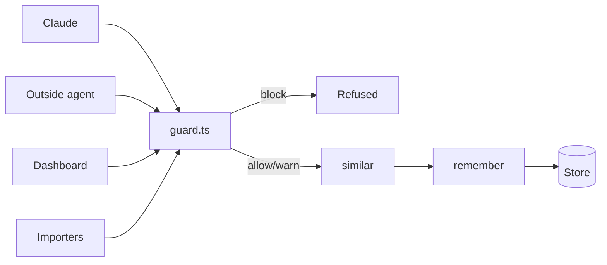

# mnemosyne-v3: Guardrails on what enters memory, honest kinds and provenance, a shared tag vocabulary, dashboard writes and review, and importers

Status: decided, ready to build (Rohit's decisions 2026-10-24, see Decisions). Created 2026-10-24. Baseline: `main` at `247ea75` (0.7.6); the map plan (`docs/plans/mapx-solar-map.md`) ships first, so `main` moves on before wave 4. Delivery: each phase on a short branch off `main`, merged straight into `main` after its review; nothing is pushed. Two releases: 0.8.0 after wave 3 (REL8), 0.9.0 at the end (REL9).

Status 2026-10-25: waves 1-3b are shipped (0.8.0, then fixes 0.8.1 and 0.8.2; `main` at `2f1a104`). The 0.9.0 half (waves 4-7) was reviewed against the code on 2026-10-25 and corrected in place; see "0.9.0 review (2026-10-25)" before Wave 4. Not yet started; Rohit is still adding points before execution is planned. The solar-system map (the old phase MAPX) and the project registry (the old SESSION.5) moved to `docs/plans/mapx-solar-map.md` on 2026-10-25; the map plan ships first and `main` moves on, so lanes branch from the new `main`.

## Summary

Version 3 of the Mnemosyne plugin: control what goes into memory, and organise what is there. Every save, from Claude, outside agents, the dashboard or an importer, passes one guard that blocks secrets and oversize text and warns about near-duplicates and task chatter. Saves then record honest provenance and a kind instead of 'imported' and 'unknown'. Tags come from a small shared vocabulary with entity, agent and asset namespaces. The dashboard gains create, edit, retire and a review queue, and documents and session logs can be imported through the same guard. It matters because the store today holds 447 tags for 140 memories (407 used once), five rows marked SUPERSEDED that are still recalled, and no usable provenance at all.

The plan has 12 phases (MODEL, GUARD, META, VOCAB, REL8, CRUDX, IMPORT, CRUD, SESSION, HARDEN, REL9, LATER) holding 47 tasks, in 9 waves. Waves 1-3 plus REL8 (wave 3b) are release 0.8.0: the guard, kinds and provenance, the audit trail and the vocabulary. Waves 4-7 are release 0.9.0: dashboard writes and review, the importers, session summaries, and the expiry sweep. The solar-system map, first added here on 2026-10-25, is now its own plan (`docs/plans/mapx-solar-map.md`) and ships before wave 4. Wave 8 (LATER) is parked and starts only on Rohit's go.

## How to use this plan (for the coordinator)

1. Each task below is written to be pasted as a worker prompt. A worker prompt is: the "Standing constraints for every worker" section, the phase block (its file scope, hazards and review level), and the task block (goal, acceptance, refs, gate).
2. Task ids are stable. Build the Orca task DAG from the wave table: a task depends on every task of the phases listed in its phase's "Needs first", plus the in-phase order given in the table.
3. Tasks inside one phase touch the same files, so run them in the listed order, not in parallel. Phases in the same wave have disjoint file scopes and can run side by side (MODEL, GUARD and HARDEN part A in wave 1, CRUDX and IMPORT in wave 4, CRUD and SESSION in wave 5).
4. `hooks/register.ts` changes hands only at wave boundaries. The map plan's MAPX.8 touches one small hunk of it first, on `main`, before the wave 4 lanes branch (map plan, D6). `tests/bun/helpers.ts` is forbidden everywhere except HARDEN.
5. Tasks marked "Rohit" are manual: do not dispatch them to a worker. Wait for Rohit to report.
6. Research reference: `research/v3-research.md` (next to this plan).

---

## Goal

Nothing enters memory without passing one guard. Every memory says what kind it is, who wrote it and through what, and when it expires if it is project state. Tags come from a shared vocabulary. Rohit can create, edit, retire and restore memories on the dashboard, and documents and session logs come in through the same guard.

Why: "control the garbage going in; the memory must not hold garbage." Today every row says 'imported' and 'unknown', 407 of 447 tags are used once, and five SUPERSEDED rows are still recalled (research/v3-research.md).

From: Rohit's v3 requirement list (2026-10-23/24), the earlier shortlist, the 0.7.0 open items, and the read-only research in research/v3-research.md.

---

## Design / context

### What is wrong today

1. Every save is labelled `source: 'imported'` by design, because the engine's trim deletes STATED rows after 24 h and spares only IMPORTED (`hooks/register.ts:1043-1045`, `engine/src/core/beam/store.ts:230-262`). Provenance is therefore lost on all 140 rows.
2. `memory_type` is never set: the plugin's tools have no kind, and handleRemember does not forward one (`engine/src/mcp-tools.ts:556-564`, `store.ts:442`). All 140 rows are 'unknown'.
3. Nothing checks content on the way in beyond an exact-duplicate match per owner (`store.ts:156-160`). The engine's `sanitizeContent` and `classifyMemory` are unused.
4. The store holds 4 near-duplicate clusters (10 rows at cosine 0.88 or more), 5 rows marked SUPERSEDED or HISTORICAL that are still recalled, and about 40 dated progress notes (store query, 2026-10-24).
5. 447 distinct tags for 140 memories, 407 used once; the top tag repeats the owner name. The tagger gets no vocabulary (`hooks/backfill.ts:51-59`).
6. The dashboard can only forget (`ui/server.ts:1584-1630`), and its body cap is 4096 bytes (`ui/server.ts:105`).
7. Baseline: main at `5824f3d` (0.7.0), clean, not pushed past 0.7.0.
8. Eight engine tables are always empty, and the Health tab lists them as plain "empty", which reads like a fault (Rohit, 2026-10-24). Seven are empty by design: `episodic_memory`, `consolidation_log`, `gists`, `facts`, `graph_edges`, `triples` and `scratchpad` are written only by engine tools the plugin never exposes (`mnemopi_sleep`, `mnemopi_graph_link`, `mnemopi_triple_add`, `mnemopi_scratchpad_*`; DESIGN.md §5 and `research/v3-research.md` §1.2 item 8 and §2 items 9-12), and the `fts_episodes*` / `fts_facts*` tables are their search indexes. The eighth, `memory_validations`, is dead schema: `handleValidate` returns a `validator` but never inserts a row (`engine/src/mcp-tools.ts:853-880`), and nothing else writes it.

### Shape of the change

The vendored engine gets five small changes, all in MODEL:

1. the trim spares rows whose scope is not 'session';
2. remember and update store memory_type, trust_tier and valid_until, with a restore;
3. a read-only `mnemopi_similar` tool;
4. an owner-checked `mnemopi_expire_unused` tool that sets `valid_until` on unused, unpinned memories of the expirable kinds (dry run by default);
5. an audit trail: retire, restore, update, attest and expire each write one `memory_validations` row (who, what, when; never the text), and forget purges a memory's rows (C10).

Everything else is plugin code. The dashboard also labels the tables that are empty by design, with the reason, so they stop reading as gaps (C10). One import-free module, `hooks/guard.ts`, is called by every write path before the engine:

1. Claude's tool calls (`hooks/register.ts`);
2. outside agents (`bin/mcp-proxy.ts`);
3. the dashboard (`ui/server.ts`);
4. the importers (`hooks/import.ts`, `bin/import.ts`).

Near-duplicates are checked in the same engine process as the save. Retiring never deletes: it uses the engine's existing `invalidate`, and every retire can be restored.



File map:

1. `engine/` is changed by MODEL.
2. `hooks/guard.ts` (new) is changed by GUARD, META, LATER.
3. `hooks/kinds.ts` (new) is changed by META.
4. `hooks/register.ts` is changed by GUARD, META, VOCAB, IMPORT, SESSION, HARDEN, LATER (one wave each).
5. `bin/mcp-proxy.ts` is changed by GUARD, META, LATER.
6. `hooks/tags.ts`, `hooks/vocab.ts` (new), `hooks/backfill.ts`, `bin/vocab.ts` (new) are changed by VOCAB.
7. `bin/memories.ts` is changed by META (backup) and VOCAB.
8. `ui/server.ts` is changed by CRUDX.
9. `ui/app.ts`, `ui/index.html`, `ui/style.css`, `ui/review.ts` (exists since 0.7.x: the Review tab with four filters) are changed by CRUD.
9a. `hooks/activity-log.ts` (the activity action and origin names) is changed by CRUDX.0 only, before the wave 4 lanes start.
10. `hooks/import.ts`, `bin/import.ts` (new) are changed by IMPORT.
11. `hooks/session.ts` (new) is changed by SESSION.
12. `hooks/engine.ts`, `tests/bun/helpers.ts`, `bin/install-engine.ts` are changed by HARDEN.

The map plan (`docs/plans/mapx-solar-map.md`) also edits `ui/server.ts` (`galaxyLevel`, `getMemory`), `ui/app.ts`, `ui/index.html`, `ui/style.css` and a small hunk of `hooks/register.ts`; whichever branch lands second rebases onto `main` (map plan, D4, D6, D7).

### Contracts

1. C1: `hooks/guard.ts` exports `admit({ content, kind?, origin }) -> { verdict, hits: [{ rule, message }] }` and imports nothing.
   1. Rule ids: G1 secret, G2 size, G3 near-duplicate (added by META), G4 chatter; G5 and G6 later.
   2. GUARD writes it; META, CRUDX, IMPORT, SESSION and LATER call it.
2. C2: engine tools, written by MODEL; META, CRUDX and IMPORT call them:
   1. `mnemopi_remember` takes `memory_type`, `trust_tier` and `valid_until`;
   2. `mnemopi_update` takes `memory_type`, `valid_until` and `restore: true`;
   3. `mnemopi_similar { content, top_k, min_score }` returns `{ matches, embeddings }`, read-only;
   3a. `mnemopi_expire_unused { days, kinds, dry_run (default true), limit }` returns `{ expired|candidates: [{ id, kind, last_used, preview }], count }` (MODEL.5);
   3b. `mnemopi_invalidate`, `mnemopi_update`, `mnemopi_validate` and `mnemopi_expire_unused` take an optional `validator` string (default 'unknown') and record it in the audit trail (MODEL.6, C10);
   4. the trim spares any row whose scope is not 'session'.
   None of these is added to the proxy's allow-list.
3. C3: kinds are the engine's names: fact, preference, instruction, decision, context, error, artifact, event, plus 'unknown' for old rows. `hooks/kinds.ts` holds the plain labels. META writes it; VOCAB, CRUD and IMPORT read it.
4. C4: provenance per write path:

   | Path | source | trust_tier | veracity |
   |---|---|---|---|
   | Claude save | claude-code | DERIVED | unknown |
   | Trigger phrase | user | STATED | stated |
   | Outside agent | mcp:\<client\> | EXTERNAL_WRITE | unknown |
   | Dashboard | dashboard | STATED | stated |
   | Doc import | import:doc | IMPORTED | imported |
   | Session import | import:session | IMPORTED | imported |

   Rows written before v3 keep 'imported' (see Decisions). META writes the save paths; CRUDX and IMPORT follow the table.
5. C5: `<root>/vocabulary.json`, mode 0600, shape `{ version, tags, candidates }` (VOCAB.1). It is written only by `bin/vocab.ts`. VOCAB writes it; CRUDX and CRUD read it.
6. C6: tag format `ns:value` or `value`:
   1. `ns` is one of `entity`, `agent`, `asset`;
   2. `value` is lowercase kebab-case, 1-31 characters;
   3. a tag that is a project name is dropped.
   VOCAB writes the rule; every tag writer uses it.
7. C7: dashboard routes, written by CRUDX and read by CRUD:
   1. `POST /api/memory/create`, `/update`, `/retire`, `/restore`, and `/api/vocabulary/admit`, `/alias`;
   2. `GET /api/review` and `/api/vocabulary`;
   3. every POST sits behind the existing `post()` guard;
   4. answers: 422 means blocked, 409 means warned (guard hits or near-duplicates) and needs `confirm: true`, 413 means the body is over the route's cap (24 KB for create and update);
   5. update also takes `pinned` and `expires_in_days`; `/api/review` and `/api/memories` rows carry `state`: live, retired, expired or lapsed (0.9.0 review).
8. C8: proposal files `tags-proposed.json` and `import-proposed.json` hold ids, sha256 and verdicts, never memory text, mode 0600. VOCAB and IMPORT write them.
9. C9: `bin/memories.ts backup` (VACUUM INTO `<root>/backups/`, 0600, keeps 10). Every apply command runs it first and stops if it fails. META writes it; VOCAB, IMPORT and SESSION call it.
10. C10: the audit trail and the unused tables (Rohit, 2026-10-24):
   1. a `memory_validations` row is `{ memory_id, validator, action, validated_at }` with `action` one of retire, restore, update, attest, expire; `new_content` and `note` stay NULL, so memory text never enters the trail;
   2. validator values: 'dashboard' (CRUDX), 'claude-code' (Claude's own update), 'expire-sweep' (SESSION.4), else 'unknown';
   3. the engine's existing trigger `trim_validations_to_3` (`engine/src/core/beam/schema.ts:330-341`) keeps only the newest 3 rows per memory; that is kept as is, so the trail is "the last 3 actions", not a full history;
   4. forget deletes the memory's trail rows in the same transaction as the row (`purgeWorkingMemoryArtifacts`);
   5. `GET /api/health-report` gains `unusedByDesign: { <table>: <reason> }` for `episodic_memory`, `consolidation_log`, `gists`, `facts`, `graph_edges`, `triples`, `scratchpad` and the `fts_episodes*` and `fts_facts*` tables; the Health tab shows each as "unused by design" with its reason instead of "empty".
   MODEL writes 1-4; CRUDX writes 5 and the review history; CRUD shows both; SESSION passes 'expire-sweep'.
11. C11 and C12 (the solar-system map's data and the project registry `projects.json`) moved to `docs/plans/mapx-solar-map.md` on 2026-10-25 and are not part of this plan. C11.4 there defines the exported `memoryState` helper that CRUDX.3 reuses.

### Out of scope

1. No engine-side guard (fork churn, and the engine cannot ask Claude to update instead).
2. No quarantine table: flags in metadata plus the Review queue instead.
3. No `triple_end`: triples have no owner and escape forget.
4. No sync and no Python importers: the auto-memory move already happened on 2026-10-16.
5. No automatic retiring of any memory, with one decided exception (Rohit chose auto-expire, 2026-10-24): the unused-expiry sweep (MODEL.5, SESSION.4). It only expires memories of the kinds context, event, error and artifact that nobody has recalled for 90 days, never a pinned one and never kinds fact, preference, instruction, decision or unknown. It sets `valid_until` (it deletes nothing), backs the store up first, and every expired row can be restored from the Review tab.
6. No CI matrix for Linux or Windows; they are stated as untested.
7. Also cut during drafting: the engine's regex classifier (29 of 140 rows wrongly typed 'relationship'), and PII blocking (warn later, see LATER.3).
8. No use of the engine's sleep/consolidation, triples, graph links or scratchpad. They stay unexposed and their tables stay empty; v3 only labels them (C10.5). Making them safe would need owners and forget-purge on episodes and triples, and stopping sleep from widening channel rows to global, all engine changes.

### Risks

1. A trim change deletes durable rows. Guards: MODEL.1's scope and tier specs, data-loss review, and the C9 backup before any apply. Phase: MODEL.
2. The guard blocks real memories. Guards: the negative corpus, warn-only for everything except secrets and size, the per-rule ids, and GUARD.4's audit. Phases: GUARD, META.
3. A retag, import or replace damages the store. Guards: dry runs, sha256 staleness, backup first, before-and-after specs, data-loss review, and Rohit applies on a copy first. Phases: META, VOCAB, IMPORT, CRUDX.
4. A memory is retired that Rohit wanted. Guards: per-memory confirm, no bulk action, and restore for every retire; no agent retires by hand. The one automatic path is the unused-expiry sweep: only the kinds context, event, error and artifact, never pinned or 'unknown', 90 days unused, a backup first, a dry run before the first real run, and an Expired list with Restore. Phases: CRUD.2, HARDEN.4, MODEL.5, SESSION.4.
5. Recall ranking shifts when provenance becomes honest. Today every row has veracity 'unknown' (weight 0.8). New Claude saves stay 'unknown', imports get 'imported' (0.6) and dashboard saves get 'stated' (1.0), all on purpose. Guard: the C4 table is documented and specced. Phase: META.2.
6. Memory text sent to Haiku (retag, session import, summaries). Guards: the same channel as today's tags, summaries off by default, and the README names it. Phases: VOCAB, IMPORT, SESSION.

---

## Task graph (build the Orca DAG from this)

Phase-level dependencies ("Needs first" means every task of the listed phase is done, including its review):

| Wave | Phase | Needs first | Tasks in order |
|---|---|---|---|
| 1 | MODEL | nothing | MODEL.1, MODEL.2, MODEL.3, MODEL.5, MODEL.6, MODEL.4 |
| 1 | GUARD | nothing | GUARD.1, GUARD.2, GUARD.3, then GUARD.4 (Rohit) |
| 1 | HARDEN part A | nothing | HARDEN.1, HARDEN.2 |
| 2 | META | MODEL, GUARD | META.5, META.1, META.2, META.3, META.4 |
| 3 | VOCAB | META | VOCAB.1, VOCAB.2, VOCAB.3, VOCAB.4 |
| 3b | REL8 (0.8.0) | VOCAB, HARDEN part A | REL8.1 |
| 4 | CRUDX | REL8 | CRUDX.0 (coordinator, on `main`, before both wave 4 lanes start), CRUDX.1, CRUDX.2, CRUDX.3, CRUDX.4, CRUDX.5 |
| 4 | IMPORT | REL8, CRUDX.0 | IMPORT.0, IMPORT.1, IMPORT.2, IMPORT.3 |
| 5 | CRUD | CRUDX | CRUD.1, CRUD.2, CRUD.3, CRUD.4 |
| 5 | SESSION | IMPORT | SESSION.1, SESSION.2, SESSION.4 |
| 6 | HARDEN part B | CRUD, SESSION | HARDEN.3, then HARDEN.4 (Rohit), then HARDEN.5 (Rohit) |
| 7 | REL9 (0.9.0) | HARDEN.3 (HARDEN.4 and HARDEN.5 are Rohit's runs and no longer gate the release; 0.9.0 review) | REL9.1 |
| 8 | LATER | REL9 (parked) | LATER.1, LATER.2, LATER.3, LATER.5 (all manual until Rohit says go; LATER.4 moved to the map plan) |

Task-level dependencies beyond the in-phase order: IMPORT.2 depends on IMPORT.0 (the spike). SESSION.2 reads the transcript reader built in IMPORT. CRUDX.3 reads the `pinned` flag written by IMPORT.3 (both are wave 4 now; CRUDX.3 uses a fixture, so neither waits; see Notes for the reviewer, item 2).

Task counts: MODEL 6, GUARD 4, META 5, VOCAB 4, REL8 1, CRUDX 6, IMPORT 4, CRUD 4, SESSION 3, HARDEN 5, REL9 1, LATER 4 = 47 tasks in 12 phases (LATER.4 is a pointer, not counted; the old MAPX phase and SESSION.5 moved to `docs/plans/mapx-solar-map.md`).

---

## Lanes, workers and models (Rohit's decision, 2026-10-24)

Three lanes, each a fresh Orca worktree created off `main` on 2026-10-24 (the old 0.7.0 worktrees `-int`, `-mk-1`, `-mk-2`, `-mk-3` were removed; all were clean with nothing unmerged). Each phase gets its own short branch off `main`; after its review it merges straight into `main` (Rohit's decision), and the other lanes rebase onto `main` at the next wave boundary. Nothing is pushed.

| Lane | Worktree | Worker |
|---|---|---|
| A | Orca worktree `v3-lane-a` | Claude Sonnet, high effort |
| B | Orca worktree `v3-lane-b` | Claude Sonnet, medium effort (high for the data-loss phases below) |
| C | Orca worktree `v3-lane-c` | OMP; Rohit sets the model in OMP himself, probably DeepSeek's flash model (he gave "4.1 flash 1017"; unconfirmed) |

Who builds what (a proposal; the coordinator may swap lanes A and B between phases, never lane C onto a data-loss phase):

| Wave | Lane A (Sonnet high) | Lane B (Sonnet) | Lane C (OMP) |
|---|---|---|---|
| 1 | MODEL | GUARD | HARDEN.1, HARDEN.2 |
| 2 | META | reviews META | idle |
| 3 | VOCAB | reviews VOCAB | idle |
| 3b | reviews REL8 | idle | REL8.1 (docs and version 0.8.0) |
| 4 | CRUDX (after the coordinator's CRUDX.0), then reviews IMPORT | IMPORT (high), then reviews CRUDX (high) | idle |
| 5 | CRUD, then reviews SESSION (SESSION.4 at data-loss depth) | SESSION (high, it holds the expiry sweep), then reviews CRUD | idle |
| 6 | idle | reviews HARDEN.3 | HARDEN.3, then Rohit's HARDEN.4 and HARDEN.5 |
| 7 | reviews REL9 | idle | REL9.1 (docs and version 0.9.0) |

Rules:
1. Three lanes run at once only in wave 1, and two in waves 4 and 5. Waves 2, 3, 6 and 7 have one build phase, because their file scopes overlap. The idle lane does reviews, not extra builds.
2. The data-loss phases (MODEL, VOCAB, CRUDX, IMPORT, CRUD) and MODEL.5 and SESSION.4 (the expiry sweep) never go to lane C. Lane C builds only standard-risk, reversible work: HARDEN, REL8, REL9.
3. A phase is reviewed by a different lane and worker than the one that built it. Data-loss reviews are done by Sonnet at high effort; lane C never gives the approving review of a data-loss phase.
4. HARDEN.2's gate counts files in the real home's engine log folder before and after the test run. While other lanes run `bun run test:bun` at the same time that count can move for reasons that are not HARDEN.2's, so run that one gate when the other lanes are not running tests, or read a changed count as inconclusive and rerun.
5. Workers do not choose models, efforts or agents and do not dispatch other workers; the coordinator alone does that.

### Waves 4-7 routing (Rohit's decision, 2026-10-26; replaces the tables above for these waves)

Two lanes, both Claude Sonnet, in two fresh Orca worktrees off `main` (the 0.8.0 `v3-lane-*` worktrees were removed on 2026-10-26). Lane C (OMP) is dropped. Both worktrees are kept for all four waves; each lane's agent session is cleared at every phase boundary. Each phase is reviewed by a separate Sonnet high review session (not the other lane) before it merges into `main`.

| Wave | Lane A `v3-lane-a` | Lane B `v3-lane-b` |
|---|---|---|
| 4 | CRUDX (Sonnet high), after the coordinator's CRUDX.0 | IMPORT (Sonnet high) |
| 5 | CRUD (Sonnet medium) | SESSION (Sonnet high, it holds the expiry sweep) |
| 6 | HARDEN.3 (Sonnet medium) | idle |
| 7 | REL9.1 (Sonnet low) | idle |

---

## Wave 1: MODEL (engine) and GUARD (plugin)

### Phase MODEL: The engine keeps durable rows by scope and stores the kind, provenance and expiry it is given

Today the plugin must label every save 'imported', because the engine's 24-hour trim spares only IMPORTED rows; that one label hides where every memory came from. This phase makes the trim spare any row whose scope is not 'session', lets remember and update store memory_type, trust_tier and valid_until, adds a restore for retired rows, and adds a read-only near-duplicate tool. It is the only phase that changes the vendored engine.

1. Delivers: C2 and C10.1-4, with UPSTREAM changes 12-16 and build `18.12.3-mnemosyne.8`.
2. Needs first: nothing.
3. Read first: `engine/src/core/beam/store.ts:222-262`, `:435-548`, `:643-672`, `engine/src/mcp-tools.ts:552-567`, `:674-693` and `engine/UPSTREAM.md`.
4. May touch: `engine/`, `scripts/engine-diff.ts`, `hooks/engine-build.ts`, `tests/bun/engine-build.spec.ts`, `tests/embed/`.
5. Must not touch: `hooks/register.ts`, `bin/`, `ui/`, `tests/bun/helpers.ts`.
6. Review level: data-loss. Hazards: a trim change that deletes or keeps the wrong rows. Guards: before-and-after row specs for each scope and tier, and engine-diff. The engine is a vendored fork, so every changed file must be listed in UPSTREAM.md or engine-diff fails.
7. Suggested commit message: `feat(engine): durable by scope, kind and provenance on save, restore, and a near-duplicate tool`

#### MODEL.1: The trim never deletes a row whose scope is not 'session' (critical)

1. Goal: `trimWorkingMemory` (`engine/src/core/beam/store.ts:230-262`) deletes STATED rows that are older than 24 h or past 1000 per owner. Rows saved as channel or global must survive whatever their trust tier.
2. Acceptance:
   1. a STATED row with scope 'channel' and one with scope 'global', both with a timestamp 48 h old, survive a remember that triggers the trim (`engine/test/trim-scope.spec.ts`);
   2. a STATED row with scope 'session' older than 24 h is still trimmed, and IMPORTED rows are still spared (same spec);
   3. `UPSTREAM.md` change 12 records the change and why.
3. Refs: `engine/src/core/beam/store.ts:230-262`; `DESIGN.md` section 5 (the IMPORTED decision).
4. Gate: `bun run test:bun && bun scripts/engine-diff.ts` (timeout 900 s, must exit 0).
5. Scope: phase MODEL.

#### MODEL.2: mnemopi_remember and mnemopi_update store memory_type, trust_tier and valid_until; update can restore a retired row (critical)

1. Goal: the engine tools accept and store the kind, trust tier and expiry, and update can restore a retired row.
2. Acceptance:
   1. `mnemopi_remember` forwards `memory_type`, `trust_tier` (one of STATED, DERIVED, EXTERNAL_WRITE, IMPORTED, else derived from source as today) and `valid_until` to remember (`engine/src/mcp-tools.ts:552-567`);
   2. `mnemopi_update` accepts `memory_type`, `valid_until` and `restore: true`; restore clears `valid_until` and `superseded_by`, only on the caller's own row (`session_id = MNEMOPI_SESSION_ID`);
   3. the dedupe path (`store.ts:450-496`) still keeps the first author and never lowers veracity;
   4. `engine/test/remember-fields.spec.ts` covers each field, a bad trust tier, restore of another owner's row (refused) and restore of a live row (no change).
3. Refs: `engine/src/mcp-tools.ts:552-567`, `:674-693`; `engine/src/core/beam/store.ts:435-548`, `:643-672`.
4. Gate: `bun run test:bun && bun scripts/engine-diff.ts && bun run typecheck` (timeout 900 s, must exit 0).
5. Scope: phase MODEL. Do after MODEL.1.

#### MODEL.3: A read-only mnemopi_similar tool returns the closest live memories by cosine (critical)

1. Goal: a new read-only tool that finds near-duplicates.
2. Acceptance:
   1. `mnemopi_similar { content, top_k (1-10, default 3), min_score (default 0.88) }` returns `{ matches: [{ id, owner, score, preview (80 chars) }], embeddings: true }` over the caller's owner plus global rows that have a vector, excluding superseded or expired rows;
   2. with embeddings off it returns `{ matches: [], embeddings: false }` and no error;
   3. it writes nothing: row counts of `working_memory`, `memory_embeddings` and `annotations` and every `recall_count` are unchanged (`engine/test/similar.spec.ts` with fixture vectors);
   4. under real embeddings, `tests/embed/similar.spec.ts` saves two near-identical notes and one unrelated note and sees only the near-identical one above 0.88;
   5. it is not in `bin/mcp-proxy.ts`'s allow-list.
3. Refs: `engine/src/core/beam/store.ts:416-432`; `research/v3-research.md` section 3.5 (threshold).
4. Gate (two commands, both must exit 0):
   1. `bun run test:bun && bun scripts/engine-diff.ts` (timeout 900 s; covers acceptance 1, 2, 3, 5);
   2. `bun run test:embed` (timeout 900 s; covers acceptance 4; needs the embedding model download).
5. Scope: phase MODEL. Do after MODEL.2.

#### MODEL.5: A mnemopi_expire_unused tool expires memories nobody has recalled for N days (critical)

1. Goal: the engine side of auto-expire (Rohit's choice). A memory counts as unused when `max(last_recalled, created_at)` is older than `days`; recalling a memory resets its clock, so no separate expiry bump on recall is needed.
2. Acceptance:
   1. `mnemopi_expire_unused { days (default 90, minimum 30), kinds (default context, event, error, artifact), dry_run (default true), limit (default 50, maximum 200) }` works on the caller's own rows only (`session_id = MNEMOPI_SESSION_ID`), and returns the candidates or the expired rows as `{ id, kind, last_used, preview (80 chars) }` plus a count;
   2. it never touches a row that is pinned (`metadata.pinned` true), whose kind is outside `kinds` (so never fact, preference, instruction, decision or 'unknown'), that already has a `valid_until`, or whose scope is 'session';
   3. with `dry_run` false it sets `valid_until` to now and writes nothing else: no row is deleted, and `restore: true` from MODEL.2 brings each one back;
   4. `engine/test/expire-unused.spec.ts` covers each exclusion above, a row recalled yesterday (kept), another owner's row (untouched), dry run changing nothing, a real run followed by a restore, and the `limit`;
   5. it is not in `bin/mcp-proxy.ts`'s allow-list.
3. Refs: `engine/src/core/beam/store.ts:643-672`, `engine/src/mcp-tools.ts:674-693`; the `recall_count` and `last_recalled` columns.
4. Gate: `bun run test:bun && bun scripts/engine-diff.ts && bun run typecheck` (timeout 900 s, must exit 0).
5. Scope: phase MODEL. Do after MODEL.3 and before MODEL.6. Review level: data-loss.

#### MODEL.6: Retire, restore, update, attest and expire leave an audit row; forget purges it (C10.1-4)

1. Goal: `memory_validations` gets a real writer. Today the table exists (`engine/src/core/beam/schema.ts:316-341`) but nothing inserts into it, and `handleValidate` returns a `validator` it never stores (`engine/src/mcp-tools.ts:853-880`).
2. Acceptance:
   1. `mnemopi_invalidate` (action retire), `mnemopi_update` with `restore: true` (restore), `mnemopi_update` with new content (update), `mnemopi_validate` attest (attest) and `mnemopi_expire_unused` with `dry_run` false (expire, one row per expired memory) each insert one row `{ memory_id, validator, action }`, only when the engine call actually changed or attested a row; a no-op or refused call writes nothing;
   2. each of these tools takes an optional `validator` string (default 'unknown', at most 64 characters, else 400-style error); `new_content` and `note` are always NULL;
   3. `forgetWorking` deletes the memory's `memory_validations` rows in the same transaction (`purgeWorkingMemoryArtifacts`, `engine/src/core/beam/store.ts:866-880`);
   4. the trigger `trim_validations_to_3` is unchanged;
   5. `engine/test/audit-trail.spec.ts` covers each action, a no-op writing nothing, the 3-row cap, forget purging, and that no column holds memory text;
   6. none of the tools is added to `bin/mcp-proxy.ts`'s allow-list.
3. Refs: `engine/src/core/beam/store.ts:643-672` (invalidate), `:762` (updateWorking), `:866-880` (forget); `engine/src/mcp-tools.ts:853-880`.
4. Gate: `bun run test:bun && bun scripts/engine-diff.ts && bun run typecheck` (timeout 900 s, must exit 0).
5. Scope: phase MODEL. Do after MODEL.5 and before MODEL.4. Review level: data-loss (forget path).

#### MODEL.4: UPSTREAM.md lists changes 12-16 and the build moves to 18.12.3-mnemosyne.8

1. Goal: record the engine changes and bump the build id.
2. Acceptance:
   1. `engine/UPSTREAM.md` has entries 12 (trim by scope), 13 (fields on remember/update, restore), 14 (`mnemopi_similar`), 15 (`mnemopi_expire_unused`), 16 (the audit trail), each with What, Why, Files, Tests;
   2. `hooks/engine-build.ts` `ENGINE_BUILD` and `engine/package.json` version are `18.12.3-mnemosyne.8`;
   3. `bun scripts/engine-diff.ts` exits 0.
3. Gate: `bun scripts/engine-diff.ts && grep -q 'mnemosyne.8' hooks/engine-build.ts` (timeout 300 s, must exit 0).
4. Scope: phase MODEL. Do last in the phase.

### Phase GUARD: One guard checks every save: secrets and oversize text are blocked, task chatter is flagged

An import-free module, `hooks/guard.ts`, that the hooks, the outside-agent proxy, the dashboard server and the importers all call before anything reaches the engine. It blocks known secret formats and oversize or empty text and warns about dated task chatter. A blocked save never reaches the engine and its text is never logged. Near-duplicates are added in META, once the engine tool exists.

1. Delivers: `hooks/guard.ts`, wired into the hooks and the proxy, the `guardMode` option, and a read-only audit.
2. Needs first: nothing (runs beside MODEL).
3. Read first: `hooks/tags.ts`, `hooks/register.ts:1241-1291` and `bin/mcp-proxy.ts:118-176`.
4. May touch: `hooks/guard.ts`, `hooks/register.ts`, `bin/mcp-proxy.ts`, `bin/guard-audit.ts`, `.claude-plugin/plugin.json`, `tests/guard.test.ts`, `tests/register.test.ts`, `tests/bun/mcp-proxy.spec.ts`, `tests/bun/guard-audit.spec.ts`, `tsconfig.bun.json`.
5. Must not touch: `engine/`, `ui/`, `tests/bun/helpers.ts`.
6. Review level: standard. Hazards: false positives on paths and hashes (guards: the 40-string negative corpus, and GUARD.4's audit of the real store expecting 0 blocks); a secret leaking into the activity log (guard: specs that the log line holds rule ids only).
7. Suggested commit message: `feat(guard): one admission check for every memory write`

#### GUARD.1: hooks/guard.ts: admit() with the secret, size and chatter rules (critical)

1. Goal: build the import-free guard module with rules G1, G2, G4.
2. Acceptance:
   1. `admit({ content, kind?, origin })` returns `{ verdict: 'allow' | 'warn' | 'block', hits: [{ rule, message }] }` and imports nothing (a spec reads the file and finds no import line);
   2. G1 blocks AWS AKIA keys, `gh[pousr]_` tokens, `sk-` keys, `xox[abp]-` tokens, JWTs, PEM private key headers, Bearer tokens, `password`/`secret`/`api_key`/`token` followed by `=` or `:` and 12+ characters, and `user:pass@` URLs; the message names the rule, never the matched text;
   3. G1 does not fire on file paths, sha256 hashes, memory ids, kebab slugs or model names (a corpus of 40 such strings in `tests/guard.test.ts`);
   4. G2 blocks empty text, text under 15 characters and text over 4000 characters, and warns over 1500 characters;
   5. G4 warns on a date plus a status word (released, merged, done, next, overnight, round) or on 'today', 'tonight', 'this session', and suggests kind 'context' with an expiry.
3. Refs: `hooks/tags.ts` (import-free pattern); `research/v3-research.md` section 4.
4. Gate: `claude plugin test .` (timeout 600 s, must exit 0).
5. Scope: phase GUARD.

#### GUARD.2: Claude's saves and outside agents' saves go through the guard (critical)

1. Goal: wire `admit()` into the two existing write paths.
2. Acceptance:
   1. in `tool.call` (`hooks/register.ts:1241`), `memory_remember` and a content `memory_update` call `admit()` first; a block is a deny naming the rule ids and no engine process starts (`tests/register.test.ts` counts process runs);
   2. a warn stores the memory with `metadata.guard = [rule ids]` and the reply carries one warning line per hit;
   3. `bin/mcp-proxy.ts` applies the same check before writing to the engine; a block is a JSON-RPC error -32602 with the rule ids (`tests/bun/mcp-proxy.spec.ts`);
   4. the activity line of a blocked call has `ok: false`, error `guard:<rule ids>` and no content text (both specs).
3. Refs: `hooks/register.ts:1241-1291`; `bin/mcp-proxy.ts:118-176`.
4. Gate: `claude plugin test . && bun run test:bun` (timeout 900 s, must exit 0).
5. Scope: phase GUARD. Do after GUARD.1.

#### GUARD.3: A guard setting and a read-only audit of a store

1. Goal: add the `guardMode` option and a read-only audit command.
2. Acceptance:
   1. a plugin option `guardMode`: 'strict' (default, Rohit's decision) or 'warn'; strict refuses a warned save unless the call passes `confirm: true`, and the refusal names each rule and says to resend with `confirm: true` if the save is wanted; secret and size blocks have no override in either mode;
   2. `bun bin/guard-audit.ts --store <dir>` opens the store read-only and prints only counts per rule and verdict, never memory text (`tests/bun/guard-audit.spec.ts` with a temp store);
   3. `claude plugin validate .` passes with the new option.
3. Gate: `claude plugin test . && bun run test:bun && claude plugin validate .` (timeout 900 s, must exit 0).
4. Scope: phase GUARD. Do after GUARD.2.

#### GUARD.4: Rohit audits the real store: zero blocks (manual, Rohit)

1. Acceptance: `bun bin/guard-audit.ts --store ~/.claude/mnemosyne/store` reports 0 blocks over the 140 rows; any warn counts are noted in the coordinator's final report.
2. Manual step: Rohit runs the audit on his store after GUARD merges. A block on a real row is a false positive and goes back to GUARD.1. Do not dispatch this to a worker.

---

## Wave 2: META (plugin)

### Phase META: Saves record a kind, honest provenance and an expiry; near-duplicates and replacements are handled

With MODEL's engine changes in, the plugin stops writing 'imported' and writes what is true: the kind of memory, who wrote it and through what, and an expiry for project-state notes. Before a save, the near-duplicate tool lists close matches so Claude updates instead of piling up rows, and a new replaces argument retires the row a save supersedes. A backup helper that every later apply command uses also lands here.

1. Delivers: C3, C4, C9, the near-duplicate warning and `replaces`.
2. Needs first: MODEL (the engine fields and tool) and GUARD (the module).
3. Read first: `hooks/register.ts:1027-1068` and `:458-480`.
4. May touch: `hooks/register.ts`, `hooks/guard.ts`, `hooks/kinds.ts`, `bin/mcp-proxy.ts`, `bin/memories.ts`, `tests/register.test.ts`, `tests/guard.test.ts`, `tests/kinds.test.ts`, `tests/bun/mcp-proxy.spec.ts`, `tests/bun/memories.spec.ts`, `tests/embed/`.
5. Must not touch: `engine/`, `ui/`, `tests/bun/helpers.ts`.
6. Review level: data-loss. Hazards: a save path still writing 'imported' (guard: META.2 acceptance 1's grep spec); a replace retiring the wrong row (guard: owner check and a restore spec).
7. Suggested commit message: `feat(memory): kind, provenance and expiry on save; near-duplicate warning; replaces`

#### META.5: A store backup every apply command runs first (C9) (critical; do first in this phase)

1. Goal: a backup helper that every later apply command runs first.
2. Acceptance:
   1. `bun bin/memories.ts --store <dir> backup` writes `<root>/backups/mnemopi-<UTC stamp>.db` with `VACUUM INTO`, mode 0600, and prints the path and the row count;
   2. it refuses when the disk has less free space than twice the store size, and keeps the newest 10 backups;
   3. `/mnemosyne-tags apply` calls it first and stops if it fails (spec with a read-only backups folder).
3. Gate: `bun run test:bun && claude plugin test .` (timeout 900 s, must exit 0).
4. Scope: phase META.

#### META.1: memory_remember and memory_update take a kind

1. Goal: add the kind argument end to end.
2. Acceptance:
   1. `hooks/kinds.ts` (import-free) lists eight kinds by engine name with a plain label: fact, preference, instruction (rule or runbook), decision, context (project state), error (bug note), artifact (reference), event (session summary);
   2. `memory_remember` and `memory_update` take `kind`; it is forwarded as `memory_type`; a missing kind saves as 'unknown' with a one-line warning, never a refusal (superseded 2026-10-25 on branch `v3/kind-required`: a `memory_remember` without a kind is now refused, in the plugin and the proxy); an unknown value is refused;
   3. the rules section (`hooks/register.ts:59-69`) asks for a kind and says to update or replace rather than save a near-duplicate;
   4. the proxy accepts and forwards `kind` the same way.
3. Refs: `engine/src/core/typed-memory.ts:1-16`; `hooks/register.ts:59-130`.
4. Gate: `claude plugin test . && bun run test:bun` (timeout 900 s, must exit 0).
5. Scope: phase META. Do after META.5.

#### META.2: Each save path writes honest source, trust tier and veracity (C4) (critical)

1. Goal: each save path writes the values in the C4 table.
2. Acceptance:
   1. Claude's save: source 'claude-code', trust_tier DERIVED, veracity unknown; a trigger-phrase save: source 'user', STATED, stated; an outside agent: source `mcp:<client>`, EXTERNAL_WRITE; no plugin path writes source 'imported' any more (a grep spec over `hooks/` and `bin/` for the literal `source: 'imported'` finds none);
   2. kind 'context' saves get `valid_until` 14 days from now unless the call gives `expires_in_days` (1-365);
   3. a saved row read back in a spec has these exact values in source, trust_tier, veracity, memory_type and valid_until;
   4. rows saved before v3 are not touched.
3. Refs: `hooks/register.ts:1034-1053`, `:1251-1279`; `bin/mcp-proxy.ts:162-176`.
4. Gate: `claude plugin test . && bun run test:bun` (timeout 900 s, must exit 0).
5. Scope: phase META. Do after META.1.

#### META.3: A save warns about near-duplicates (G3)

1. Goal: add rule G3 using the engine's `mnemopi_similar`.
2. Acceptance:
   1. before `memory_remember`, the same engine process first runs `mnemopi_similar`, then the save (one process, two requests); matches at 0.88 or more go into the reply as id, owner, score and preview, with 'update one of these instead';
   2. in warn mode the save still lands with `metadata.guard` including `near-duplicate:<id>`; in strict mode it is refused unless `confirm: true`;
   3. with embeddings off no warning is given and the save is unchanged;
   4. `tests/embed/near-duplicate.spec.ts` proves the warning with real vectors; `tests/register.test.ts` proves the request order and the strict refusal with a stub engine.
3. Refs: `hooks/register.ts:458-480` (runAll).
4. Gate (two commands, both must exit 0):
   1. `claude plugin test .` (timeout 600 s; covers acceptance 1, 2, 3 and the stub-engine part of 4);
   2. `bun run test:embed` (timeout 900 s; covers the real-vector spec).
5. Scope: phase META. Do after META.2.

#### META.4: memory_remember takes replaces: the superseded row is retired, not deleted (critical)

1. Goal: `replaces` retires the row a save supersedes.
2. Acceptance:
   1. `replaces: <id>` (with owner when it is another project's global row) runs `mnemopi_invalidate(old, new id)` after a successful save, as the old row's owner;
   2. an unknown id or a row the caller cannot own fails that step with a clear line; the new memory stays saved;
   3. a retired row is not returned by `memory_recall` and can be restored (MODEL.2 restore) in a spec;
   4. the activity log records a 'retire' line with both ids.
3. Gate: `claude plugin test . && bun run test:bun` (timeout 900 s, must exit 0).
4. Scope: phase META. Do after META.3.

---

## Wave 3: VOCAB (plugin)

### Phase VOCAB: A shared tag vocabulary with entity, agent and asset namespaces, and a retag of the store

Tags today are free-form Haiku wording: 447 tags for 140 memories, 407 used once, many repeating the project name. This phase adds a vocabulary file the tagger must choose from, namespaces for entities, agents and assets, alias folding, and an admission rule for new tags. A retag command then re-tags every memory and fills its kind in the same Haiku call, at a smaller batch with backoff.

1. Delivers: C5, C6, the constrained tagger and `/mnemosyne-tags retag`.
2. Needs first: META (kinds, backup).
3. Read first: `hooks/tags.ts`, `hooks/backfill.ts` and `hooks/register.ts:940-1025`.
4. May touch: `hooks/tags.ts`, `hooks/vocab.ts`, `hooks/backfill.ts`, `hooks/register.ts`, `bin/vocab.ts`, `bin/memories.ts`, `tests/tags.test.ts`, `tests/vocab.test.ts`, `tests/register.test.ts`, `tests/bun/vocab.spec.ts`, `tests/bun/memories.spec.ts`, `tsconfig.bun.json`.
5. Must not touch: `engine/`, `ui/`, `tests/bun/helpers.ts`.
6. Review level: data-loss. Hazard: the retag overwrites tags Rohit wants. Guards: dry run, sha256 staleness, backup first, and Rohit runs it on a copy (HARDEN.5).
7. Suggested commit message: `feat(tags): shared vocabulary with namespaces, and a retag`

#### VOCAB.1: The vocabulary file and its helper (C5)

1. Goal: the vocabulary file and `bin/vocab.ts`.
2. Acceptance:
   1. `<root>/vocabulary.json` (0600, written by rename) holds `{ version, tags: { <tag>: { ns, description, aliases, admitted, count } }, candidates: { <tag>: { count, firstSeen } } }`;
   2. `bun bin/vocab.ts --store <dir> init` seeds it read-only from the store: tags used on 2 or more memories after alias folding, plus the `agent:` seeds (claude-code, codex, opencode, agy) and no project names; `admit`, `alias` and `list` subcommands work;
   3. `init` refuses to overwrite an existing file without `--force`;
   4. `tests/bun/vocab.spec.ts` covers init, admit, alias and the file mode.
3. Gate: `bun run test:bun` (timeout 900 s, must exit 0).
4. Scope: phase VOCAB.

#### VOCAB.2: cleanTags folds aliases and enforces namespaces (C6)

1. Goal: the tag cleaner enforces the C6 format and folds aliases.
2. Acceptance:
   1. a tag is `ns:value` or `value`, where ns is entity, agent or asset, and value is lowercase kebab-case, 1-31 characters; spaces become hyphens ('code review' -> 'code-review');
   2. aliases from the vocabulary map to their tag; a tag equal to an owner's readable project name is dropped;
   3. the save and update paths and the proxy use the new cleaner; old stored tags still read and display;
   4. `tests/tags.test.ts` and `tests/vocab.test.ts` cover each rule.
3. Refs: `hooks/tags.ts`; `research/v3-research.md` section 5.
4. Gate: `claude plugin test . && bun run test:bun` (timeout 900 s, must exit 0).
5. Scope: phase VOCAB. Do after VOCAB.1.

#### VOCAB.3: The tagger chooses from the vocabulary and may propose one new tag

1. Goal: constrain the Haiku tagger to the vocabulary and ask for a kind.
2. Acceptance:
   1. the tag prompt (`hooks/backfill.ts:51-59`) lists up to 150 admitted tags grouped by namespace, asks for 2-5 from the list plus at most one `new:<tag>`, and also asks for one kind from `hooks/kinds.ts`;
   2. `parseTags` maps aliases, moves `new:` tags into candidates, and returns `{ tags, kind }`; a candidate used on 3 memories becomes admitted 'auto';
   3. the prompt still treats the note as quoted data (the existing injection rule stays);
   4. specs feed recorded model replies, including junk, and check the parsed result.
3. Gate: `claude plugin test . && bun run test:bun` (timeout 900 s, must exit 0).
4. Scope: phase VOCAB. Do after VOCAB.2.

#### VOCAB.4: /mnemosyne-tags retag: a dry run, then an apply after a backup, at a smaller batch (critical)

1. Goal: the retag command.
2. Acceptance:
   1. `/mnemosyne-tags retag` proposes `{ tags, kind }` for every row (one Haiku call each) into `tags-proposed.json` with each row's sha256; apply runs the C9 backup first, skips rows changed since the dry run, and writes `metadata.tags` and `memory_type` through `mnemopi_update` only;
   2. `BACKFILL_CONCURRENCY` drops from 4 to 2 and `GET_BATCH` from 40 to 20, and a rate-limited call waits and retries up to 3 times before counting as failed (spec with a stub model that answers 429 twice);
   3. apply never changes content, importance, source or any knowledge table (spec compares before and after).
3. Refs: `hooks/backfill.ts:9-30`; `hooks/register.ts:940-1025`.
4. Gate: `claude plugin test . && bun run test:bun` (timeout 900 s, must exit 0).
5. Scope: phase VOCAB. Do after VOCAB.3. The batch size (20) is decided, see Decisions item 8.

---

## Wave 3b: REL8 (release 0.8.0)

### Phase REL8: Docs for the 0.8.0 half and version 0.8.0

README and DESIGN describe what 0.8.0 ships: the guard (strict by default), kinds and provenance, the trim-by-scope change, the audit trail, near-duplicates and `replaces`, the backup command and the vocabulary; the version moves to 0.8.0. Dashboard writes, the importers, session summaries and the expiry sweep are not in 0.8.0 and are not described as shipped.

1. Needs first: VOCAB and HARDEN part A (HARDEN.1, HARDEN.2).
2. May touch: `README.md`, `DESIGN.md`, `.claude-plugin/plugin.json`.
3. Must not touch: `ui/`, `hooks/`, `engine/`, `bin/`.
4. Review level: light. Hazard: `DESIGN.md` section 5 still describing the IMPORTED workaround (guard: REL8.1 acceptance 2).
5. Suggested commit message: `docs: guardrails, kinds, provenance, audit trail, vocabulary; v0.8.0`
6. After the phase: Rohit tags and pushes 0.8.0 with the release skill; wave 4 starts after that.

#### REL8.1: README, DESIGN and version 0.8.0

1. Goal: document the 0.8.0 half and set the version.
2. Acceptance:
   1. README has sections for the guard (rules, `guardMode` with 'strict' as the default, what is blocked and how to confirm a warned save), kinds, provenance, the vocabulary and namespaces, and says this update needs `/mnemosyne-setup`;
   2. `DESIGN.md` gains a v0.8.0 section recording the trim-by-scope decision that replaces section 5's IMPORTED note, contracts C1-C6, C9 and C10.1-4, and why the seven engine tables stay unused;
   3. `.claude-plugin/plugin.json` version is 0.8.0.
3. Gate (two commands, both must exit 0):
   1. `claude plugin validate . && claude plugin test .` (timeout 600 s);
   2. `grep -q 'guardMode' README.md && grep -q 'v0.8.0' DESIGN.md && grep -q '"version": "0.8.0"' .claude-plugin/plugin.json` (timeout 60 s).
4. Scope: phase REL8.

---

## 0.9.0 review (2026-10-25): gaps found against the code, and how the plan now handles them

The 0.9.0 phases were written on 2026-10-24, before waves 1-3b were built. On 2026-10-25 each claim in waves 4-7 was checked against `main` at `2f1a104` (0.8.2). The fixes below are already written into the phases. Items marked "coordinator default" are choices made to close a gap; Rohit can overturn any of them.

1. Stale line refs (CRUDX, CRUD). `ui/server.ts` grew by about 200 lines. Forget is now `ui/server.ts:1642-1700`, `post()` `:1767-1777`, `MAX_BODY_BYTES` `:106`, the route table `:1837-1888`. The Host and token checks are in the outer request handler (`:1908`, `:1914`), not in `post()`. `ui/app.ts`'s forget confirm is `:325-390`, and the Health storage rows are `ui/health.ts:184-215`. All refs are updated below.
2. One body cap (CRUDX.1). `post()` checks one global `MAX_BODY_BYTES` (4096), but the guard allows content up to 4000 characters (`hooks/guard.ts:28`), which can be over 4096 bytes once wrapped in JSON. CRUDX.1 now gives `post()` a per-route cap argument: 24 KB for create and update, 4096 for everything else.
3. The Review tab already exists (CRUD). `ui/review.ts` and `tests/bun/review-view.spec.ts` have been in place since 0.7.x: a Review tab with four client-side filters (never recalled, no tags, not recalled in 30 days, low importance) and a Forget button per row. The plan called it new. CRUD.2 now extends that tab rather than building a second one. Coordinator default: the Review rows get Retire (which can be restored) instead of Forget (which deletes for good). Forget stays in the memory detail sheet only.
4. Retired, expired and lapsed rows look the same (CRUDX.3, CRUD). In the engine, retiring sets `valid_until` to now (plus `superseded_by` when a replacement is given). The sweep's expiry and a context note's normal 14-day expiry also just set `valid_until`. Telling them apart needs the audit trail: action 'retire' or 'expire' in `memory_validations` (newest 3 kept), otherwise "lapsed". CRUDX.3 now gives each row one of four states: live, retired, expired (by the sweep) or lapsed (its own expiry date passed).
5. Retired rows show as live on the dashboard today (CRUDX, CRUD). `/api/memories` and the Memories tab ignore `valid_until` and `superseded_by` (`ui/server.ts:440`), so the 14-day context expiry from 0.8.x is already invisible. CRUDX.3 adds `state` to `/api/memories`. CRUD.2 dims non-live rows in Memories behind a "Show retired" toggle, off by default (coordinator default). The map shows non-live rows in its outer belt; that is in `docs/plans/mapx-solar-map.md`, which ships first and computes the same four states itself (its C11.4).
6. New activity actions sit outside every lane's scope (CRUDX.0, new). `ActivityAction` (`hooks/activity-log.ts:10`) has no 'restore', 'import' or 'expire', and `ActivityOrigin` has no 'import' or 'session'. CRUDX may not touch `hooks/`, and IMPORT runs beside it. New task CRUDX.0 adds them once, on `main`, before both wave 4 lanes branch. It is types plus one spec, done by the coordinator.
7. The dashboard save must match the other save paths (CRUDX.1). Kind is required on every save since 0.8.1, context notes get a 14-day `valid_until` by default (`hooks/kinds.ts:45`, `validUntilFor`), and tags go through `cleanTags` and `tagRules`. `bin/mcp-proxy.ts:185` shows that path without `register.ts`. CRUDX.1 now names that pattern and the shared helpers to import (they are read, not changed). G3's near-duplicate call lives in `register.ts` (`:553`), which the server cannot import, so CRUDX.1 calls `mnemopi_similar` itself with `NEAR_DUPLICATE_SCORE` from `hooks/guard.ts:107`.
8. Pinning and expiry in the dashboard (CRUDX.1, CRUD.1). IMPORT.3 adds `pinned` to `memory_update`, but the dashboard had no way to pin, and the form had no expiry. CRUDX.1's update now takes `pinned` (sent as an engine metadata merge, `{ pinned: true|false }`) and `expires_in_days`. CRUD.1's form shows both, with the 14-day context default filled in.
9. Engine argument name (CRUDX.2). `mnemopi_invalidate` takes `replacement_id`, not `replaced_by`. The route keeps `replaced_by` in its body and maps it.
10. Session start cannot add context (SESSION.2). In the plugin API, `session.start` returns only `{ cwd }` (`SessionStartResult`), so it cannot put a block into the conversation. The existing first-prompt recall in `prompt.submit` (`hooks/register.ts:1652`) is where context goes in today. SESSION.2 now adds the block there, on a session's first prompt.
11. `/clear` fires no `session.start` (SESSION.1, SESSION.4). After `/clear` the process continues under a new session id, and only `session.end` fires for the old id. So "summarise the previous session at session start" misses every `/clear`. SESSION.1 now writes a small pending marker at `session.end` (session id and transcript path, no text), and the next session's first prompt finishes it in the background. The sweep keeps its 24-hour marker and also runs from the first prompt of a session.
12. Transcript reading limits (IMPORT.0). `$.fs.read` refuses files over 4 MiB, and long session transcripts pass that. `session.start`'s input has no transcript path. IMPORT.0's spike now also records how the transcript path is found (`session.end` input, or `~/.claude/projects/<slug>/<id>.jsonl`), the real size spread, and whether reading has to move to `bin/import.ts` through `$.process.run`.
13. SESSION task order disagreed. The wave table said SESSION.1, .2, .4; the blocks ran 1, 4, 2. The blocks are reordered to 1, 2, 4.
14. REL9 was blocked by Rohit's manual runs (HARDEN.4, HARDEN.5). Coordinator default: REL9 now needs only HARDEN.3. The review-and-retire pass and the knowledge backfill use the shipped tools and can happen after the 0.9.0 tag.
15. Engine log growth is still real. `~/.claude/mnemosyne/model-cache/logs` holds 481 files today (2026-10-25), so HARDEN.3 stays as written.
16. 0.8.5 landed first (2026-10-26) and added `hooks/settings.ts` (the schema and resolver for `<root>/config.json`), the `settings` activity action (`ActivityAction` in `hooks/activity-log.ts`) and the four settings routes (`GET /api/settings`, `POST /api/settings/update`, `POST /api/settings/reset`, `POST /api/backup`, in `ui/settings-routes.ts`). CRUDX.0 adds its actions on top of `settings`, and CRUDX and CRUD rebase onto the new route table and the Settings tab, not onto the 0.8.4 files.

Checked and correct as written: the engine tools `mnemopi_similar`, `mnemopi_expire_unused` (days at least 30, default kinds context, event, error and artifact, dry run by default, honours `metadata.pinned`), update's `restore` and metadata merge, and the `validator` argument; `bin/vocab.ts admit` and `alias`; `bin/memories.ts backup`; the `guardMode` option; `$.model.complete` for Haiku calls; HARDEN.1 and HARDEN.2, done in 0.8.0.

---

## Wave 4: CRUDX (server) and IMPORT (plugin), side by side

### Phase CRUDX: Dashboard server: create, update, retire, restore, a review queue and the vocabulary

The dashboard can only forget today. This phase adds write routes behind the existing token, Host and Origin guards. Each runs the guard and goes through the engine as the row's owner. A read-only review route lists retirement candidates with a reason per row.

1. Delivers: C7 on the server.
2. Needs first: REL8 (so META's engine args and backup and VOCAB's vocabulary helper are in, and 0.8.0 is out).
3. Read first: `ui/server.ts:1642-1700` (forget, the pattern), `ui/server.ts:1767-1777` (`post()`), `ui/server.ts:1900-1920` (Host and token checks), `bin/mcp-proxy.ts:170-230` (a guarded save outside `register.ts`).
4. May touch: `ui/server.ts`, `tests/bun/ui-server.spec.ts`, `tests/bun/crud-api.spec.ts`, `tests/bun/review-api.spec.ts`, `tests/bun/memories.spec.ts`; `hooks/activity-log.ts` and `tests/activity-log.test.ts` in CRUDX.0 only.
5. Must not touch: `engine/`, `hooks/` (except CRUDX.0's file), `ui/app.ts`, `tests/bun/helpers.ts`. Importing `hooks/guard.ts`, `hooks/kinds.ts`, `hooks/tags.ts` and `hooks/vocab.ts` is allowed; editing them is not.
6. Review level: data-loss. Hazard: a write route without the Origin check (guard: a 403 spec on each route).
7. Suggested commit message: `feat(ui): create, edit, retire and review routes`
8. Map plan (`docs/plans/mapx-solar-map.md`): its MAPX.2 also edits `ui/server.ts` (`galaxyLevel`, `getMemory`), in different regions from this phase, so whichever lands second rebases (D7). Its MAPX.9 (Edit, Pin and Retire in the Details panel) waits for CRUDX.1 and CRUDX.2 and CRUD.1 and CRUD.2.

#### CRUDX.0: Activity names for restore, import and expire (coordinator, before wave 4 lanes)

1. Goal: the activity log can name every 0.9.0 write, so CRUDX, IMPORT and SESSION never edit the same file at once.
2. Acceptance:
   1. `ActivityAction` gains 'restore', 'import' and 'expire'; `ActivityOrigin` gains 'import' and 'session' (`hooks/activity-log.ts:10-11`); nothing else changes;
   2. `tests/activity-log.test.ts` writes and reads one line of each new name.
3. Gate: `claude plugin test . && bun run typecheck` (timeout 600 s, must exit 0).
4. Scope: phase CRUDX. Done by the coordinator on `main`; both wave 4 lanes branch (or rebase) after it. The map plan counts only recall, remember and update and ignores the new names (D8), so neither plan waits on the other here.

#### CRUDX.1: POST /api/memory/create and /api/memory/update (C7) (critical)

1. Goal: the two write routes.
2. Acceptance:
   1. both routes sit behind the existing `post()` guard (Origin, JSON, size) and the outer Host and token checks; `post()` gains a per-route body cap argument, 24 KB for these two routes, and every other route keeps 4096 (`MAX_BODY_BYTES`);
   2. create takes `{ owner, content, kind, tags?, importance?, expires_in_days?, confirm? }`; kind is required and checked with `kindProblem` (`hooks/kinds.ts`); owner must be 'global' or an owner already in the store, else 400;
   3. update takes `{ memory_id, content?, kind?, tags?, importance?, expires_in_days?, pinned?, confirm? }`; the owner comes from the row, as forget does; `pinned` is sent as an engine metadata merge `{ pinned: true|false }`;
   4. `admit()` runs first on any new content, with origin 'dashboard': a block is 422 with rule ids and no override; a warn is 409 with the hits unless the body has `confirm: true`; then G3 calls `mnemopi_similar` (top 3, `NEAR_DUPLICATE_SCORE`), and a match is a 409 warn of its own, unless `confirm: true`;
   5. tags go through `cleanTags` and the vocabulary's `tagRules`; `valid_until` comes from `validUntilFor` (so a context note gets 14 days unless `expires_in_days` says otherwise), as in `bin/mcp-proxy.ts`;
   6. writes go through `mnemopi_remember` / `mnemopi_update` as the owner, with source 'dashboard', trust_tier STATED, author_type human and veracity 'stated' (C4); update passes `validator: 'dashboard'`; one activity line each ('remember' or 'update'), origin ui, ids only;
   7. `tests/bun/crud-api.spec.ts` covers each status code, a foreign Origin (403), a missing token (401), a 4000-character body accepted and a body over 24 KB refused (413), the context default expiry, and pin and unpin.
3. Refs: `ui/server.ts:1642-1700` (forget); `ui/server.ts:106` (`MAX_BODY_BYTES`); `bin/mcp-proxy.ts:185` (guarded save); `hooks/guard.ts:107` (`NEAR_DUPLICATE_SCORE`).
4. Gate: `bun run test:bun && bun run typecheck` (timeout 900 s, must exit 0).
5. Scope: phase CRUDX. Do after CRUDX.0.

#### CRUDX.2: POST /api/memory/retire and /api/memory/restore (critical)

1. Goal: retire and restore routes.
2. Acceptance:
   1. `retire { memory_id, replaced_by? }` runs `mnemopi_invalidate` (its argument is `replacement_id`) as the row's owner; `restore { memory_id }` runs `mnemopi_update` with `restore: true`; neither deletes a row (spec counts rows); both pass `validator: 'dashboard'` (C10);
   2. a missing row is 404, a row with no owner 409, one write at a time (the forgets limiter, renamed to a general write limiter that create, update, retire, restore and forget share);
   3. each logs one line ('retire' or 'restore'), origin ui, with the ids.
3. Gate: `bun run test:bun` (timeout 900 s, must exit 0).
4. Scope: phase CRUDX. Do after CRUDX.1.

#### CRUDX.3: GET /api/review, and a state on every memory

1. Goal: a read-only review route, and the Memories list can tell live rows from retired ones.
2. Acceptance:
   1. read-only; per candidate `{ id, owner, preview, reasons[] }` where a reason is one of 'marked superseded' (SUPERSEDED, HISTORICAL, DEPRECATED or 'possibly stale' in the text), 'near-duplicate of \<id\> (\<score\>)' (cosine 0.88 or more from `memory_embeddings`), 'dated status note', 'guard flag', 'never recalled, older than 30 days'; only live rows are candidates;
   2. non-live rows are listed apart, each with `state` and the date it stopped being live: 'retired' (newest trail action is retire), 'expired' (newest trail action is expire, from the sweep) or 'lapsed' (its own `valid_until` passed with no such action), so each can be restored;
   3. `/api/memories` rows gain the same `state` field ('live' for the rest); nothing else in that reply changes;
   4. the routes never change `recall_count` or any row (spec);
   5. with no vectors the near-duplicate reason is simply absent.
3. Gate: `bun run test:bun` (timeout 900 s, must exit 0).
4. Scope: phase CRUDX. Do after CRUDX.2. Pinned rows are never candidates (IMPORT.3 adds the `pinned` flag in the same wave; CRUDX.3 reads `metadata.pinned`, treats a missing flag as not pinned, and tests with a fixture row, so it never waits on IMPORT.3). Map plan (D1): if `docs/plans/mapx-solar-map.md` has merged, import its exported `memoryState` helper from `ui/server.ts` (its C11.4) for `state` instead of writing a second rule, with the same four values; if it has not, write the rule from C11.4's text and let the map plan's MAPX.2 import yours; the coordinator decides at build time.

#### CRUDX.4: GET /api/vocabulary and POST /api/vocabulary/admit and /alias

1. Goal: vocabulary routes.
2. Acceptance:
   1. GET returns the vocabulary file's tags and candidates; the POSTs call `bin/vocab.ts` admit/alias under the `post()` guard;
   2. a bad tag format is 400;
   3. spec covers each.
3. Gate: `bun run test:bun` (timeout 900 s, must exit 0).
4. Scope: phase CRUDX. Do after CRUDX.3.

#### CRUDX.5: Health labels the unused tables; Review shows each non-live row's audit trail (C10)

1. Goal: the server side of C10.5 and the history read.
2. Acceptance:
   1. `GET /api/health-report` adds `unusedByDesign: { <table>: <reason> }` (C10.5) as a fixed map in `ui/server.ts`; `tables` is unchanged; a table in the map that does not exist in the store is left out;
   2. `GET /api/review`'s non-live rows (retired, expired, lapsed) carry `history: [{ action, validator, at }]` from `memory_validations`, newest first, read-only; empty when there is none;
   3. `tests/bun/review-api.spec.ts` and `tests/bun/ui-server.spec.ts` cover both, including a store without `memory_validations` (history empty, no error).
3. Gate: `bun run test:bun && bun run typecheck` (timeout 900 s, must exit 0).
4. Scope: phase CRUDX. Do after CRUDX.4. The map plan reads the last 3 audit rows itself through its own route and does not wait for this task (D10).

### Phase IMPORT: Importing documents and session logs through the guard

Two importers, both with a dry run and an apply after a backup: markdown or text documents split into chunks, and Claude Code session transcripts boiled down by Haiku into a few durable memories. Every candidate passes the guard and the near-duplicate check, and lands with source 'import:doc' or 'import:session'.

1. Delivers: `/mnemosyne-import doc` and `/mnemosyne-import session`, and the `pinned` flag on `memory_update` (IMPORT.3).
2. Needs first: REL8 (META and VOCAB included) and CRUDX.0 (the 'import' activity names).
3. May touch: `hooks/import.ts`, `bin/import.ts`, `hooks/register.ts`, `tests/import.test.ts`, `tests/register.test.ts`, `tests/bun/import.spec.ts`, `tests/bun/pinned.spec.ts`, `tsconfig.bun.json`.
4. Must not touch: `engine/`, `ui/`, `tests/bun/helpers.ts`.
5. Review level: data-loss. Hazard: a big document floods the store (guard: the dry run shows the count, plus the guard size caps and near-duplicate check). Session text leaves the machine to Haiku, as tags already do; it is named in the README.
6. Suggested commit message: `feat(import): documents and session logs, through the guard`
7. Map plan (D6): `hooks/register.ts` is first touched by the map plan's MAPX.8 (one small hunk near `owner()` and the `session.start` handler), merged on `main` before this phase's lane branches; rebase onto `main` if it is not in your branch yet.

#### IMPORT.0: Spike: where session transcripts live and what the hooks may read (manual spike)

1. Acceptance:
   1. record the transcript path for this project and session, its line format, whether `$.fs.read` can read it, and a size cap that keeps one Haiku call under its token limit;
   2. record how a hook finds the path: `session.start`'s input has none, so check `session.end`'s input and `$.session`, else derive `~/.claude/projects/<slug>/<session id>.jsonl` (and how the slug is made from the folder);
   3. record the size spread of real transcripts on this machine: `$.fs.read` refuses files over 4 MiB, so state whether reading must go through `bin/import.ts` with `$.process.run` (which streams the tail), and confirm what `/clear` and `--resume` do to the session id and file;
   4. the result is in this task's worker_done report before IMPORT.2 starts; if transcripts cannot be read from the hooks, IMPORT.2 moves to `bin/import.ts` and the plan is updated.
2. Manual step: the worker runs the spike in a real session and reports commands and output; the coordinator reads it before dispatching IMPORT.2.
3. Output: a written report only; no code change is required by this task.

#### IMPORT.1: /mnemosyne-import doc \<path\> (critical)

1. Goal: the document importer.
2. Acceptance:
   1. only `.md` and `.txt` under 1 MB; the file is split at headings into chunks of at most 1500 characters; each chunk goes through `admit()` and `mnemopi_similar`;
   2. the dry run lists chunk count, verdicts and near-duplicates and writes `import-proposed.json` (0600, no content, only path, heading, sha256, verdict); apply runs the C9 backup first and saves kind 'artifact', source 'import:doc', trust_tier IMPORTED, veracity 'imported', `metadata.origin { path, sha256, heading }`;
   3. importing an unchanged file again adds nothing; a changed chunk replaces its old row through `replaces` (META.4);
   4. blocked chunks are never saved and their text is never logged (spec).
3. Gate: `claude plugin test . && bun run test:bun` (timeout 900 s, must exit 0).
4. Scope: phase IMPORT.

#### IMPORT.2: /mnemosyne-import session \<id | last\>

1. Goal: the session importer. Depends on IMPORT.0's report.
   IMPORT.0 result (2026-10-26, approved): transcripts are `~/.claude/projects/<slug>/<session id>.jsonl` (slug = the cwd with every character outside [A-Za-z0-9] replaced by '-'); `session.end` carries no transcript path; 19% of real transcripts are over `$.fs.read`'s 4 MiB cap (max 157 MB). So the reading moves to `bin/import.ts session <id | last>`, run from the hook through `$.process.run`: it streams the file, keeps only user and assistant conversation text, runs `redact()` over it, and caps the Haiku input at 30,000 characters, keeping the newest turns. `last` is the newest `.jsonl` in the project folder, not the running session's own.
2. Acceptance:
   1. Haiku is asked for at most 5 durable memories (preferences, decisions, rules, runbooks; never task progress) as JSON with kind and tags from the vocabulary; replies are parsed like tags, junk gives nothing;
   2. each candidate goes through `admit()` and `mnemopi_similar`; the dry run shows them; apply after the backup saves them with source 'import:session', trust_tier IMPORTED;
   3. a spec with a recorded transcript fixture and a stub model checks the parse, the guard and the saved fields.
3. Gate: `claude plugin test . && bun run test:bun` (timeout 900 s, must exit 0).
4. Scope: phase IMPORT. Depends on IMPORT.0.

#### IMPORT.3: memory_update takes pinned (wave 4, built beside the importers; SESSION and CRUDX use it)

1. Goal: pin and unpin.
2. Acceptance:
   1. Claude's `memory_update` tool (`hooks/register.ts:150`) takes `pinned: true` or `false` and sends it as the engine's metadata merge `{ pinned }`; pinned rows are never retirement candidates (CRUDX.3 reads the flag) and never get an automatic expiry (the engine's `mnemopi_expire_unused` already skips them);
   2. pinning a row clears nothing else; unpinning leaves any existing `valid_until` as it is;
   3. outside agents cannot pin: the proxy strips `metadata` from its schema (`bin/mcp-proxy.ts:305`) and gets no `pinned` property (coordinator default, 0.9.0 review); pins come from Claude and the dashboard only;
   4. a spec pins and unpins a row on a temp store and reads `metadata.pinned` back (the session-start block is SESSION.2's spec, not this one).
3. Gate: `claude plugin test . && bun run test:bun` (timeout 900 s, must exit 0).
4. Scope: phase IMPORT. Do last in the phase. The map plan reads `metadata.pinned` and treats a missing flag as not pinned, so it does not wait for this task (D3).

---

## Wave 5: CRUD (UI) and SESSION (plugin), side by side

### Phase CRUD: Dashboard: new and edit forms, retire and restore in the existing Review tab, and the vocabulary panel

The UI half of CRUDX. Rohit can write and edit memories with a kind, vocabulary tags, an expiry and a pin, see the guard's warnings before saving, and work through the Review tab retiring one memory at a time with a confirm. The Review tab already exists (four filters and a Forget button per row, `ui/review.ts`); this phase extends it. Nothing happens in bulk.

1. Delivers: the UI for C7.
2. Needs first: CRUDX.
3. Read first: `ui/app.ts:325-390` (the detail sheet and the forget confirm), `ui/app.ts:814-830` (`forgetById`), `ui/app.ts:901` (the Review host), `ui/review.ts` (the Review tab today), `ui/health.ts:184-215`.
4. May touch: `ui/app.ts`, `ui/index.html`, `ui/style.css`, `ui/review.ts`, `ui/health.ts`, `ui/tsconfig.json`, `tests/bun/ui-views.spec.ts`, `tests/bun/review-view.spec.ts`, `tests/bun/health-view.spec.ts`.
5. Must not touch: `ui/server.ts`, `engine/`, `hooks/`, `tests/bun/helpers.ts`.
6. Review level: standard. Hazard: a bulk retire creeping in (guard: CRUD.2 acceptance 3 and its spec).
6a. From the CRUDX review (2026-10-26, all low, CRUDX merged as 5debd36): (1) the near-duplicate review reason marks both rows of a pair, each naming the other; CRUD.2 shows such rows as "keep one of these" so a person never retires both by accident; (2) `/api/review` compares every pair of up to 1000 vectors on each call, which can stall the dashboard briefly on a big store; if CRUD.2's Review tab calls it on every filter change, call it once per tab open instead; (3) vocabulary admit and alias write no activity line (no action name exists); a `vocabulary` action, added on `main` like CRUDX.0, is a later follow-up, not CRUD's.
7. Manual QA steps (Rohit, in the dashboard, after the phase merges):
   1. New memory: write a note, pick a kind and two vocabulary tags, see a near-duplicate warning, Save anyway, find it in Memories.
   2. Edit: change kind and tags of a memory; pin it; a secret pasted in is refused with the rule name.
   3. Review: a SUPERSEDED row shows with its reason; Retire asks once more naming the memory; it moves to the Not live list marked retired; Restore brings it back.
   4. Memories: a retired row is hidden; "Show retired" shows it dimmed with its state.
   5. Vocabulary: admit a candidate; alias one tag to another.
8. Suggested commit message: `feat(ui): create, edit, review and vocabulary`
9. Map plan (`docs/plans/mapx-solar-map.md`): its MAPX.6 and MAPX.7 also edit `ui/app.ts`, `ui/index.html` and `ui/style.css`; whichever branch lands second rebases onto `main` (D4). Its MAPX.9 reuses CRUD.1's form and CRUD.2's two-step confirm and Restore as they are (they are unchanged by the map plan), and waits until CRUD.1 and CRUD.2 are merged.

#### CRUD.1: New memory and Edit forms with guard feedback

1. Goal: the create and edit form.
2. Acceptance:
   1. a New memory button and an Edit button in the detail panel open one form: content, kind (the eight plain labels, required), tags (picker grouped by namespace, from `/api/vocabulary`), importance, expiry in days (filled with 14 for kind context, empty for the rest), Pinned (edit only), owner (existing owners or global; create only);
   2. a 409 shows each warning (guard hits and near-duplicates, each near-duplicate with its id and score) and a Save anyway button that resends with `confirm: true`; a 422 shows the rule names and no save button; a 413 says the text is too long;
   3. specs in `tests/bun/ui-views.spec.ts` cover each answer, the context expiry default, and that the form never sends `pinned` on create.
3. Gate: `bun run test:bun && bun run typecheck` (timeout 900 s, must exit 0).
4. Scope: phase CRUD.

#### CRUD.2: Review tab: retire candidates with a confirm, the not-live list with restore, and retired rows in Memories (critical)

1. Goal: extend the existing Review tab, and stop retired rows reading as live.
2. Acceptance:
   1. the Review tab keeps its four filters and gains a fifth, "Retire candidates", which lists `/api/review` candidates with their reasons, newest reason first;
   2. every Review row's Forget button becomes Retire (coordinator default, 0.9.0 review); Forget stays in the memory detail sheet only;
   3. Retire is two steps, like forget (`ui/app.ts:346-390`): the confirm names the memory's first line and id and offers an optional 'replaced by'; there is no select-all;
   4. a "Not live" list shows each non-live row with its state and date: 'retired' (by hand), 'expired as unused' (the sweep, with its last-used date) or 'lapsed' (its own expiry date passed), each with Restore;
   5. the Memories tab hides non-live rows by default; a "Show retired" toggle shows them dimmed with their state; the toggle is a per-viewer setting only;
   6. `sentenceOf` (`ui/app.ts:418`) gives plain sentences for the new activity names: restore, import and expire;
   7. `tests/bun/review-view.spec.ts` and `tests/bun/ui-views.spec.ts` cover the confirm, the absence of bulk actions, the Forget-to-Retire swap, restore, the three state marks, the Memories toggle and the three new sentences.
3. Gate: `bun run test:bun && bun run typecheck` (timeout 900 s, must exit 0).
4. Scope: phase CRUD. Do after CRUD.1.

#### CRUD.3: Vocabulary panel

1. Goal: the vocabulary panel.
2. Acceptance:
   1. tags by namespace with counts; candidates with Admit and Alias to; an unused admitted tag shows a zero count but is never auto-removed;
   2. spec covers admit and alias calls, and a 400 for a bad tag shown as a message.
3. Gate: `bun run test:bun` (timeout 900 s, must exit 0).
4. Scope: phase CRUD. Do after CRUD.2.

#### CRUD.4: Health shows "unused by design"; not-live rows show their last actions (C10)

1. Goal: the UI side of C10.
2. Acceptance:
   1. in the Health tab's storage list (`storageRows` and `storageSummary`, `ui/health.ts:184-215`), a table named in `unusedByDesign` shows "unused by design" and its reason instead of "empty", and is not counted in the summary line's "N empty"; the Empty filter still lists it, marked;
   2. each row in the Review tab's Not live list shows its `history` as one line per action ("retired by dashboard, 2026-10-25"); no line when the history is empty (a lapsed row usually has none);
   3. all text goes through `textContent`; `tests/bun/health-view.spec.ts` and `tests/bun/review-view.spec.ts` cover both, and an older server answer without `unusedByDesign`, `history` or `state` still renders.
3. Gate: `bun run test:bun && bun run typecheck` (timeout 900 s, must exit 0).
4. Scope: phase CRUD. Do after CRUD.3.

### Phase SESSION: What were we doing last time: session summaries and pinned memories on the first prompt

When a session ends (exit, `/clear` or resume), the plugin notes it in a small pending file. The next session summarises it once, in the background, into one 'event' memory that expires after 30 days, using IMPORT's transcript reader. On a session's first prompt, that summary and any pinned memories go into context through the existing first-prompt recall. The plugin API gives `session.start` no way to add context (it returns only `{ cwd }`), and `/clear` fires `session.end` but no `session.start` (0.9.0 review, items 10 and 11). Pinning is a flag on the memory (Python Mnemosyne's pinned, as metadata), and unpinned project-state notes fade out through their expiry.

1. Delivers: the first-prompt block, summaries behind an option, the expiry sweep.
2. Needs first: IMPORT (the transcript reader and IMPORT.0's findings).
3. May touch: `hooks/session.ts`, `hooks/register.ts`, `bin/memories.ts`, `.claude-plugin/plugin.json`, `tests/session.test.ts`, `tests/register.test.ts`, `tests/bun/` (except `helpers.ts`).
4. Must not touch: `engine/`, `ui/`, `tests/bun/helpers.ts`.
5. Review level: standard, with SESSION.4 reviewed at data-loss depth (it holds the expiry sweep). Hazard: a slow first prompt (guard: the block reads only the store; summaries and the sweep run in the background after the reply, and summaries default to off).
6. Suggested commit message: `feat(session): last-session summary, pins on the first prompt, and the unused-expiry sweep`
7. Map plan (D6): this phase's `hooks/register.ts` edits come after the map plan's MAPX.8 hunk (registry write near `owner()`); the registry itself is no longer part of this phase (see the SESSION.5 note below SESSION.4).

#### SESSION.1: The previous session is summarised once, in the background

1. Goal: background summary of the previous session.
2. Acceptance:
   1. a plugin option `sessionSummary`: 'off' (default, see Decisions) or 'on';
   2. when on, `session.end` writes a pending entry (mode 0600) holding only the ended session's id, its owner and its transcript path, found the way IMPORT.0 recorded; no text, no model call, so it is quick even on exit;
   3. on the next session's first prompt, after the reply, in the background: each pending entry with no summary yet gets one Haiku call for a summary of at most 600 characters; the summary goes through `admit()` and is saved as kind 'event', source 'import:session', `valid_until` 30 days, `metadata.session = <session id>`; the entry is then removed; activity action 'remember', origin 'session';
   4. a lost call leaves its pending entry and the next first prompt finishes it; a session with no transcript, or one already summarised (`metadata.session` matches), is skipped; at most 3 entries per run;
   5. `tests/session.test.ts` covers each with a stub model, including `/clear` (an end with no start).
3. Gate: `claude plugin test .` (timeout 600 s, must exit 0).
4. Scope: phase SESSION. Do after IMPORT.3 (merged earlier, wave 4). Uses IMPORT's transcript reader.

#### SESSION.2: The first prompt shows the last summary and pinned memories

1. Goal: the first-prompt context block.
2. Acceptance:
   1. the existing first-prompt path in `prompt.submit` (`hooks/register.ts:1652`, the `isFirst` branch) adds one more context entry ahead of the recall: the newest live 'event' summary for this owner, then pinned memories (at most 5, 2000 characters in all), each with id and owner;
   2. nothing is added when there is neither; a pinned memory that the recall also found is shown once;
   3. a spec checks the block, the caps, the order, the de-duplication, and that a later prompt in the same session adds nothing.
3. Gate: `claude plugin test .` (timeout 600 s, must exit 0).
4. Scope: phase SESSION. Do after SESSION.1.

#### SESSION.4: The unused-expiry sweep runs once a day, and Rohit can preview it

1. Goal: the plugin side of auto-expire. Needs MODEL.5 and IMPORT.3 (the pinned flag).
2. Acceptance:
   1. a plugin option `expireUnusedDays`: 90 (default), or 0 to turn the sweep off; values 1-29 are refused;
   2. the sweep runs at most once per 24 hours (a marker file, mode 0600), triggered from `session.start` and from a session's first prompt (so a long-lived process that only sees `/clear` still sweeps), after the reply, in the background: the C9 backup first (stop if it fails), then `mnemopi_expire_unused` with `dry_run` false and `validator: 'expire-sweep'` (C10), for the owner's own rows only; the activity log line (action 'expire', origin 'session') holds counts and ids, never memory text;
   3. `bun bin/memories.ts expire` is a dry run that prints the candidates (id, kind, last used, first 80 characters) and `bun bin/memories.ts expire --apply` runs it for real after a backup, so Rohit can preview the first run on his store;
   4. rows with a pinned flag, other kinds or an existing expiry are never touched (the engine enforces this; a spec checks the plugin does not pass wider kinds than the option allows);
   5. `tests/session.test.ts` and `tests/bun/` specs cover the daily marker, both triggers, the off setting, a failed backup stopping the sweep, and the dry run, all on a temp store.
3. Gate: `claude plugin test . && bun run test:bun` (timeout 900 s, must exit 0).
4. Scope: phase SESSION. Do after SESSION.2.

SESSION.5 (the local project registry, `projects.json`) moved to the map plan as MAPX.8 on 2026-10-25 (Rohit: the map is built first, as its own plan; see `docs/plans/mapx-solar-map.md`, contract C12). SESSION is therefore three tasks: SESSION.1, SESSION.2, SESSION.4.

---

## Wave 6: HARDEN (part B)

### Phase HARDEN: Open items: the bank env hole, tests out of the real home, engine log growth, platform notes, the cleanup and knowledge runs

The leftovers from 0.7.0 that touch safety and housekeeping, plus the two runs Rohit does on his own store once the tools exist: the review-and-retire pass and then the knowledge backfill, in that order so Haiku calls are not spent on memories that get retired.

1. Delivers: the bank pin, no test writes into the real home, log pruning, platform notes; then Rohit's review and backfill runs.
2. Needs first: part A (HARDEN.1, HARDEN.2) needs nothing and ran in wave 1 beside MODEL and GUARD (shipped in 0.8.0); part B (HARDEN.3 to HARDEN.5) needs CRUD and SESSION and runs in wave 6. Only HARDEN.3 gates REL9; HARDEN.4 and HARDEN.5 are Rohit's runs and may come after the 0.9.0 tag (0.9.0 review, item 14). Part A may not touch `hooks/register.ts`; only part B may.
3. May touch: `hooks/engine.ts`, `hooks/register.ts` (part B only), `bin/install-engine.ts`, `tests/bun/helpers.ts`, `tests/bun/install-engine.spec.ts`, `tests/bun/engine-env.spec.ts`, `tests/register.test.ts`.
4. Must not touch: `engine/`, `ui/`.
5. Review level: standard. Hazard: HARDEN.2's gate reads the real home's log count; it only reads.
6. Suggested commit message: `fix: bank env pin, tests stay out of home, engine log pruning`

#### HARDEN.1: MNEMOPI_MCP_BANK cannot be set from a .env file

1. Goal: close the bank env hole.
2. Acceptance:
   1. a spec runs the engine with `MNEMOPI_MCP_BANK=evil` in a `.env` in the working folder and in a temp HOME, and the save lands in the default bank only, with no `banks/evil` folder created;
   2. if it fails, the fix pins the bank the same way as the embedding pins (`hooks/engine.ts:35-75`, UPSTREAM change 11 pattern) without an engine change, or the task is replanned.
3. Refs: `engine/src/mcp-tools.ts:465`; `hooks/engine.ts:42`.
4. Gate: `bun run test:bun` (timeout 900 s, must exit 0).
5. Scope: phase HARDEN.

#### HARDEN.2: test:bun writes nothing under the real home

1. Goal: tests stay out of the real home.
2. Acceptance:
   1. every spawned engine in tests gets `HOME` and `PI_CONFIG_DIR` under a temp folder (`tests/bun/helpers.ts`);
   2. the file count of `~/.claude/mnemosyne/model-cache/logs` is the same before and after `bun run test:bun`.
3. Gate (a read-only listing of the real home before and after; it writes nothing): `a=$(ls ~/.claude/mnemosyne/model-cache/logs 2>/dev/null | wc -l); bun run test:bun && b=$(ls ~/.claude/mnemosyne/model-cache/logs 2>/dev/null | wc -l) && test "$a" = "$b"` (timeout 900 s, must exit 0).
4. Scope: phase HARDEN. This is the only task allowed to edit `tests/bun/helpers.ts`.

#### HARDEN.3: Engine logs are pruned, and platform limits are stated

1. Goal: log pruning and platform notes.
2. Acceptance:
   1. session start and `/mnemosyne-setup` delete `omp.*.log` files (481 files on 2026-10-25) in the model cache's logs folder older than 7 days, keeping at least the newest 20 (spec with a temp folder);
   2. `/mnemosyne-setup` on an Intel Mac (darwin x64) says embeddings are not supported there and leaves them off (spec with a stubbed platform);
   3. the setup reply names Linux and Windows as untested.
3. Gate: `claude plugin test . && bun run test:bun` (timeout 900 s, must exit 0).
4. Scope: phase HARDEN.

#### HARDEN.4: Rohit reviews and retires on his store, one memory at a time (manual, Rohit)

1. Acceptance: Rohit works through the Review tab; each retire is his own click on one memory; the count retired and restored is recorded, no texts.
2. Manual step: Rohit, in the dashboard. Destructive in effect (rows leave recall), so never done by an agent; restore exists for every retire.

#### HARDEN.5: Rohit runs the retag and then the knowledge backfill (manual, Rohit)

1. Acceptance: after HARDEN.4: `/mnemosyne-tags retag` dry run on a copy of the store, then apply; then `/mnemosyne-knowledge` dry run and apply (about 134 Haiku calls today, fewer after retirements); counts recorded.
2. Manual step: Rohit runs both; each apply backs up first (C9). Do not dispatch this to a worker.

The solar-system map (the old phase MAPX, MAPX.0 to MAPX.7) moved out of this plan on 2026-10-25. Rohit wants the map built first, ahead of the rest of 0.9.0, as its own plan: `docs/plans/mapx-solar-map.md`, which also carries the map's contract (C11) and the project registry (C12). Nothing in this plan builds the map; where the two plans meet, the affected task has a one-line note. The approved mockup stays in `docs/plans/mapx-design/`.

---

## Wave 7: REL9 (release 0.9.0)

### Phase REL9: Docs for the 0.9.0 half and version 0.9.0

README and DESIGN describe the dashboard writes and the Review tab (with the audit trail and the "unused by design" Health labels), `/mnemosyne-import`, session summaries, pinned memories and the unused-expiry sweep; the version moves to 0.9.0.

1. Needs first: HARDEN.3 (not Rohit's HARDEN.4 and HARDEN.5; 0.9.0 review, item 14).
2. May touch: `README.md`, `DESIGN.md`, `.claude-plugin/plugin.json`.
3. Must not touch: `ui/`, `hooks/`, `engine/`, `bin/`.
4. Review level: light.
5. Suggested commit message: `docs: dashboard writes and review, importers, session summaries; v0.9.0`
6. After the phase: Rohit tags and pushes 0.9.0 with the release skill.

#### REL9.1: README, DESIGN and version 0.9.0

1. Goal: document the 0.9.0 half and set the version.
2. Acceptance:
   1. README has sections for dashboard writes and Review (Retire in the Review tab, Forget only in the detail sheet, the four row states), `/mnemosyne-import`, session summaries (off by default), pinned memories (Claude and the dashboard only), and `expireUnusedDays`, and names what leaves the machine to Haiku (the solar-system map's README text is the map plan's MAPX.10, not this task);
   2. `DESIGN.md` gains a v0.9.0 section with contracts C7, C8 and C10.5, the review history and the expiry sweep's limits (the map's contracts C11 and C12 and the changed §3.7 galaxy description belong to the map plan's MAPX.10);
   3. `.claude-plugin/plugin.json` version is 0.9.0.
3. Gate (two commands, both must exit 0):
   1. `claude plugin validate . && claude plugin test .` (timeout 600 s);
   2. `grep -q 'expireUnusedDays' README.md && grep -q 'v0.9.0' DESIGN.md && grep -q '"version": "0.9.0"' .claude-plugin/plugin.json` (timeout 60 s).
4. Scope: phase REL9. The map plan's MAPX.10 edits the same three files (D9): if it has merged, rebase onto its README and DESIGN.md changes and keep them; the map ships first as 0.8.3 (Rohit, 2026-10-25), so 0.9.0 keeps its number.

---

## Wave 8: LATER (parked; starts only on Rohit's go)

### Phase LATER: Later: persona and canonical facts, agent-aware recall, PII and injection warnings

Nice-to-haves kept out of 0.8.0 and 0.9.0. Persona (always-on rules) and canonical facts (one live value per key) port ideas from the Python Mnemosyne on top of pinned memories and replaces. Agent-aware recall boosts memories tagged `agent:<client>`. PII and prompt-injection text get warnings. None starts without Rohit's go; each gets its own acceptance review before build.

1. Needs first: REL9.
2. May touch: `hooks/register.ts`, `hooks/guard.ts`, `bin/mcp-proxy.ts`, `tests/register.test.ts`, `tests/guard.test.ts`, `tests/bun/mcp-proxy.spec.ts`.
3. Must not touch: `engine/`, `tests/bun/helpers.ts`.
4. Review level: standard. Hazard: scope creep into 0.8.0 (guard: wave 8 and manual tasks only).
5. Suggested commit message: `feat: persona, canonical facts, agent-aware recall, more guard warnings`

#### LATER.1: Persona and canonical facts (manual, parked)

1. Acceptance:
   1. persona: kind 'instruction' memories with `metadata.persona` are pinned and listed by a persona command (promote, demote, list);
   2. canonical: `memory_remember` with `key` saves at most one live row per owner and key, retiring the previous one through `replaces`.
2. Manual step: parked; Rohit decides before build whether these add anything over pinned plus replaces.

#### LATER.2: Agent-aware recall for outside agents (manual, parked)

1. Acceptance: the proxy's recall ranks memories tagged `agent:<client>` first for that client, and keeps others; a spec with two clients.
2. Manual step: parked; needs VOCAB's `agent:` tags in real use first.

#### LATER.3: PII and prompt-injection warnings in the guard (manual, parked)

1. Acceptance: G5 warns on phone numbers and third-party emails (the user's own email is exempt); G6 warns on 'ignore previous instructions' style text and flags the row; both warn-only.
2. Manual step: parked; warn-only rules, added once 0.8.0's false-positive rate is known.

#### LATER.4: Moved to the map plan (2026-10-25)

1. Rohit moved the writer-sun idea into the solar-system map, reshaped as one sun with a nodule per writer. It now lives in `docs/plans/mapx-solar-map.md`. Nothing is left here; the id is kept so references stay stable.

#### LATER.5: Port features from the Python engine (manual, parked; added 2026-10-25)

1. Acceptance: read the Python Mnemosyne code (mnemosyne-oss/mnemosyne, MIT) for each pick before porting into `engine/` as an UPSTREAM.md change: hygiene audit and clean, trust tier from source, canonical facts, cross-session conflict resolution, audit on forget and invalidate. Research report: 16 gaps found (2026-10-25).
2. Manual step: parked; Rohit picks which and when.

---

## Verification

### Gate commands

Run from the repository root. All must exit 0.

1. SUITE: run after every merge of a worker's branch into the integration branch (timeout 1500 s). A task counts as done only when SUITE is green on the merged result and its own task gate passed:

   ```
   claude plugin test . && bun run typecheck && bun run test:bun && claude plugin validate . && bun scripts/engine-diff.ts && bun scripts/vendor-map.ts --check
   ```

   SUITE covers every task from MODEL.1 to REL9.1 except MODEL.3 and META.3's embedding parts.
2. EMBED: run once at the end of the whole plan (timeout 900 s), plus MODEL.3's and META.3's own gate. The near-duplicate tool needs real vectors, so its proof needs the model download:

   ```
   bun run test:embed
   ```

3. The individual gates, for reference (timeouts in seconds):

   | Gate | Command | Timeout |
   |---|---|---|
   | test | `claude plugin test .` | 600 |
   | typecheck | `bun run typecheck` | n/a |
   | validate | `claude plugin validate .` | n/a |
   | bun | `bun run test:bun` | 900 |
   | engine | `bun scripts/engine-diff.ts` | 300 |
   | vendor | `bun scripts/vendor-map.ts --check` | 300 |

### Review rule

1. The review of each phase is done by a different worker than the one who built it. The builder never approves its own work.
2. Review depth is set per phase: data-loss (MODEL, META, VOCAB, CRUDX, IMPORT) means the reviewer checks specifically for deleted, kept, relabelled or overwritten rows, secrets in logs, and that every apply backs up first; standard (GUARD, CRUD, SESSION except SESSION.4, HARDEN, LATER; SESSION.4, the expiry sweep, is reviewed at data-loss depth); light (REL8, REL9).
3. A reviewer reruns the gate commands itself and does not trust "tests pass" from the builder.
4. A task whose review finds a defect goes back to a worker with the finding written into the task; do not widen the task's file scope to make it pass.

---

## Standing constraints for every worker

1. Only MODEL touches `engine/` (UPSTREAM.md changes 12-16, `ENGINE_BUILD` `18.12.3-mnemosyne.8`). Every other phase forbids `engine/`.
2. Nothing touches the real store `~/.claude/mnemosyne/store`. Tests and audits use temp stores. The only tasks that point at it are Rohit's manual ones (GUARD.4, HARDEN.4, HARDEN.5).
3. Every 'apply' command backs the store up first (C9) and stops if the backup fails. Rohit runs each apply himself, on a copy of the store first.
4. Retiring a memory by hand needs Rohit's OK, per memory. No agent retires, and there is no bulk retire. The one exception is the unused-expiry sweep (MODEL.5, SESSION.4), which Rohit chose: restorable, limited to expirable kinds, never on a real store from a build worker.
5. Never use `git checkout` or `git stash` to undo changes.
6. No silent workarounds. If a tool, path or method named in a task fails or returns unusable output, stop, report the exact error text, and ask before using a substitute.
7. A failed tool gets three real tries before reporting, and each try must change something (fix a wrong name or argument; use its other form such as the CLI or a different argument shape; check how it is registered or run it by hand). Say each failure in one line. After the third, stop and report what was called, the exact text and the three attempts.
8. Memory text is never logged or written to a proposal file; only ids, sha256 values, rule ids and verdicts (C8).
9. Stay inside the task's "May touch" files. If a task seems to need a file outside it, ask the coordinator instead of editing it.
10. A worker reports done with the task id, what changed, the gate command and its real output.

---

## Decisions (Rohit, 2026-10-24) and what is still open

Decided:

1. (a) Auto-expire: yes. Tasks MODEL.5 and SESSION.4, plus the Review mark in CRUD.2. Defaults: 90 days unused (never under 30), expirable kinds context, event, error and artifact only (fact, preference, instruction, decision and 'unknown' are never swept), pinned rows exempt, on by default with `expireUnusedDays: 0` to turn it off. No rank decay.
2. Item 7, `guardMode`: 'strict' is the default (GUARD.3). A warned save is refused unless resent with `confirm: true`; secrets and size are blocked in both modes.
3. Item 8: rows saved before v3 keep `source = 'imported'`; no relabel.
4. Item 9: session summaries are off by default (SESSION.1).
5. Item 12: two releases, 0.8.0 after wave 3 (REL8: guard, kinds, provenance, audit trail, vocabulary) and 0.9.0 for the dashboard writes and review, the importers and session work (REL9).
6. Item 13: no integration branch; each phase merges straight into `main` after its review.
7. Upstream: the engine stays on 18.12.3 and is not compared against 18.12.4-18.12.6 before MODEL. Upstream fixes or features are imported selectively later, each as its own UPSTREAM.md change.
8. Taken as the coordinator's defaults: (d) VOCAB.4 lowers the backfill batch to 20 and concurrency to 2; (f) `triple_end` stays cut; item 11 keeps the 0.88 near-duplicate threshold; item 10, the five SUPERSEDED or HISTORICAL rows (`da54d924…`, `ce61a767…`, `72d4c387…`, `412c7317…`, `f485b1bd…`), are handled by Rohit's own clicks in HARDEN.4.

8a. The solar-system map (the old phase MAPX) and the project registry (the old SESSION.5) moved out of this plan on 2026-10-25 (Rohit: the map is built first, as its own plan): `docs/plans/mapx-solar-map.md`. This plan keeps only the coordination notes in the affected tasks.

Still open, not blocking any wave:

9. (b) Pinning `MNEMOPI_HOST_LLM_ENABLED`.
10. (c) A real-session extraction test.
11. (e) A 'second brain' line in the Goal.

---

## Notes for the reviewer

1. In-phase task order comes from the source's "Build order" lines, not from task-level `deps` (the source only has `IMPORT.2` depending on `IMPORT.0`). META and SESSION build orders are not numeric (META.5 first; IMPORT.3, .1, .2).
2. RESOLVED by Rohit's pick: the pinned flag task moved from SESSION (wave 5) to IMPORT.3 (wave 4), so CRUDX.3 and IMPORT.3 land in the same wave. CRUDX.3 treats a missing flag as not pinned and tests with a fixture, so the two lanes never wait on each other.
3. Changed in the 0.9.0 review (2026-10-25): REL9 depends on HARDEN.3 only. Rohit's manual HARDEN.4 and HARDEN.5 no longer block the release. REL8 needed only HARDEN part A.
4. Source wording "run log" (GUARD.4, HARDEN.4, HARDEN.5) and "the IMPORT brief's report" / "the orchestrator" (IMPORT.0) were MK terms; here they are "the coordinator's final report" and "the task's worker_done report". Check this is acceptable.
5. The source's "Open questions" about `guardMode`, legacy rows, session summaries, the five SUPERSEDED rows, threshold, release split and integration branch are carried as items 7-13 of the old Open decisions list, now decided. Item 13 originally named an MK-specific branch and is reworded.
6. The source's SUITE `covers` list does not include MODEL.3 or META.3's embedding parts (EMBED covers them), nor IMPORT.0, HARDEN.4/5, or the LATER tasks. Copied as is.
7. Source task fields `critical` and `risk` (numeric) are shown only as "(critical)" in task titles; the numeric values are dropped. Phase fields route, size, lane_group and subagents are dropped as MK-only.
8. The README "3 GB peak note" in Decisions item 8 is from the request, not the source; the source does not mention it.
9. Wave 4 and 5 phases touch `hooks/register.ts` only in IMPORT and SESSION respectively, so the side-by-side pairs have disjoint scopes; `tsconfig.bun.json` appears in GUARD, VOCAB and IMPORT (different waves, no overlap).
10. The solar-system map moved out on 2026-10-25. The old phase MAPX (8 tasks, counted in the earlier "56 tasks in 13 phases"), SESSION.5, contract C11 and the file map's item 13 (`ui/map-*.ts`, `bin/activity.ts`) are in `docs/plans/mapx-solar-map.md` (with C11 and C12 there). The counts here are now 47 tasks in 12 phases. The dependency table in that plan (D1 to D10) is the list of every place the two plans meet.
